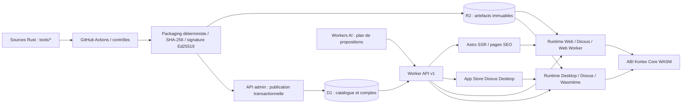
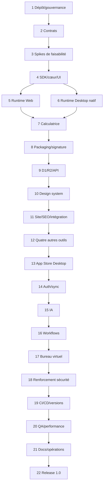

# Partie A — Synthèse architecturale

## A.1. Flux et responsabilités



- **Outil indépendant** : source Rust `wasm32-unknown-unknown`, un `module.wasm` Core WASM, `manifest.json`, `contract.json`, ressources statiques déclarées. Les outils ne s’appellent pas directement : orchestration exclusive par l’hôte.
- **Paquet** : extension `.tool`, conteneur ZIP canonique, version de format et ABI explicites, publication atomique de métadonnées pointant vers l’objet R2 immuable. La preuve de signature Ed25519 est **détachée** : pas de signature circulaire dans le ZIP.
- **Runtime commun** : bibliothèque Rust cœur pour validation, transport, arbitrage permissions, protocole de messages, gestion d’instances ; rendu UI hôte par Dioxus. **Navigateurs** : exécution du guest dans un Web Worker + API standard `WebAssembly` via adaptateur TypeScript, bridge JSON depuis la vue Dioxus ; **Desktop** : Wasmtime Core, Dioxus Desktop/WebView pour l’interface. Le guest ne contient ni Dioxus, ni DOM, ni accès système libre.
- **Cloud** : Worker API TypeScript seul maître des règles de publication et de catalogue ; D1 relationnel pour identités/métadonnées/versionnements ; R2 pour artefacts/installeurs ; Astro SSR interroge l’API via Service Binding (jamais de client D1 direct) ; le navigateur Web utilise `/api/v1/*` sur **l’origine du site** via un proxy serveur Astro strict au même Service Binding, pour conserver les cookies HttpOnly same-origin ; Workers AI prépare des actions, il ne les exécute pas.
- **Distribution** : le Worker propose un téléchargement stable et éventuellement sert un flux R2 ; chaque hôte vérifie l’empreinte **et** la signature avant toute instanciation. Les versions sont adressées par clés immuables (`tools/{id}/{version}/{sha256}.tool`). L’App Store Desktop partage le même catalogue que le site.
- **Échelle** : environ 10 000 fiches supportées par pagination, index SQL, publication indépendante des déploiements du site et de l’App Store, sitemaps segmentés et cache invalidable ; ce chiffre n’est **pas** une promesse de 10 000 outils développés en V1.

## A.2. Parcours de bout en bout

1. GitHub Actions valide le code d’un outil, compile `module.wasm`, crée un ZIP déterministe, calcule SHA-256, signe un descripteur d’artefact, dépose l’artefact en R2 puis appelle l’API d’administration avec un justificatif d’identité CI.
2. L’API vérifie autorisation et cohérence manifeste/contrat/empreinte/signature, crée en D1 un enregistrement versionné **non visible**, le valide, puis rend la version visible via un basculement transactionnel de la « version courante » ; aucun écrasement d’un objet déjà publié.
3. L’accueil, la recherche, les pages `/tools/[id]`, les endpoints SEO et l’App Store lisent le catalogue via l’API ; une publication est visible sans recompiler Astro ni Desktop.
4. À l’ouverture, le client récupère le paquet, vérifie la chaîne de confiance, extrait en mémoire ou en cache borné, instancie Core WASM ; les interactions déclenchent l’ABI universelle, la UI JSON est rendue en composants Dioxus hôtes.
5. Les actions partagées sont toujours proposées en `contract.json`, validées contre JSON Schema puis exécutées par le Runtime. Les permissions sensibles sont accordées **par l’utilisateur** à un contexte d’outil/instance ; le cloud ne dispose pas de chemins de fichiers locaux.
6. L’IA produit un plan structuré et **non une commande système** ; l’interface locale le montre, refuse ou demande une autorisation, puis applique les actions permises. Un workflow suit exactement le même exécuteur d’actions.

## A.3. Bornes de V1

**Inclus** : web public et Desktop Windows/macOS/Linux ; cinq outils réels ; cinq catégories d’aptitudes exercées (calcul, UI réactive, fichiers/stockage, actions automatisables, UI avancée) ; comptes facultatifs, préférences et bibliothèque synchronisées, exécution locale des workflows sur application ouverte, IA contrôlée, bureau virtuel Web, observabilité, builds de production et procédure de mise à jour.

**Exclus** : exécution de workflows lorsque tous les clients sont fermés ; place de marché payante ; accès GPU arbitraire depuis un module guest ; compatibilité binaire avec n’importe quel paquet tiers non validé ; création effective de 10 000 outils ; accès distant aux documents de l’utilisateur sans consentement. Chaque exclusion est contractualisée et testée.

# Partie B — Arbitrages techniques, hypothèses et preuves

## B.1. Décisions approuvées et gelables

| ID | Décision | Motif et effet | Preuve/étape de gel |
|---|---|---|---|
| ADR-001 | WebAssembly **Core**, cible `wasm32-unknown-unknown`, même binaire Web/Desktop | Évite l’exécution native non standard du Component Model dans le navigateur ; évite deux pipelines guest | 3.0, 3.1 puis 2.5 |
| ADR-002 | Dioxus exclusivement dans les **hôtes** ; UI déclarative JSON versionnée issue du guest | WASM sandboxé indépendant des DOM/WebView ; une bibliothèque de composants commune | 3.2, 4.4 |
| ADR-003 | API Worker source unique des règles métier catalogue | Astro consulte l’API via Service Binding ; Desktop via HTTPS | 9.4, 11.1 |
| ADR-004 | IA et workflows agissent sur le client actif ; aucune exécution cloud de `.tool` | Contrôle local des fichiers, autorisations, secrets | 15.2, 16.3 |
| ADR-005 | Capacités hôte médiées ; **pas** de GPU guest direct en V1 | Permet audits et portabilité | 4.2, 18.1 |
| ADR-006 | Simple/Medium/Pro = densité/complexité visuelle ; **aucun** plan payant | Fidélité à la capture, cohérence « outils gratuits » | 10.2, 11.2 |
| ADR-007 | ZIP `.tool` signé via descripteur **détaché** Ed25519, hachage SHA-256 | Évite le cycle « signer un ZIP contenant sa signature » | 8.2, 8.3 |
| ADR-008 | Versions immuables, alias `current_version` transactionnel en D1 | Publication/rollback atomiques ; pas de rebuild de clients | 9.5, 19.5 |
| ADR-009 | OIDC Authorization Code + PKCE pour clients ; session Web HttpOnly ; aucune clé longue durée en JS | Identité externe configurable sans fournisseur inventé | 14.0, 14.1 |
| ADR-010 | Un outil = un namespace d’état, des demandes hôte et une liste de capacités déclarées | Isolation entre outils, fichiers hors sandbox via handles et consentement | 4.2, 18.2 |

## B.2. Contrats Kortex V1 fixés par le plan

**Format `manifest.json`** : `format_version: "1.0"`, `id` slug ASCII `[a-z0-9]+(?:-[a-z0-9]+)*` (3–64), `version` SemVer, `name`, `summary`, `description`, `category`, `tags[]`, `seo:{title,description}`, `icon_path`, `abi_version:"1.0"`, `ui_schema_version:"1.0"`, `permissions[]`, `entrypoint:"module.wasm"`, `min_runtime:"1.0.0"`. Les chemins sont relatifs, sans `..` ni chemin absolu ; les textes et tailles sont bornés dans le schéma.

**Format `contract.json`** : `contract_version:"1.0"`, `tool_id`, `actions[]` de `{id, description, input_schema, output_schema, permissions[], side_effect:"none"|"local-write"|"network", idempotent:boolean, timeout_ms}`. `action.id` unique par outil ; identifiant global d’action = `{tool_id}.{action_id}` ; schémas JSON 2020-12 **dans un sous-ensemble validable par Rust et TS** (types, propriétés, `required`, bornes, tableaux, `enum`, pas de `$ref` externe ni code).

**ABI WASM Core Kortex 1.0** (exports guest) : `memory`; `kortex_alloc(len:i32)->i32`, `kortex_dealloc(ptr:i32,len:i32)`, `kortex_dispatch(ptr:i32,len:i32)->i64`. Résultat `i64 = (ptr_u32 << 32) | len_u32`. L’hôte alloue/copie une requête UTF-8 JSON, appelle dispatch, décode pointer/longueur, lit la réponse, libère chaque allocation selon la convention du SDK. L'import guest `kortex_v1.host_enqueue(ptr:i32,len:i32)->i32` accepte une demande de capacité JSON bornée et retourne uniquement un statut de **mise en file** (`0=acceptée`, valeurs négatives = rejet) ; la réponse asynchrone est réinjectée par un futur `dispatch` de type `capability.result`. **Aucun accès host synchrone blocant, aucun WASI implicite.** L’ABI contrôle les pointeurs, longueurs, tailles, mémoire et réentrance ; une nouvelle ABI majeure utilisera un autre module d’import.

**Enveloppe JSON** : requête `{v:1, request_id:string, kind:"init"|"render"|"ui.event"|"action.invoke"|"capability.result"|"state.restore"|"shutdown", payload:object}` ; réponse `{v:1,request_id,ok:boolean,data?:object,error?:{code:string,message:string,retryable:boolean}}`. `request_id` est un UUID opaque, jamais utilisé comme autorisation. La fonction dispatch est séquentielle, sans réentrance concurrente ; limites initiales **projet** : requête/réponse 1 MiB, UI ≤ 2 000 nœuds, ZIP `.tool` ≤ 25 MiB, guest WASM ≤ 20 MiB, mémoire guest ≤ 64 MiB (le module déclare un maximum de 1 024 pages WASM 64KiB ; le tool-builder passe et vérifie la limite linker), action ≤ 30 s, file de 128 événements maximum. Limites ajustables uniquement via évolution documentée et tests croisés (et non contraintes garanties par les plateformes).

**UI JSON V1** : arbre `{type, key, props, children}` ; types autorisés `column,row,grid,card,text,heading,button,input,textarea,select,checkbox,table,progress,alert,svg-chart,toolbar,tabs`. Seules les clés déclarées et des propriétés sérialisables sont permises ; pas de HTML arbitraire, de script, d’URL non vérifiée, ni de CSS provenant du paquet. Événements `{node_key,event_type,value}`. Les graphiques sont rendus par l’hôte à partir de données ; le WebView Desktop ne reçoit pas d’appel WebGPU du guest.

**Capacités V1** : `storage.read`, `storage.write` (namespace privé), `file.pick`, `file.read`, `file.save` (handles éphémères et octets bornés), `network.fetch` (origines HTTP(S) explicitement autorisées et vérification DNS/redirects côté hôte), `clipboard.write` (geste et approbation) ; `gpu.direct` absent. Un outil sans permission déclarée ne peut obtenir une capacité par simple message JSON. Aucune commande shell, socket brute, accès hors répertoire, ou exécution dynamique.

**Preuve de publication** : objet externe `{schema_version:1,tool_id,version,abi_version,sha256,signing_key_id,signature}` où `signature` est Ed25519 sur le texte UTF-8 exactement `kortex-artifact-v1\n{tool_id}\n{version}\n{abi_version}\n{sha256_hex_lower}\n` ; ce document est signé après formation du ZIP. La signature n’est pas intégrée au ZIP ; le catalogue fournit le descripteur authentifié, dont les hôtes vérifient la signature par une clé de confiance embarquée. Rotation de clés via manifeste de clés signé par une racine hors ligne.

**Catalogue API V1** : `{items:ToolSummary[],next_cursor:string|null}` ; pagination curseur et limite 1–100 ; ordre stable `(published_at DESC,id DESC)` ou `(name_norm ASC,id ASC)`, filtre `status=published`, cursor opaque signé ; codes normalisés `BAD_REQUEST`, `NOT_FOUND`, `CONFLICT`, `UNAUTHORIZED`, `FORBIDDEN`, `RATE_LIMITED`, `UNAVAILABLE`, `INTEGRITY_ERROR`. Tous les POST sensibles ont `request_id` et protection idempotence.

**Migrations** : SQL forward-only numéroté, contraintes et index explicites, intégration `schema_version`/`contract_version` aux données ; D1 n’héberge jamais le ZIP ou le WASM.

## B.3. Compatibilités vérifiées, hypothèses et points bloquants techniques

- **Confirmé dans les documentations** : Wasmtime exécute les **Core Modules**, distingue `Module` et Component Model, et fournit fuel/interruption ; Dioxus Desktop utilise une WebView et du Rust natif ; Astro autorise le SSR à la demande, y compris `/tools/[id]` ; Workers offre Service Bindings ; D1 a des limites par base et une sérialisation des requêtes ; Workers AI offre des réponses structurées mais leur validité n’est pas garantie et doit être revérifiée côté serveur. Voir les liens vérifiés en B.4.
- **À prouver, non à présumer** : (P1) ABI Rust guest ↔ JS Worker ↔ Wasmtime sur au moins 2 navigateurs et 3 OS ; (P2) compilabilité Dioxus Web/Desktop avec le schéma UI ; (P3) téléchargements ZIP sous mémoire disponible, validation anti-ZIP-bomb ; (P4) moteur de rendu de graphiques `svg-chart` identique WebView/Web ; (P5) identités OIDC et chiffrement local des jetons compatibles OS ; (P6) runners GitHub pour les trois systèmes et signature des installateurs. Prototypes 3.0–3.4, 6.2, 13.5 et 19.3.
- **Limitations Cloudflare à vérifier en déploiement** : mémoire Workers, CPU et subrequests, taille D1, quotas R2/AI, coût du flux de téléchargement, quotas et disponibilité du compte réel. Des valeurs lues dans la documentation ne garantissent **aucun** quota contractuel individuel. Prévoir stress tests, budget d’exploitation et alarme avant publication.
- **Dépendances non figées arbitrairement** : en étape 1.2, inscrire dans `docs/DEPENDENCY_BASELINE.md` une matrice **de versions réellement disponibles et compatibles**, avec Rust/Cargo stable, `wasm32-unknown-unknown`, `wasmtime`, `dioxus`, `astro`, `@astrojs/cloudflare`, `tailwindcss`, `pnpm`, `wrangler`, `typescript`. Verrouiller les versions dans `Cargo.lock` et `pnpm-lock.yaml`. Aucune commande « latest » en CI.
- **Environnements à obtenir du propriétaire du projet** (bloquants seulement au déploiement) : domaine et sous-domaines Web/API/Runtime, compte Cloudflare et plan, buckets et D1, organisation GitHub, fournisseur OIDC conforme, clés de signature de publication et de distribution, certificats Windows/macOS, politique de rétention et adresse de contact. En leur absence, livrer une configuration locale/test, ne jamais simuler un succès production.

## B.4. Références techniques externes vérifiées le 23/10/2026

- Wasmtime Core et API : https://docs.rs/wasmtime/latest/wasmtime/ ; interruption : https://docs.rs/wasmtime/latest/wasmtime/struct.Config.html
- Dioxus Desktop/WebView : https://dioxuslabs.com/learn/0.7/guides/platforms/desktop/
- Astro SSR : https://docs.astro.build/fr/guides/on-demand-rendering/ ; adapter : https://docs.astro.build/en/guides/integrations-guide/cloudflare/
- Service Bindings : https://developers.cloudflare.com/workers/runtime-apis/bindings/service-bindings/http/
- Limites Workers : https://developers.cloudflare.com/workers/platform/limits/ ; D1 : https://developers.cloudflare.com/d1/reference/faq/
- Workers AI JSON Mode : https://developers.cloudflare.com/workers-ai/features/json-mode/
- GitHub Actions OIDC : https://docs.github.com/en/actions/reference/security/oidc

**Provenance** : principes métier, pages et services tirés des deux RTF et du PDF ; apparence tirée de la capture ; ABI, schemas exacts, sécurité, seuils et déroulé ajoutés comme **conception proposée et approuvée**, à valider expérimentalement avant gel. « Page 1 du PDF » = compilation des quatre hôtes ; page 2 = SSR/outils ; page 3 = `.tool`/R2/D1 ; page 4 = API ; page 5 = IA locale. Les différences `D2`/`R1` vues dans certaines légendes sont traitées comme coquilles : les services cibles sont D1/R2.

# Partie C — Arborescence cible du monorepo

**Les fichiers ci-dessous ne sont pas supposés déjà créés : leur étape responsable figure entre crochets.** Les arborescences de build (`target/`, `dist/`, `.astro/`, `.wrangler/`, installations et caches) restent hors Git. Le design est partagé par tokens et contrats, pas par une prétendue feuille CSS exécutable à l’identique dans toutes les WebViews.

```text
kortex/
├── README.md [1.0]                         ├── LICENSE [22.0]
├── Cargo.toml [1.0]                        ├── Cargo.lock [1.2]
├── rust-toolchain.toml [1.2]              ├── package.json [1.1]
├── pnpm-workspace.yaml [1.1]              ├── pnpm-lock.yaml [1.2]
├── .gitignore [1.0]                       ├── .editorconfig [1.0]
├── .env.example [1.3]                     ├── .github/
│   ├── CODEOWNERS [1.4]                   │   └── workflows/
│   ├── pull-request.yml [1.4]            │       ├── validate.yml [19.0]
│   ├── tools.yml [19.1]                   │       ├── website.yml [19.2]
│   ├── api.yml [19.2]                     │       └── desktop.yml [19.3]
├── docs/
│   ├── MASTER_PLAN.md [1.0]               ├── ARCHITECTURE.md [1.0]
│   ├── CONTRACTS.md [2.0]                 ├── PROGRESS.md [1.0]
│   ├── DECISIONS.md [1.0]                 ├── DEPENDENCY_BASELINE.md [1.2]
│   ├── DESIGN.md [10.0]                   ├── SECURITY.md [18.0]
│   ├── OPERATIONS.md [21.0]               ├── DEPLOYMENT.md [21.1]
│   ├── RECOVERY.md [21.2]                 ├── CONTRIBUTING.md [21.3]
│   ├── adr/ [2.0]                        ├── runbooks/ [21.2]
│   └── evidence/ [3.0]                    └── reports/ [20.0]
├── shared/
│   ├── schemas/ [2.1–2.4]
│   │   ├── manifest.schema.json          ├── contract.schema.json
│   │   ├── ui.schema.json                ├── protocol.schema.json
│   │   ├── artifact.schema.json          ├── api.schema.json
│   │   └── workflow.schema.json
│   ├── fixtures/ [2.4]                   ├── typescript/ [2.4]
│   │   └── src/index.ts                  └── rust/ [2.4]
│   │                                          └── src/lib.rs
│   └── generated/ [2.4] (généré, revu, versionné)
├── crates/
│   ├── kortex-abi/ [2.2]                  ├── kortex-sdk/ [4.0]
│   ├── kortex-core/ [4.1]                 ├── kortex-capabilities/ [4.2]
│   ├── kortex-pack/ [8.0]                 ├── kortex-verify/ [8.2]
│   ├── kortex-ui/ [4.4]                   ├── kortex-runtime-native/ [6.0]
│   ├── kortex-workflows/ [16.0]
│   └── kortex-xtask/ [8.1]
├── runtime/
│   ├── web/ [5.0–5.4]                     └── desktop/ [6.1–6.3]
│   └── assets/ [4.4]
├── tools/
│   ├── calculatrice/ [7.0–7.3]           ├── convertisseur-casse/ [12.0]
│   ├── calculateur-hash/ [12.1]          ├── timestamp-utc/ [12.2]
│   └── explorateur-csv/ [12.3–12.4]
├── database/migrations/
│   ├── 0001_catalog.sql [9.0]            ├── 0002_publication.sql [9.1]
│   ├── 0003_auth.sql [14.0]              ├── 0004_sync.sql [14.2]
│   └── 0005_workflows.sql [16.4]
├── api/
│   ├── package.json [9.2]                ├── wrangler.jsonc [9.2]
│   └── src/
│       ├── index.ts [9.2]                ├── env.ts [9.2]
│       ├── routes/ [9.3–9.6, 14–16]
│       ├── services/ [9.3–9.6]           ├── security/ [9.5, 14.1, 18]
│       └── tests/ [9.3+]
├── website/
│   ├── astro.config.mjs [11.0]           ├── wrangler.jsonc [11.0]
│   ├── package.json [11.0]               ├── public/ [11.0]
│   └── src/
│       ├── layouts/ [10.2, 11.0]         ├── styles/ [10.1]
│       ├── components/ [10.2–10.4]       ├── pages/ [11.1–11.6]
│       ├── lib/ [11.0–11.5]             ├── middleware.ts [14.4]
│       └── assets/ [10.0]
├── desktop/
│   ├── Cargo.toml [13.0]                 ├── assets/ [13.0]
│   └── src/
│       ├── main.rs [13.0]                ├── app.rs [13.0]
│       ├── store.rs [13.1]               ├── installer.rs [13.2]
│       ├── library.rs [13.3]             ├── updates.rs [13.4]
│       └── account.rs [14.5]
├── web-adapter/ [5.1–5.3]                ├── tests/ [3, 18, 20]
├── scripts/ [1.4, 8.4, 19.5]             └── infra/ [9.2, 19.2]
```

**Règles de propriété** : `shared/schemas` et `crates/kortex-abi` = contrats gelés ; `crates/kortex-ui` = moteur de rendu extensible sans modifier les types gelés ; `api/routes` = surface externe versionnée ; `runtime/*`, `website/src/*`, `desktop/src/*` = implémentations internes sous tests de non-régression. Une création « répertoire » est concrétisée par les fichiers listés dans les étapes, sans committer de dossier vide.

# Partie D — Graphe de dépendances et ordre de réalisation



**Graphe minimal** : les flèches désignent la séquence d’**autorisation** (développement strictement ordonné), même quand deux tâches seraient techniquement parallélisables. Les dépendances fines obligatoires se trouvent dans chaque étape. Les prototypes des phases 3 précèdent tous les coûts de développement dépendants. Les sujets sécurité sont intégrés dès 2, 4, 5 et 8, puis audités transversalement en 18 ; ils ne sont pas reportés à la fin.
