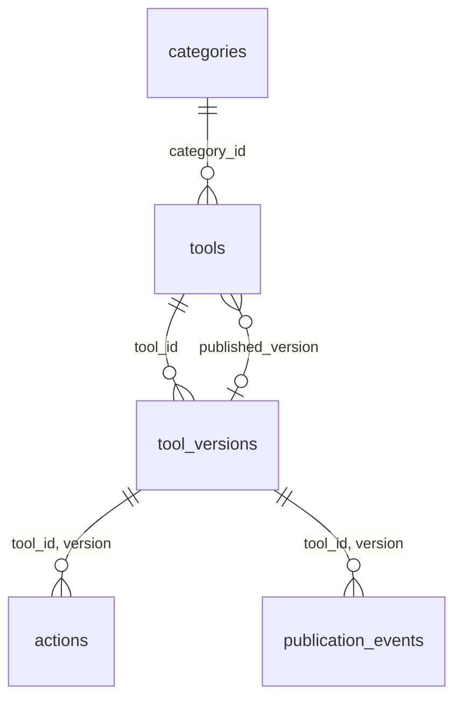

# Catalogue D1 — migration 0001

Le catalogue stocke les métadonnées et les identités de versions. Aucun WASM, ZIP ou autre artefact binaire n'est stocké en base. Le binding prévu est `KORTEX_DB` ; aucun compte ni identifiant distant n'a été créé.



| Table | Clé et colonnes principales | Contraintes |
|---|---|---|
| categories | id, name | id unique, texte borné |
| tools | id, name, name_norm, summary, category_id, status, published_version, published_at, created_at, updated_at | ID slug immuable ; catégorie FK ; pointeur composite vers sa propre version ; published exige date/version publiée |
| tool_versions | (tool_id, version), sha256, abi_version, ui_schema_version, manifest_json, contract_json, status, created_at | couple unique ; SHA lowercase 64 caractères ; ABI/UI 1.0 ; JSON ≤1 Mio chacun avec identité concordante ; contenu immuable |
| actions | (tool_id, version, action_id), description, input_schema_json, output_schema_json, permissions_json, side_effect, idempotent, timeout_ms | FK composite ; actions modifiables seulement en draft ; timeout 1–30 000 ms |
| publication_events | id, request_id, tool_id, version, event_type, created_at, detail_json | UUID unique pour idempotence ; FK version ; journal append-only ; détail JSON ≤16 Kio |

Le SQL protège les types/tailles/identités essentielles. Le futur service devra aussi valider les schémas manifest/contract gelés, la SemVer complète, les actions et signatures avant toute écriture. La base ne prétend pas vérifier Ed25519 ou remplacer les validateurs de publication.

Les quatre index partiels `idx_tools_recent`, `idx_tools_name`, `idx_tools_category_recent`, `idx_tools_category_name` couvrent `status='published'`, les tris stables `(published_at DESC,id DESC)` et `(name_norm ASC,id ASC)`, avec ou sans catégorie. Les requêtes utilisent des comparaisons de tuples strictes et LIMIT, sans OFFSET. Les index supplémentaires couvrent catégorie FK, état des versions et historique par outil. name_norm doit être normalisé par le service de façon déterministe ; SQLite n'invente pas de collation Unicode produit.

Créer d'abord l'outil en draft, puis sa version et ses actions, publier la version et enfin déplacer published_version dans la même transaction. Le FK composite du pointeur est différé, mais les triggers exigent une version publiée au moment du basculement. Pour révoquer une version courante, déplacer/retirer d'abord le pointeur puis révoquer dans la transaction. Les versions et outils ne sont pas supprimables ; archiver l'outil. Les états et la transaction complète R2/publication arrivent en 9.1 et suivantes.

Les [FK de D1](https://developers.cloudflare.com/d1/sql-api/foreign-keys/) restent actives ; utiliser une transaction et, si nécessaire, `PRAGMA defer_foreign_keys`, sans compter sur foreign_keys=OFF. Les [migrations Wrangler](https://developers.cloudflare.com/d1/reference/migrations/) enregistrent les scripts appliqués dans d1_migrations. 0001 est forward-only : elle n'est pas un script de reset `IF NOT EXISTS` qui cacherait une dérive. Ajouter une nouvelle migration pour toute évolution ; sauvegarde et déploiement distant restent à établir ultérieurement.

```text
node --test database/tests/catalog.test.mjs
node database/tests/d1-local.mjs
```

La prévalidation utilise le vrai SQLite 3.51.3 intégré à Node 24.15, la CLI sqlite3 n'étant pas installée. Le second essai utilise Wrangler 4.152.0 et son vrai émulateur D1 local, avec état isolé sous target/, UUID factice et uniquement --local. Il applique la migration deux fois (deuxième fois sans migration en attente), insère 10 000 outils/versions/actions/événements, contrôle les FK et quatre plans indexés, puis exige cinq refus de contraintes. SQLite teste treize refus et une transaction d'archivage/révocation. D1 local interdit sqlite_version() : aucune version interne D1 n'est déduite ; celle de la prévalidation SQLite est mesurée séparément.

Preuves : docs/evidence/validation-8.3-9.0.json. Ces essais établissent la migration et les plans locaux, sans mesure de latence cloud, charge concurrente ou catalogue distant provisionné.
