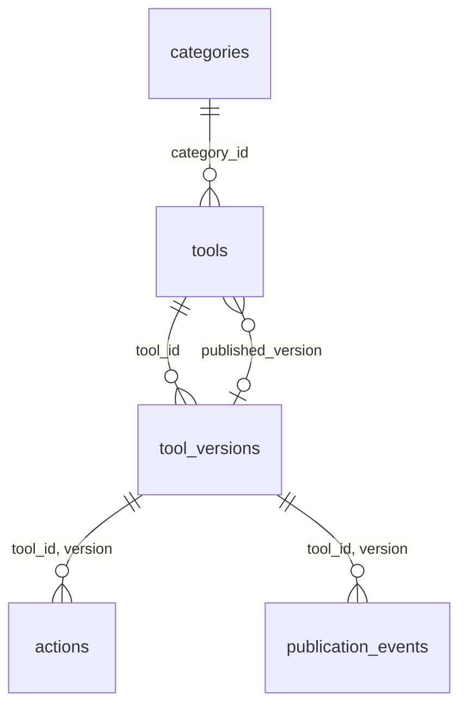

# Catalogue D1 — migration 0001

Le catalogue stocke les métadonnées et les identités de versions. Aucun WASM, ZIP ou autre artefact binaire n'est stocké en base. Le binding prévu est `KORTEX_DB` ; aucun compte ni identifiant distant n'a été créé.



| Table | Clé et colonnes principales | Contraintes |
|---|---|---|
| categories | id, name | id unique, texte borné |
| tools | id, name, name_norm, summary, category_id, status, published_version, published_at, created_at, updated_at | ID slug immuable ; catégorie FK ; pointeur composite vers sa propre version ; published exige date/version publiée |
| tool_versions | (tool_id, version), sha256, abi_version, ui_schema_version, manifest_json, contract_json, status, created_at | couple unique ; SHA lowercase 64 caractères ; ABI/UI 1.0 ; JSON ≤1 Mio chacun avec identité concordante ; contenu immuable |
| actions | (tool_id, version, action_id), description, input_schema_json, output_schema_json, permissions_json, side_effect, idempotent, timeout_ms | FK composite ; actions modifiables seulement en draft ; timeout 1–30 000 ms |
| publication_events | id, request_id, tool_id, version, event_type, created_at, detail_json | UUID unique pour idempotence ; FK version ; journal append-only ; détail JSON ≤16 Kio |

Le SQL protège les types/tailles/identités essentielles. Le futur service devra aussi valider les schémas manifest/contract gelés, la SemVer complète, les actions et signatures avant toute écriture. La base ne prétend pas vérifier Ed25519 ou remplacer les validateurs de publication.

Les quatre index partiels `idx_tools_recent`, `idx_tools_name`, `idx_tools_category_recent`, `idx_tools_category_name` couvrent `status='published'`, les tris stables `(published_at DESC,id DESC)` et `(name_norm ASC,id ASC)`, avec ou sans catégorie. Les requêtes utilisent des comparaisons de tuples strictes et LIMIT, sans OFFSET. Les index supplémentaires couvrent catégorie FK, état des versions et historique par outil. name_norm doit être normalisé par le service de façon déterministe ; SQLite n'invente pas de collation Unicode produit.

Créer d'abord l'outil en draft, puis sa version et ses actions, publier la version et enfin déplacer published_version dans la même transaction. Le FK composite du pointeur est différé, mais les triggers exigent une version publiée au moment du basculement. Pour révoquer une version courante, déplacer/retirer d'abord le pointeur puis révoquer dans la transaction. Les versions et outils ne sont pas supprimables ; archiver l'outil. Les états et la transaction complète R2/publication arrivent en 9.1 et suivantes.

Les [FK de D1](https://developers.cloudflare.com/d1/sql-api/foreign-keys/) restent actives ; utiliser une transaction et, si nécessaire, `PRAGMA defer_foreign_keys`, sans compter sur foreign_keys=OFF. Les [migrations Wrangler](https://developers.cloudflare.com/d1/reference/migrations/) enregistrent les scripts appliqués dans d1_migrations. 0001 est forward-only : elle n'est pas un script de reset `IF NOT EXISTS` qui cacherait une dérive. Ajouter une nouvelle migration pour toute évolution ; sauvegarde et déploiement distant restent à établir ultérieurement.

```text
node --test database/tests/catalog.test.mjs
node database/tests/d1-local.mjs
```

La prévalidation utilise le vrai SQLite 3.51.3 intégré à Node 24.15, la CLI sqlite3 n'étant pas installée. Le second essai utilise Wrangler 4.152.0 et son vrai émulateur D1 local, avec état isolé sous target/, UUID factice et uniquement --local. Il applique la migration deux fois (deuxième fois sans migration en attente), insère 10 000 outils/versions/actions/événements, contrôle les FK et quatre plans indexés, puis exige cinq refus de contraintes. SQLite teste treize refus et une transaction d'archivage/révocation. D1 local interdit sqlite_version() : aucune version interne D1 n'est déduite ; celle de la prévalidation SQLite est mesurée séparément.

Preuves : docs/evidence/validation-8.3-9.0.json. Ces essais établissent la migration et les plans locaux, sans mesure de latence cloud, charge concurrente ou catalogue distant provisionné.

## Publication — migration 0002, étape 9.1

La migration additive conserve 0001 et les schémas gelés. signing_keys contient les clés publiques et leur version de confiance/fenêtre ; artifacts lie une unique identité/version à SHA, clé R2, taille et descripteur détaché immuables. publication_jobs conserve UUID, empreinte de requête et état. publication_job_events trace chaque transition sans réutiliser des UUID dérivés qui pourraient entrer en collision. revocations consigne une révocation d'artefact ou de clé, jamais les deux à la fois. Les FK relient versions, artefacts, jobs et clés ; les index couvrent jobs actifs/état, clé d'artefact et révocations.

La répétition exacte d'un UUID de job est ignorée sans remettre son état à zéro ni ajouter d'audit. Un autre contenu sous le même UUID déclenche IDEMPOTENCY_CONFLICT. Un artefact qui contredit le SHA de tool_versions déclenche HASH_CONFLICT ; un outil absent déclenche NOT_FOUND. La future API traduira ces résultats en 409/404 ; aucun endpoint HTTP de publication n'existe en 9.1.

L'admission SQL exige des attestations R2 HEAD + relecture SHA/tailles, signature vérifiée et clé active avant validated/published. Les attestations sont écrites ensemble puis immuables. Le service de confiance devra réellement exécuter ces contrôles externes et valider artifact.schema : les contraintes SQL essentielles ne remplacent pas toute la validation JSON ni la crypto. Les fixtures publication.test.sql sont explicitement synthétiques et testent les états, sans prétendre avoir consulté R2.

Ordre transactionnel : job validated→published, version draft→published, pointeur courant vers cette version. Les statuts ne reculent pas ; failed/revoked restent terminaux. Un échec reprend dans un nouveau job sur les mêmes octets. Un rollback du catalogue peut viser une version antérieure encore publiée ; une révocation est irréversible. Retirer/déplacer les pointeurs avant d'insérer la révocation ; les triggers mettent à jour les jobs/versions concernés et la clé, et écrivent les transitions dans le journal. Les anciennes lignes publiées avant 0002 ne sont pas artificiellement assorties de preuves : une nouvelle sélection de pointeur exige le job vérifié correspondant.

```text
node --test database/tests/catalog.test.mjs database/tests/publication.test.mjs
node database/tests/publication-d1-local.mjs
```

Le test SQLite exerce aussi un échec au milieu d'une transaction puis ROLLBACK : pointeur, job et journal retrouvent leur état précédent. Le banc D1 local applique les deux migrations et leur rejeu, vérifie idempotence, refus, progression et révocation. Le banc historique d1-local.mjs isole désormais 0001 afin de conserver son jeu synthétique de 10 000 outils, dont les publications précèdent l'existence des jobs. Politique de noms, écritures conditionnelles, cache et rétention : infra/r2-policy.md. Aucun compte Cloudflare n'est nécessaire pour ces essais locaux.

Les identités et journaux de 0002 sont aussi protégés à l’insertion contre INSERT OR REPLACE ; l’immutabilité ne dépend pas de recursive_triggers ni des seuls triggers DELETE. Les tests explicites vérifient ce chemin dans SQLite et D1 local.

## Staging de publication 9.6 — complément du 27 octobre 2026

La base kortex-catalog-staging est distincte des anciennes bases de comptes supprimées. Son UUID réel est dans api/wrangler.jsonc ; elle n'est pas une base de production. Les migrations 0001_catalog, 0002_publication et 0003_admin_operations y ont été appliquées par Wrangler --remote --env staging, avec DB comme binding effectif.

0003 enregistre chaque publication, rollback et révocation avec UUID, empreinte de requête canonique, acteur, jti, réponse et date dans une table append-only. Sa ligne et la mutation sont dans la même transaction batch. Le rollback vérifie aussi expected_current_version et la santé de la cible dans un trigger avant mutation ; une course ou répétition ne laisse aucune ligne partielle. R2 est vérifié avant la transaction, sans prétendre à une transaction distribuée.

Récupération : lire le catalogue actuel, choisir une ancienne version encore publiée et non révoquée, vérifier son objet et ses clés, puis POST rollback avec le pointeur attendu et un nouvel UUID. La révocation de la version courante archive le tool et retire son pointeur dans la même transaction que le tombstone. Les octets et journaux sont conservés ; ne pas faire de DELETE/REPLACE pour réparer une version immuable. Une répétition de requête retourne sa réponse historique et ne remet pas le pointeur en place après un retrait. Les restaurations D1/Time Travel exigent une procédure opérateur distincte tenant compte des objets R2 ; aucune restauration distante n'a été simulée comme effectuée.
