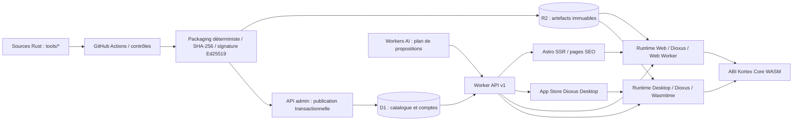
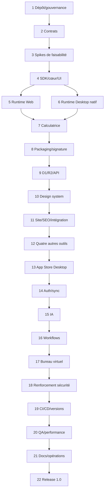

# KORTEX — PLAN DIRECTEUR DE CONSTRUCTION V1.0

**Statut :** document de référence initial ; gel contractuel progressif au fil des validations. **Date de préparation :** 23 octobre 2026. **Périmètre :** dépôt vide → produit 1.0 déployé. **Fichiers sources :** `Arborescence Projet.rtf`, `Fonctionnement général.rtf`, `Kortex — Architecture cible de la plateforme.pdf` (pages 1–5), capture d’accueil du 23/10/2026. **Arbitrages 1 à 5 :** approuvés par le commanditaire.

**Mode de lecture :** les parties A–D fixent les choix ; la partie E est l’unique séquence d’exécution autorisée ; les parties F–I vérifient la couverture et l’achèvement. Une « commande » désignant un exécutable interne Kortex ne peut être lancée qu’après l’étape qui le crée. Toute valeur de secret, identité du fournisseur OIDC, domaine, budget et numéro de version qui dépend du compte réel doit être fournie dans un registre d’environnement, et non inventée.

# Partie A — Synthèse architecturale

## A.1. Flux et responsabilités



- **Outil indépendant** : source Rust `wasm32-unknown-unknown`, un `module.wasm` Core WASM, `manifest.json`, `contract.json`, ressources statiques déclarées. Les outils ne s’appellent pas directement : orchestration exclusive par l’hôte.
- **Paquet** : extension `.tool`, conteneur ZIP canonique, version de format et ABI explicites, publication atomique de métadonnées pointant vers l’objet R2 immuable. La preuve de signature Ed25519 est **détachée** : pas de signature circulaire dans le ZIP.
- **Runtime commun** : bibliothèque Rust cœur pour validation, transport, arbitrage permissions, protocole de messages, gestion d’instances ; rendu UI hôte par Dioxus. **Navigateurs** : exécution du guest dans un Web Worker + API standard `WebAssembly` via adaptateur TypeScript, bridge JSON depuis la vue Dioxus ; **Desktop** : Wasmtime Core, Dioxus Desktop/WebView pour l’interface. Le guest ne contient ni Dioxus, ni DOM, ni accès système libre.
- **Cloud** : Worker API TypeScript seul maître des règles de publication et de catalogue ; D1 relationnel pour identités/métadonnées/versionnements ; R2 pour artefacts/installeurs ; Astro SSR interroge l’API via Service Binding (jamais de client D1 direct) ; le navigateur Web utilise `/api/v1/*` sur **l’origine du site** via un proxy serveur Astro strict au même Service Binding, pour conserver les cookies HttpOnly same-origin ; Workers AI prépare des actions, il ne les exécute pas.
- **Distribution** : le Worker propose un téléchargement stable et éventuellement sert un flux R2 ; chaque hôte vérifie l’empreinte **et** la signature avant toute instanciation. Les versions sont adressées par clés immuables (`tools/{id}/{version}/{sha256}.tool`). L’App Store Desktop partage le même catalogue que le site.
- **Échelle** : environ 10 000 fiches supportées par pagination, index SQL, publication indépendante des déploiements du site et de l’App Store, sitemaps segmentés et cache invalidable ; ce chiffre n’est **pas** une promesse de 10 000 outils développés en V1.

## A.2. Parcours de bout en bout

1. GitHub Actions valide le code d’un outil, compile `module.wasm`, crée un ZIP déterministe, calcule SHA-256, signe un descripteur d’artefact, dépose l’artefact en R2 puis appelle l’API d’administration avec un justificatif d’identité CI.
2. L’API vérifie autorisation et cohérence manifeste/contrat/empreinte/signature, crée en D1 un enregistrement versionné **non visible**, le valide, puis rend la version visible via un basculement transactionnel de la « version courante » ; aucun écrasement d’un objet déjà publié.
3. L’accueil, la recherche, les pages `/tools/[id]`, les endpoints SEO et l’App Store lisent le catalogue via l’API ; une publication est visible sans recompiler Astro ni Desktop.
4. À l’ouverture, le client récupère le paquet, vérifie la chaîne de confiance, extrait en mémoire ou en cache borné, instancie Core WASM ; les interactions déclenchent l’ABI universelle, la UI JSON est rendue en composants Dioxus hôtes.
5. Les actions partagées sont toujours proposées en `contract.json`, validées contre JSON Schema puis exécutées par le Runtime. Les permissions sensibles sont accordées **par l’utilisateur** à un contexte d’outil/instance ; le cloud ne dispose pas de chemins de fichiers locaux.
6. L’IA produit un plan structuré et **non une commande système** ; l’interface locale le montre, refuse ou demande une autorisation, puis applique les actions permises. Un workflow suit exactement le même exécuteur d’actions.

## A.3. Bornes de V1

**Inclus** : web public et Desktop Windows/macOS/Linux ; cinq outils réels ; cinq catégories d’aptitudes exercées (calcul, UI réactive, fichiers/stockage, actions automatisables, UI avancée) ; comptes facultatifs, préférences et bibliothèque synchronisées, exécution locale des workflows sur application ouverte, IA contrôlée, bureau virtuel Web, observabilité, builds de production et procédure de mise à jour.

**Exclus** : exécution de workflows lorsque tous les clients sont fermés ; place de marché payante ; accès GPU arbitraire depuis un module guest ; compatibilité binaire avec n’importe quel paquet tiers non validé ; création effective de 10 000 outils ; accès distant aux documents de l’utilisateur sans consentement. Chaque exclusion est contractualisée et testée.

# Partie B — Arbitrages techniques, hypothèses et preuves

## B.1. Décisions approuvées et gelables

| ID | Décision | Motif et effet | Preuve/étape de gel |
|---|---|---|---|
| ADR-001 | WebAssembly **Core**, cible `wasm32-unknown-unknown`, même binaire Web/Desktop | Évite l’exécution native non standard du Component Model dans le navigateur ; évite deux pipelines guest | 3.0, 3.1 puis 2.5 |
| ADR-002 | Dioxus exclusivement dans les **hôtes** ; UI déclarative JSON versionnée issue du guest | WASM sandboxé indépendant des DOM/WebView ; une bibliothèque de composants commune | 3.2, 4.4 |
| ADR-003 | API Worker source unique des règles métier catalogue | Astro consulte l’API via Service Binding ; Desktop via HTTPS | 9.4, 11.1 |
| ADR-004 | IA et workflows agissent sur le client actif ; aucune exécution cloud de `.tool` | Contrôle local des fichiers, autorisations, secrets | 15.2, 16.3 |
| ADR-005 | Capacités hôte médiées ; **pas** de GPU guest direct en V1 | Permet audits et portabilité | 4.2, 18.1 |
| ADR-006 | Simple/Medium/Pro = densité/complexité visuelle ; **aucun** plan payant | Fidélité à la capture, cohérence « outils gratuits » | 10.2, 11.2 |
| ADR-007 | ZIP `.tool` signé via descripteur **détaché** Ed25519, hachage SHA-256 | Évite le cycle « signer un ZIP contenant sa signature » | 8.2, 8.3 |
| ADR-008 | Versions immuables, alias `current_version` transactionnel en D1 | Publication/rollback atomiques ; pas de rebuild de clients | 9.5, 19.5 |
| ADR-009 | OIDC Authorization Code + PKCE pour clients ; session Web HttpOnly ; aucune clé longue durée en JS | Identité externe configurable sans fournisseur inventé | 14.0, 14.1 |
| ADR-010 | Un outil = un namespace d’état, des demandes hôte et une liste de capacités déclarées | Isolation entre outils, fichiers hors sandbox via handles et consentement | 4.2, 18.2 |

## B.2. Contrats Kortex V1 fixés par le plan

**Format `manifest.json`** : `format_version: "1.0"`, `id` slug ASCII `[a-z0-9]+(?:-[a-z0-9]+)*` (3–64), `version` SemVer, `name`, `summary`, `description`, `category`, `tags[]`, `seo:{title,description}`, `icon_path`, `abi_version:"1.0"`, `ui_schema_version:"1.0"`, `permissions[]`, `entrypoint:"module.wasm"`, `min_runtime:"1.0.0"`. Les chemins sont relatifs, sans `..` ni chemin absolu ; les textes et tailles sont bornés dans le schéma.

**Format `contract.json`** : `contract_version:"1.0"`, `tool_id`, `actions[]` de `{id, description, input_schema, output_schema, permissions[], side_effect:"none"|"local-write"|"network", idempotent:boolean, timeout_ms}`. `action.id` unique par outil ; identifiant global d’action = `{tool_id}.{action_id}` ; schémas JSON 2020-12 **dans un sous-ensemble validable par Rust et TS** (types, propriétés, `required`, bornes, tableaux, `enum`, pas de `$ref` externe ni code).

**ABI WASM Core Kortex 1.0** (exports guest) : `memory`; `kortex_alloc(len:i32)->i32`, `kortex_dealloc(ptr:i32,len:i32)`, `kortex_dispatch(ptr:i32,len:i32)->i64`. Résultat `i64 = (ptr_u32 << 32) | len_u32`. L’hôte alloue/copie une requête UTF-8 JSON, appelle dispatch, décode pointer/longueur, lit la réponse, libère chaque allocation selon la convention du SDK. L'import guest `kortex_v1.host_enqueue(ptr:i32,len:i32)->i32` accepte une demande de capacité JSON bornée et retourne uniquement un statut de **mise en file** (`0=acceptée`, valeurs négatives = rejet) ; la réponse asynchrone est réinjectée par un futur `dispatch` de type `capability.result`. **Aucun accès host synchrone blocant, aucun WASI implicite.** L’ABI contrôle les pointeurs, longueurs, tailles, mémoire et réentrance ; une nouvelle ABI majeure utilisera un autre module d’import.

**Enveloppe JSON** : requête `{v:1, request_id:string, kind:"init"|"render"|"ui.event"|"action.invoke"|"capability.result"|"state.restore"|"shutdown", payload:object}` ; réponse `{v:1,request_id,ok:boolean,data?:object,error?:{code:string,message:string,retryable:boolean}}`. `request_id` est un UUID opaque, jamais utilisé comme autorisation. La fonction dispatch est séquentielle, sans réentrance concurrente ; limites initiales **projet** : requête/réponse 1 MiB, UI ≤ 2 000 nœuds, ZIP `.tool` ≤ 25 MiB, guest WASM ≤ 20 MiB, mémoire guest ≤ 64 MiB (le module déclare un maximum de 1 024 pages WASM 64KiB ; le tool-builder passe et vérifie la limite linker), action ≤ 30 s, file de 128 événements maximum. Limites ajustables uniquement via évolution documentée et tests croisés (et non contraintes garanties par les plateformes).

**UI JSON V1** : arbre `{type, key, props, children}` ; types autorisés `column,row,grid,card,text,heading,button,input,textarea,select,checkbox,table,progress,alert,svg-chart,toolbar,tabs`. Seules les clés déclarées et des propriétés sérialisables sont permises ; pas de HTML arbitraire, de script, d’URL non vérifiée, ni de CSS provenant du paquet. Événements `{node_key,event_type,value}`. Les graphiques sont rendus par l’hôte à partir de données ; le WebView Desktop ne reçoit pas d’appel WebGPU du guest.

**Capacités V1** : `storage.read`, `storage.write` (namespace privé), `file.pick`, `file.read`, `file.save` (handles éphémères et octets bornés), `network.fetch` (origines HTTP(S) explicitement autorisées et vérification DNS/redirects côté hôte), `clipboard.write` (geste et approbation) ; `gpu.direct` absent. Un outil sans permission déclarée ne peut obtenir une capacité par simple message JSON. Aucune commande shell, socket brute, accès hors répertoire, ou exécution dynamique.

**Preuve de publication** : objet externe `{schema_version:1,tool_id,version,abi_version,sha256,signing_key_id,signature}` où `signature` est Ed25519 sur le texte UTF-8 exactement `kortex-artifact-v1\n{tool_id}\n{version}\n{abi_version}\n{sha256_hex_lower}\n` ; ce document est signé après formation du ZIP. La signature n’est pas intégrée au ZIP ; le catalogue fournit le descripteur authentifié, dont les hôtes vérifient la signature par une clé de confiance embarquée. Rotation de clés via manifeste de clés signé par une racine hors ligne.

**Catalogue API V1** : `{items:ToolSummary[],next_cursor:string|null}` ; pagination curseur et limite 1–100 ; ordre stable `(published_at DESC,id DESC)` ou `(name_norm ASC,id ASC)`, filtre `status=published`, cursor opaque signé ; codes normalisés `BAD_REQUEST`, `NOT_FOUND`, `CONFLICT`, `UNAUTHORIZED`, `FORBIDDEN`, `RATE_LIMITED`, `UNAVAILABLE`, `INTEGRITY_ERROR`. Tous les POST sensibles ont `request_id` et protection idempotence.

**Migrations** : SQL forward-only numéroté, contraintes et index explicites, intégration `schema_version`/`contract_version` aux données ; D1 n’héberge jamais le ZIP ou le WASM.

## B.3. Compatibilités vérifiées, hypothèses et points bloquants techniques

- **Confirmé dans les documentations** : Wasmtime exécute les **Core Modules**, distingue `Module` et Component Model, et fournit fuel/interruption ; Dioxus Desktop utilise une WebView et du Rust natif ; Astro autorise le SSR à la demande, y compris `/tools/[id]` ; Workers offre Service Bindings ; D1 a des limites par base et une sérialisation des requêtes ; Workers AI offre des réponses structurées mais leur validité n’est pas garantie et doit être revérifiée côté serveur. Voir les liens vérifiés en B.4.
- **À prouver, non à présumer** : (P1) ABI Rust guest ↔ JS Worker ↔ Wasmtime sur au moins 2 navigateurs et 3 OS ; (P2) compilabilité Dioxus Web/Desktop avec le schéma UI ; (P3) téléchargements ZIP sous mémoire disponible, validation anti-ZIP-bomb ; (P4) moteur de rendu de graphiques `svg-chart` identique WebView/Web ; (P5) identités OIDC et chiffrement local des jetons compatibles OS ; (P6) runners GitHub pour les trois systèmes et signature des installateurs. Prototypes 3.0–3.4, 6.2, 13.5 et 19.3.
- **Limitations Cloudflare à vérifier en déploiement** : mémoire Workers, CPU et subrequests, taille D1, quotas R2/AI, coût du flux de téléchargement, quotas et disponibilité du compte réel. Des valeurs lues dans la documentation ne garantissent **aucun** quota contractuel individuel. Prévoir stress tests, budget d’exploitation et alarme avant publication.
- **Dépendances non figées arbitrairement** : en étape 1.2, inscrire dans `docs/DEPENDENCY_BASELINE.md` une matrice **de versions réellement disponibles et compatibles**, avec Rust/Cargo stable, `wasm32-unknown-unknown`, `wasmtime`, `dioxus`, `astro`, `@astrojs/cloudflare`, `tailwindcss`, `pnpm`, `wrangler`, `typescript`. Verrouiller les versions dans `Cargo.lock` et `pnpm-lock.yaml`. Aucune commande « latest » en CI.
- **Environnements à obtenir du propriétaire du projet** (bloquants seulement au déploiement) : domaine et sous-domaines Web/API/Runtime, compte Cloudflare et plan, buckets et D1, organisation GitHub, fournisseur OIDC conforme, clés de signature de publication et de distribution, certificats Windows/macOS, politique de rétention et adresse de contact. En leur absence, livrer une configuration locale/test, ne jamais simuler un succès production.

## B.4. Références techniques externes vérifiées le 23/10/2026

- Wasmtime Core et API : https://docs.rs/wasmtime/latest/wasmtime/ ; interruption : https://docs.rs/wasmtime/latest/wasmtime/struct.Config.html
- Dioxus Desktop/WebView : https://dioxuslabs.com/learn/0.7/guides/platforms/desktop/
- Astro SSR : https://docs.astro.build/fr/guides/on-demand-rendering/ ; adapter : https://docs.astro.build/en/guides/integrations-guide/cloudflare/
- Service Bindings : https://developers.cloudflare.com/workers/runtime-apis/bindings/service-bindings/http/
- Limites Workers : https://developers.cloudflare.com/workers/platform/limits/ ; D1 : https://developers.cloudflare.com/d1/reference/faq/
- Workers AI JSON Mode : https://developers.cloudflare.com/workers-ai/features/json-mode/
- GitHub Actions OIDC : https://docs.github.com/en/actions/reference/security/oidc

**Provenance** : principes métier, pages et services tirés des deux RTF et du PDF ; apparence tirée de la capture ; ABI, schemas exacts, sécurité, seuils et déroulé ajoutés comme **conception proposée et approuvée**, à valider expérimentalement avant gel. « Page 1 du PDF » = compilation des quatre hôtes ; page 2 = SSR/outils ; page 3 = `.tool`/R2/D1 ; page 4 = API ; page 5 = IA locale. Les différences `D2`/`R1` vues dans certaines légendes sont traitées comme coquilles : les services cibles sont D1/R2.

# Partie C — Arborescence cible du monorepo

**Les fichiers ci-dessous ne sont pas supposés déjà créés : leur étape responsable figure entre crochets.** Les arborescences de build (`target/`, `dist/`, `.astro/`, `.wrangler/`, installations et caches) restent hors Git. Le design est partagé par tokens et contrats, pas par une prétendue feuille CSS exécutable à l’identique dans toutes les WebViews.

```text
kortex/
├── README.md [1.0]                         ├── LICENSE [22.0]
├── Cargo.toml [1.0]                        ├── Cargo.lock [1.2]
├── rust-toolchain.toml [1.2]              ├── package.json [1.1]
├── pnpm-workspace.yaml [1.1]              ├── pnpm-lock.yaml [1.2]
├── .gitignore [1.0]                       ├── .editorconfig [1.0]
├── .env.example [1.3]                     ├── .github/
│   ├── CODEOWNERS [1.4]                   │   └── workflows/
│   ├── pull-request.yml [1.4]            │       ├── validate.yml [19.0]
│   ├── tools.yml [19.1]                   │       ├── website.yml [19.2]
│   ├── api.yml [19.2]                     │       └── desktop.yml [19.3]
├── docs/
│   ├── MASTER_PLAN.md [1.0]               ├── ARCHITECTURE.md [1.0]
│   ├── CONTRACTS.md [2.0]                 ├── PROGRESS.md [1.0]
│   ├── DECISIONS.md [1.0]                 ├── DEPENDENCY_BASELINE.md [1.2]
│   ├── DESIGN.md [10.0]                   ├── SECURITY.md [18.0]
│   ├── OPERATIONS.md [21.0]               ├── DEPLOYMENT.md [21.1]
│   ├── RECOVERY.md [21.2]                 ├── CONTRIBUTING.md [21.3]
│   ├── adr/ [2.0]                        ├── runbooks/ [21.2]
│   └── evidence/ [3.0]                    └── reports/ [20.0]
├── shared/
│   ├── schemas/ [2.1–2.4]
│   │   ├── manifest.schema.json          ├── contract.schema.json
│   │   ├── ui.schema.json                ├── protocol.schema.json
│   │   ├── artifact.schema.json          ├── api.schema.json
│   │   └── workflow.schema.json
│   ├── fixtures/ [2.4]                   ├── typescript/ [2.4]
│   │   └── src/index.ts                  └── rust/ [2.4]
│   │                                          └── src/lib.rs
│   └── generated/ [2.4] (généré, revu, versionné)
├── crates/
│   ├── kortex-abi/ [2.2]                  ├── kortex-sdk/ [4.0]
│   ├── kortex-core/ [4.1]                 ├── kortex-capabilities/ [4.2]
│   ├── kortex-pack/ [8.0]                 ├── kortex-verify/ [8.2]
│   ├── kortex-ui/ [4.4]                   ├── kortex-runtime-native/ [6.0]
│   ├── kortex-workflows/ [16.0]
│   └── kortex-xtask/ [8.1]
├── runtime/
│   ├── web/ [5.0–5.4]                     └── desktop/ [6.1–6.3]
│   └── assets/ [4.4]
├── tools/
│   ├── calculatrice/ [7.0–7.3]           ├── convertisseur-casse/ [12.0]
│   ├── calculateur-hash/ [12.1]          ├── timestamp-utc/ [12.2]
│   └── explorateur-csv/ [12.3–12.4]
├── database/migrations/
│   ├── 0001_catalog.sql [9.0]            ├── 0002_publication.sql [9.1]
│   ├── 0003_auth.sql [14.0]              ├── 0004_sync.sql [14.2]
│   └── 0005_workflows.sql [16.4]
├── api/
│   ├── package.json [9.2]                ├── wrangler.jsonc [9.2]
│   └── src/
│       ├── index.ts [9.2]                ├── env.ts [9.2]
│       ├── routes/ [9.3–9.6, 14–16]
│       ├── services/ [9.3–9.6]           ├── security/ [9.5, 14.1, 18]
│       └── tests/ [9.3+]
├── website/
│   ├── astro.config.mjs [11.0]           ├── wrangler.jsonc [11.0]
│   ├── package.json [11.0]               ├── public/ [11.0]
│   └── src/
│       ├── layouts/ [10.2, 11.0]         ├── styles/ [10.1]
│       ├── components/ [10.2–10.4]       ├── pages/ [11.1–11.6]
│       ├── lib/ [11.0–11.5]             ├── middleware.ts [14.4]
│       └── assets/ [10.0]
├── desktop/
│   ├── Cargo.toml [13.0]                 ├── assets/ [13.0]
│   └── src/
│       ├── main.rs [13.0]                ├── app.rs [13.0]
│       ├── store.rs [13.1]               ├── installer.rs [13.2]
│       ├── library.rs [13.3]             ├── updates.rs [13.4]
│       └── account.rs [14.5]
├── web-adapter/ [5.1–5.3]                ├── tests/ [3, 18, 20]
├── scripts/ [1.4, 8.4, 19.5]             └── infra/ [9.2, 19.2]
```

**Règles de propriété** : `shared/schemas` et `crates/kortex-abi` = contrats gelés ; `crates/kortex-ui` = moteur de rendu extensible sans modifier les types gelés ; `api/routes` = surface externe versionnée ; `runtime/*`, `website/src/*`, `desktop/src/*` = implémentations internes sous tests de non-régression. Une création « répertoire » est concrétisée par les fichiers listés dans les étapes, sans committer de dossier vide.

# Partie D — Graphe de dépendances et ordre de réalisation



**Graphe minimal** : les flèches désignent la séquence d’**autorisation** (développement strictement ordonné), même quand deux tâches seraient techniquement parallélisables. Les dépendances fines obligatoires se trouvent dans chaque étape. Les prototypes des phases 3 précèdent tous les coûts de développement dépendants. Les sujets sécurité sont intégrés dès 2, 4, 5 et 8, puis audités transversalement en 18 ; ils ne sont pas reportés à la fin.

# Partie E — Plan d’exécution intégral, étapes atomiques

**Règle universelle d’étape** : ouvrir une branche `step/X.Y-*`, ne toucher qu’aux chemins créés/modifiés autorisés, maintenir tests existants, remplir `docs/reports/STEP-X.Y.md` (numéro, base commit, chemins, logs redigés, résultats réels, risques, décision), soumettre au réviseur ; **ne pas** déclarer « validée » ni modifier le gel tant que l’approbation explicite n’existe pas. Les chemins de rapport et les registres font exception administrative autorisée à chaque étape. `MASTER_PLAN.md` n’est pas modifiable par l’IA d’exécution sans procédure de changement.

## Phase 1 — Dépôt, gouvernance et reproductibilité

**But de phase :** Fournir un environnement vierge reproductible, un protocole d’étapes strict et des tests déclenchables.

### Étape 1.0 — Initialiser le dépôt et les registres

**Objectif :** Dépôt de base initialisé et traçable.

**Prérequis :** aucun — dépôt vide.

**État initial attendu :** Répertoire Git vide et documents de référence fournis.

**Travail exact à réaliser :** Créer workspace Cargo sans crates actives, documentation avec sources, grille « proposée/validée » et commit racine ; archiver les références hors source privé si redistribution non autorisée. Paramétrer règles de mise à jour des cinq registres.

**Fichiers à créer :**
- `Cargo.toml` — section `[workspace]` avec `members=["crates/*","runtime/*","tools/*"]`, `exclude=["tests/spikes/*"]` et resolver 3 ; ne pas référencer un chemin explicite absent.
- `README.md` — but et commandes futures, états non encore implémentés.
- `docs/LEGAL_PENDING.md` — décisions de licence et mentions juridiques à prendre en 22.0, sans licence inventée.
- `.gitignore` — target, node_modules, build, env, clefs et local D1.
- `.editorconfig` — UTF-8, LF, indentation.
- `docs/MASTER_PLAN.md` — copie conforme de ce document, hash de provenance.
- `docs/ARCHITECTURE.md` — A–D, diagrammes, frontières de responsabilités.
- `docs/DECISIONS.md` — ADR-001…010 approuvés, dates et signataire.
- `docs/PROGRESS.md` — étape active=1.0, historique et tableau des gels.

**Fichiers à modifier :**
- Aucun fichier existant à modifier.

**Interfaces et contrats :** Registre `PROGRESS`: id/status={pending,active,awaiting_approval,validated,blocked}, `commit`, `tests`, `approver`, `approved_at`; sans validation implicite.

**Dépendances et configuration :** Git installé ; aucune clé extérieure.

**Commandes d’exécution :** `git status --short && git diff --check`.

**Tests obligatoires :** Comparer la copie du plan à l’artefact source ; vérifier `.gitignore` avec `git check-ignore`.

**Critères d’acceptation :** Aucun secret suivi ; `PROGRESS` indique exactement 1.0 ; manifestes valides.

**Livrable final :** Dépôt de base initialisé et traçable.

**Interdictions :** Ne pas choisir silencieusement une licence juridique ni marquer l’étape validée.

**Validation :** Rapport d’exécution, preuves des tests ci-dessus, commit Git identifié, inscription « validée » dans `docs/PROGRESS.md` uniquement après approbation explicite ; autorisation de démarrer l’étape successeure.

### Étape 1.1 — Configurer les espaces TypeScript et automatisations locales

**Objectif :** Workspace JS standardisé.

**Prérequis :** 1.0.

**État initial attendu :** Root Cargo, `README`, registres disponibles.

**Travail exact à réaliser :** Définir workspace pnpm, scripts `lint`, `typecheck`, `test`, `build`, `verify` délégués aux paquets quand présents, règles de format JSON/TS/MD ; aucun `postinstall` privilégié.

**Fichiers à créer :**
- `package.json` — workspace privé, scripts racine sans simulation de succès.
- `pnpm-workspace.yaml` — packages `api`, `website`, `web-adapter`, `shared/typescript`.
- `.prettierrc.json` — formatage cohérent.
- `.npmrc` — strict peer dependencies, package manager géré par Corepack.
- `tsconfig.base.json` — TypeScript strict, modules modernes et paths explicites.

**Fichiers à modifier :**
- `README.md` — ajouter procédure d’installation locale.

**Interfaces et contrats :** Noms npm `@kortex/api`, `@kortex/website`, `@kortex/web-adapter`, `@kortex/contracts`.

**Dépendances et configuration :** Node version stable LTS réellement compatible ; `packageManager` fixé en 1.2.

**Commandes d’exécution :** `corepack enable && pnpm install --lockfile-only`.

**Tests obligatoires :** `pnpm -v`; détecter tout script `test` factice avant admission des paquets.

**Critères d’acceptation :** Workspace correctement reconnu ; aucun paquet manquant n’est dit « testé ».

**Livrable final :** Workspace JS standardisé.

**Interdictions :** Aucun mock permanent, aucune modification de contrat public ou de périmètre hors de cette étape.

**Validation :** Rapport d’exécution, preuves des tests ci-dessus, commit Git identifié, inscription « validée » dans `docs/PROGRESS.md` uniquement après approbation explicite ; autorisation de démarrer l’étape successeure.

### Étape 1.2 — Établir et figer la baseline des dépendances

**Objectif :** Baseline 1.0 documentée, reproductible.

**Prérequis :** 1.1.

**État initial attendu :** Workspaces root et règles de format en place.

**Travail exact à réaliser :** Tester réellement sur machine/CI les versions stables de Rust, `wasm32-unknown-unknown`, Wasmtime, Dioxus, Astro Cloudflare, Wrangler, TS ; ajouter dépendances de test racine `playwright`, `vitest`, `ajv`, `ajv-formats`, `axe-core` et `wrangler` épinglées ; documenter matrice et pins ; committer lockfiles ; refuser incompatibilité et traiter via ADR.

**Fichiers à créer :**
- `rust-toolchain.toml` — toolchain stable explicite et target.
- `docs/DEPENDENCY_BASELINE.md` — versions exactes, matrices Windows/Linux/macOS/browser, liens et dates, politique d’update.
- `Cargo.lock` — résolution Rust lorsque les packages minimaux sont initialisés.
- `pnpm-lock.yaml` — résolution pnpm verrouillée.

**Fichiers à modifier :**
- `package.json` — ajouter `packageManager` version concrète.
- `Cargo.toml` — paramètres workspace package/rust-version établis.

**Interfaces et contrats :** Les versions sont exactes dans les lockfiles, non flottantes ; `cargo --locked`, `pnpm --frozen-lockfile`.

**Dépendances et configuration :** Installation testée de Node, Rustup, pnpm et `dx` sur hôtes concernés ; versions relevées, non devinées.

**Commandes d’exécution :** `rustc -V && cargo -V && rustup target add wasm32-unknown-unknown && pnpm install --frozen-lockfile`.

**Tests obligatoires :** Démontrer exécution du compilateur cible et relever les résolutions, pas seulement lister des noms.

**Critères d’acceptation :** Matrice documentée ; locks cohérents ; absence de dépendance `*` ou `latest` en CI.

**Livrable final :** Baseline 1.0 documentée, reproductible.

**Interdictions :** Ne pas choisir une version non vérifiée pour satisfaire artificiellement la matrice.

**Validation :** Rapport d’exécution, preuves des tests ci-dessus, commit Git identifié, inscription « validée » dans `docs/PROGRESS.md` uniquement après approbation explicite ; autorisation de démarrer l’étape successeure.

### Étape 1.3 — Établir configurations et secrets par environnement

**Objectif :** Contrat de configuration livrable.

**Prérequis :** 1.2.

**État initial attendu :** Versions de base verrouillées et documentation gouvernance.

**Travail exact à réaliser :** Séparer local/staging/prod ; définir liste de paramètres `PUBLIC_WEB_ORIGIN`, `PUBLIC_API_ORIGIN`, `PUBLIC_RUN_ORIGIN`, `OIDC_*`, clés Ed25519 et CF IDs ; exemples sans valeurs réelles ; nommer propriétaires et autorisations.

**Fichiers à créer :**
- `.env.example` — placeholders NON SECRETS et annotations.
- `infra/environments.md` — matrice des ressources Cloudflare/GitHub/OIDC par env.
- `scripts/check-env.mjs` — vérification de schéma et absence de secrets publics.
- `tests/config/secrets.test.mjs` — détection des préfixes interdits et clés dans fichiers versionnés.

**Fichiers à modifier :**
- `.gitignore` — exclure `.dev.vars*`, `.env*` sauf `.env.example`.
- `README.md` — procédure d’injection sécurisée.

**Interfaces et contrats :** Tout `PUBLIC_*` doit être non secret ; `KORTEX_SIGNING_PRIVATE_KEY` exclusivement dans CI sécurisée ; clé publique distribuable.

**Dépendances et configuration :** Node verrouillé, gestionnaire de secrets GitHub/Cloudflare ultérieure.

**Commandes d’exécution :** `node scripts/check-env.mjs --example && node --test tests/config/secrets.test.mjs`.

**Tests obligatoires :** Variables manquantes catégorisées ; secrets simulés détectés ; exemples validés.

**Critères d’acceptation :** Aucun secret réel ; séparation env observée dans tests.

**Livrable final :** Contrat de configuration livrable.

**Interdictions :** Aucun mock permanent, aucune modification de contrat public ou de périmètre hors de cette étape.

**Validation :** Rapport d’exécution, preuves des tests ci-dessus, commit Git identifié, inscription « validée » dans `docs/PROGRESS.md` uniquement après approbation explicite ; autorisation de démarrer l’étape successeure.

### Étape 1.4 — Installer revue PR et protocole de rapports

**Objectif :** Processus de construction verrouillé.

**Prérequis :** 1.3.

**État initial attendu :** Registres de validation et check-env existants.

**Travail exact à réaliser :** Rédiger template de rapport, règles CODEOWNERS, workflow PR minimal ne publiant rien, linter de progression vérifiant séquence et gel ; configurer protection de branche manuelle (propriétaire).

**Fichiers à créer :**
- `docs/reports/TEMPLATE.md` — preuve par étape avec commande, code de sortie, hash de log.
- `.github/CODEOWNERS` — responsables des contrats et déploiements.
- `.github/pull_request_template.md` — périmètre, tests, contrat impacté, validation humaine.
- `.github/workflows/pull-request.yml` — lint du plan/registres sans clés.
- `scripts/check-progress.mjs` — id strictement croissant et état valide.

**Fichiers à modifier :**
- `docs/PROGRESS.md` — référence de commit, schema de rapport.

**Interfaces et contrats :** Toute étape gelée exige `approved_by` non vide et `approved_at` ISO 8601 ; PR d’un seul identifiant.

**Dépendances et configuration :** GitHub Actions sans privilège écriture par défaut.

**Commandes d’exécution :** `node scripts/check-progress.mjs && git diff --check`.

**Tests obligatoires :** Cas artificiellement validé sans approbateur et saut d’étape rejetés.

**Critères d’acceptation :** Contrôle d’état non contournable ; PR ne publie pas.

**Livrable final :** Processus de construction verrouillé.

**Interdictions :** Aucun mock permanent, aucune modification de contrat public ou de périmètre hors de cette étape.

**Validation :** Rapport d’exécution, preuves des tests ci-dessus, commit Git identifié, inscription « validée » dans `docs/PROGRESS.md` uniquement après approbation explicite ; autorisation de démarrer l’étape successeure.

## Phase 2 — Schémas, ABI et compatibilité

**But de phase :** Fixer d’abord les surfaces gelables pour que les cinq outils et les quatre hôtes partagent le même protocole.

### Étape 2.0 — Formaliser contrats publics et ADR

**Objectif :** Contrat normatif candidat au gel.

**Prérequis :** 1.4.

**État initial attendu :** Baseline, registres et rapports actifs.

**Travail exact à réaliser :** Transcrire ADR-001…010 et formats B.2 en normes RFC 2119 ; définir SemVer, compatibilité ascendante, politique de dépréciation, erreurs, version du protocole et procédure exceptionnelle. Préparer ADR distincts, journal des changements.

**Fichiers à créer :**
- `docs/CONTRACTS.md` — norme ABI/protocole/schémas/action/UI/capacités.
- `docs/adr/0001-wasm-core.md` — décision de cible et double hôte.
- `docs/adr/0002-host-ui.md` — arbre UI host/Dioxus.
- `docs/adr/0003-service-catalog.md` — API seule source métier.
- `docs/adr/0004-local-execution.md` — IA/workflows locaux.
- `docs/adr/0005-distribution-trust.md` — ZIP, chaîne de confiance, signature détachée.

**Fichiers à modifier :**
- `docs/DECISIONS.md` — statuts et références ADR.

**Interfaces et contrats :** Une évolution mineure ajoute des champs optionnels tolérés ; changement des exports/imports ABI, suppression de champ obligatoire, sémantique d’action = majeure.

**Dépendances et configuration :** Aucune dépendance runtime.

**Commandes d’exécution :** `node scripts/check-progress.mjs && git diff --check`.

**Tests obligatoires :** Vérification humaine des noms/types/limites de B.2 dans ADR et normes.

**Critères d’acceptation :** Chaque règle normative possède ID et owner ; aucun TODO sur ABI 1.0.

**Livrable final :** Contrat normatif candidat au gel.

**Interdictions :** Aucun mock permanent, aucune modification de contrat public ou de périmètre hors de cette étape.

**Validation :** Rapport d’exécution, preuves des tests ci-dessus, commit Git identifié, inscription « validée » dans `docs/PROGRESS.md` uniquement après approbation explicite ; autorisation de démarrer l’étape successeure.

### Étape 2.1 — Créer JSON Schemas du manifeste et des actions

**Objectif :** Schemas identité/actions exécutables.

**Prérequis :** 2.0.

**État initial attendu :** CONTRACTS.md candidat au gel.

**Travail exact à réaliser :** Encoder exactement champs, bornes, formats et refus de références distantes ; bâtir exemples valides et malveillants : id invalide, doublons, permissions inconnues, récursivité, overflow ; générer validateurs TS depuis schéma.

**Fichiers à créer :**
- `shared/schemas/manifest.schema.json` — format/identité/SEO/capacités.
- `shared/schemas/contract.schema.json` — actions input/output side effects/idempotence.
- `shared/fixtures/manifest.valid.json` — référence canonique.
- `shared/fixtures/contract.valid.json` — actions de démonstration.
- `shared/fixtures/invalid-manifest.json` — fixture de rejet.
- `shared/fixtures/invalid-contract.json` — fixture de rejet.
- `scripts/validate-schema.mjs` — runner AJV temporaire sur fixtures jusqu’au package partagé.

**Fichiers à modifier :**
- `docs/CONTRACTS.md` — exemples précis et règles de normalisation.

**Interfaces et contrats :** JSON Schema 2020-12 ; `$ref` local au schéma uniquement, pas d’extension permissive ; slug et SemVer validés distinctement.

**Dépendances et configuration :** AJV et `ajv-formats` compatibles, versions lockées.

**Commandes d’exécution :** `node scripts/validate-schema.mjs`.

**Tests obligatoires :** Tests valides/invalides ; vérifier indépendance de l’ordre des clés.

**Critères d’acceptation :** Fixtures acceptées/rejetées conformément à la norme dans TS.

**Livrable final :** Schemas identité/actions exécutables.

**Interdictions :** Aucun mock permanent, aucune modification de contrat public ou de périmètre hors de cette étape.

**Validation :** Rapport d’exécution, preuves des tests ci-dessus, commit Git identifié, inscription « validée » dans `docs/PROGRESS.md` uniquement après approbation explicite ; autorisation de démarrer l’étape successeure.

### Étape 2.2 — Créer types Rust et constantes ABI

**Objectif :** Crate ABI et tests.

**Prérequis :** 2.1.

**État initial attendu :** Schemas manifest/contract valides ; workspace Cargo.

**Travail exact à réaliser :** Écrire types sérialisables, `HostError`, `Envelope`, constantes pour fonctions export/import et limites, pack/unpack réponse i64 ; tests de pointeurs/codes overflow ; aucune lib d’exécution encore.

**Fichiers à créer :**
- `crates/kortex-abi/Cargo.toml` — crate portable `serde`, `serde_json`, `thiserror` si compatible.
- `crates/kortex-abi/src/lib.rs` — types et versions publiques.
- `crates/kortex-abi/src/wire.rs` — enveloppe et codec.
- `crates/kortex-abi/src/pointer.rs` — pack/unpack pointeurs bornés.
- `crates/kortex-abi/tests/wire.rs` — fixtures canoniques.

**Fichiers à modifier :**
- `Cargo.toml` — ajouter membre si wildcard ne suffit pas.
- `docs/CONTRACTS.md` — documenter valeurs et invariants.

**Interfaces et contrats :** Exports `kortex_alloc/dealloc/dispatch`, import `kortex_v1.host_enqueue`, `RequestKind`, `Reply`, erreur structurée ; jamais un pointeur natif hors memory WASM.

**Dépendances et configuration :** `serde` stable cible native et wasm ; compat `wasm32-unknown-unknown`.

**Commandes d’exécution :** `cargo test -p kortex-abi --locked && cargo check -p kortex-abi --target wasm32-unknown-unknown --locked`.

**Tests obligatoires :** Roundtrip JSON et limites (len 0, 1 MiB+1, ptr débordant, code inconnu).

**Critères d’acceptation :** ABI compilable native et WASM ; test codec terminé.

**Livrable final :** Crate ABI et tests.

**Interdictions :** Aucun mock permanent, aucune modification de contrat public ou de périmètre hors de cette étape.

**Validation :** Rapport d’exécution, preuves des tests ci-dessus, commit Git identifié, inscription « validée » dans `docs/PROGRESS.md` uniquement après approbation explicite ; autorisation de démarrer l’étape successeure.

### Étape 2.3 — Schéma déclaratif UI et workflows

**Objectif :** Contrats UI/workflows candidats au gel.

**Prérequis :** 2.2.

**État initial attendu :** Crate `kortex-abi` utilisable.

**Travail exact à réaliser :** Définir types de nœuds, props validées, clés stables, événements, limite d’arbre, graphiques, accessibilité ; définir graphe workflow versionné sans lien aux outils spécifiques et règles de validation DAG/cycles explicitement interdits V1.

**Fichiers à créer :**
- `shared/schemas/ui.schema.json` — nœuds, layouts, props et events.
- `shared/schemas/protocol.schema.json` — Request/Reply et capability.result.
- `shared/schemas/workflow.schema.json` — nodes, edges, action refs, mapping JSON Pointer.
- `shared/fixtures/ui.valid.json` — UI riche test.
- `shared/fixtures/workflow.valid.json` — graphe de deux actions.

**Fichiers à modifier :**
- `docs/CONTRACTS.md` — spécification des props, refus HTML brut, invariants DAG.

**Interfaces et contrats :** `svg-chart` = `{kind:"bar"|"line",labels:string[],series:{label,values:number[]}[]}` borné ; workflow `node.id`, `action_ref`, `input_bindings`, `requires_confirmation`.

**Dépendances et configuration :** JSON Schema 2020-12 ; AJV, Rust serde.

**Commandes d’exécution :** `node scripts/validate-schema.mjs && cargo test -p kortex-abi --locked`.

**Tests obligatoires :** Rejets : cycle, duplicate keys, URL CSS, nœud inconnu, sortie hors schéma.

**Critères d’acceptation :** Schémas stables et fixtures croisées documentées.

**Livrable final :** Contrats UI/workflows candidats au gel.

**Interdictions :** Aucun mock permanent, aucune modification de contrat public ou de périmètre hors de cette étape.

**Validation :** Rapport d’exécution, preuves des tests ci-dessus, commit Git identifié, inscription « validée » dans `docs/PROGRESS.md` uniquement après approbation explicite ; autorisation de démarrer l’étape successeure.

### Étape 2.4 — Créer contrats partagés TS/Rust et tests croisés

**Objectif :** Contrats doubles sans dérive.

**Prérequis :** 2.3.

**État initial attendu :** Quatre schémas et crate ABI existants.

**Travail exact à réaliser :** Créer package partagé TS types, validators runtime, crate Rust modèles schémas ; générer/contrôler code à partir des mêmes fixtures ; procédure de regen déterministe avec diff nul.

**Fichiers à créer :**
- `shared/typescript/package.json` — package `@kortex/contracts`.
- `shared/typescript/src/index.ts` — types publics et validateurs.
- `shared/typescript/src/validate.ts` — erreurs canoniques.
- `shared/rust/Cargo.toml` — crate serde/validation.
- `shared/rust/src/lib.rs` — API validation manifeste et contrat.
- `shared/generated/README.md` — règles de génération sans artefacts opaques.
- `tests/contracts/cross-language.test.mjs` — fixtures acceptées de manière identique.

**Fichiers à modifier :**
- `pnpm-workspace.yaml` — activer package shared.
- `Cargo.toml` — inclure crate partagée.

**Interfaces et contrats :** `validateManifest`, `validateContract`, `validateUi`, `validateWorkflow` en TS ; Rust `validate_manifest`, `validate_contract` ; `Result<_,Violation[]>`.

**Dépendances et configuration :** AJV + crate JSON Schema Rust choisie compatible avec sous-ensemble et lock.

**Commandes d’exécution :** `pnpm --filter @kortex/contracts test && cargo test -p kortex-shared --locked`.

**Tests obligatoires :** Matrice fixtures positive/négative identique en TS et Rust ; génération reproductible.

**Critères d’acceptation :** Contrats doubles sans dérive.

**Livrable final :** Contrats doubles sans dérive.

**Interdictions :** Aucun mock permanent, aucune modification de contrat public ou de périmètre hors de cette étape.

**Validation :** Rapport d’exécution, preuves des tests ci-dessus, commit Git identifié, inscription « validée » dans `docs/PROGRESS.md` uniquement après approbation explicite ; autorisation de démarrer l’étape successeure.

### Étape 2.5 — Établir suite de conformité protocolaire

**Objectif :** Corpus de conformité exécutable.

**Prérequis :** 2.4.

**État initial attendu :** Types TS/Rust et fixtures disponibles.

**Travail exact à réaliser :** Figer tests noirs indépendants des implémentations des runtimes : handshake `init`, `render`, `action.invoke`, erreurs, ordre des messages, compat versions ; définir version min runtime et négociation refus ; règles de mise à jour signées.

**Fichiers à créer :**
- `tests/conformance/README.md` — matrice ABI, JSON, permissions et versions.
- `tests/conformance/v1.cases.json` — cas d’exécution sérialisés avec résultats attendus.
- `tests/conformance/check.mjs` — runner côté TS sur fixtures.
- `docs/adr/0006-versioning.md` — ABI/format/contract/API versioning.

**Fichiers à modifier :**
- `docs/CONTRACTS.md` — règles de gel après preuves P1–P5.

**Interfaces et contrats :** `tool.abi_version` doit être pris en charge par runtime ; refus `UNSUPPORTED_ABI` avant instanciation.

**Dépendances et configuration :** Node et validateurs partagés verrouillés.

**Commandes d’exécution :** `node tests/conformance/check.mjs && cargo test -p kortex-abi --locked`.

**Tests obligatoires :** Tous les cas contractuels passent localement ; tests cross-host conditionnés aux prototypes phase 3.

**Critères d’acceptation :** Corpus de conformité exécutable.

**Livrable final :** Corpus de conformité exécutable.

**Interdictions :** Ne pas geler l’hypothèse de portabilité sans prototype en phase 3.

**Validation :** Rapport d’exécution, preuves des tests ci-dessus, commit Git identifié, inscription « validée » dans `docs/PROGRESS.md` uniquement après approbation explicite ; autorisation de démarrer l’étape successeure.

## Phase 3 — Prototypes de faisabilité bloquants

**But de phase :** Prouver architecture cross-host avant tout développement irréversible du runtime, des outils et du portail.

### Étape 3.0 — Prototyper le guest Core WASM et l’ABI sous navigateur

**Objectif :** Preuve P1 Web, rapport reproductible.

**Prérequis :** 2.5.

**État initial attendu :** ABI candidate gelable et corpus de conformité v1.

**Travail exact à réaliser :** Produire un guest Rust sans permissions et un harness JS Web Worker ; `alloc`/`dispatch` `init`, `render`, `action.invoke` ; construire instanciation JS et reprendre les buffers ; pas de DOM dans guest.

**Fichiers à créer :**
- `tests/spikes/core-guest/Cargo.toml` — crate expérimentale temporaire.
- `tests/spikes/core-guest/src/lib.rs` — guest implémentant exactement ABI v1.
- `tests/spikes/browser-runner/index.html` — bootstrap navigateur.
- `tests/spikes/browser-runner/worker.ts` — instanciation WebAssembly et import host_enqueue.
- `tests/spikes/browser-runner/test.spec.ts` — test Playwright et messages.
- `docs/evidence/spike-3.0.md` — versions, mesure, erreurs, capture de logs.

**Fichiers à modifier :**
- `docs/DEPENDENCY_BASELINE.md` — éventuels ajustements motivés avant gel.

**Interfaces et contrats :** Envoi/reprise mémoire guest et import `host_enqueue` asynchrone ; use-case `multiply(25,48)→1200`.

**Dépendances et configuration :** Playwright Chromium et Firefox ; target wasm déjà installé.

**Commandes d’exécution :** `cargo build --manifest-path tests/spikes/core-guest/Cargo.toml --target wasm32-unknown-unknown --release && pnpm exec playwright test tests/spikes/browser-runner/test.spec.ts`.

**Tests obligatoires :** 10 000 dispatchs identiques, invalid JSON et taille excessive, Web Worker mort/restart.

**Critères d’acceptation :** Même résultat et même ABI en deux moteurs ; aucun accès API navigateur depuis guest.

**Livrable final :** Preuve P1 Web, rapport reproductible.

**Interdictions :** Ne pas « corriger » ABI dans un adaptateur secret non documenté.

**Validation :** Rapport d’exécution, preuves des tests ci-dessus, commit Git identifié, inscription « validée » dans `docs/PROGRESS.md` uniquement après approbation explicite ; autorisation de démarrer l’étape successeure.

### Étape 3.1 — Exécuter strictement le même binaire sous Wasmtime

**Objectif :** Preuve P1 Desktop avec hash.

**Prérequis :** 3.0.

**État initial attendu :** Guest compilé et preuve JS navigateur.

**Travail exact à réaliser :** Exécuter le `module.wasm` **exact** de 3.0 avec Wasmtime et mock host_request refusant toute capacité ; valider signature exports, temps, mémoire, erreurs de pointer/length, interruptions.

**Fichiers à créer :**
- `tests/spikes/native-runner/Cargo.toml` — harness Wasmtime version baseline.
- `tests/spikes/native-runner/src/main.rs` — imports, instantiate, dispatch et copie mémoire.
- `tests/spikes/native-runner/tests/compat.rs` — parité comportement avec navigateur.
- `docs/evidence/spike-3.1.md` — hash SHA-256 comparé et traces.

**Fichiers à modifier :**
- `docs/CONTRACTS.md` — écarts éventuellement résolus par exception approuvée.

**Interfaces et contrats :** Interdiction de recompiler `module.wasm` pour l’hôte natif ; `memory` 32-bit, pas de WASI.

**Dépendances et configuration :** Wasmtime Core Module, features fuel/epoch selon baseline.

**Commandes d’exécution :** `cargo run --manifest-path tests/spikes/native-runner/Cargo.toml --release && cargo test --manifest-path tests/spikes/native-runner/Cargo.toml`.

**Tests obligatoires :** SHA-256 du `.wasm` identique ; mêmes 30 cas wire ; cancellation boucle CPU infinie.

**Critères d’acceptation :** Portabilité binaire prouvée et interruption native effective.

**Livrable final :** Preuve P1 Desktop avec hash.

**Interdictions :** Aucun mock permanent, aucune modification de contrat public ou de périmètre hors de cette étape.

**Validation :** Rapport d’exécution, preuves des tests ci-dessus, commit Git identifié, inscription « validée » dans `docs/PROGRESS.md` uniquement après approbation explicite ; autorisation de démarrer l’étape successeure.

### Étape 3.2 — Valider le rendu UI déclaratif Dioxus sur Web et Desktop

**Objectif :** Preuve P2 et P4.

**Prérequis :** 3.1.

**État initial attendu :** ABI Web+native démontrée ; schéma UI v1 fixé.

**Travail exact à réaliser :** Implémenter prototype unique renderer Dioxus montrant carte, formulaire, table, graphiques SVG, events ; tester Web avec CSS livré et Desktop WebView ; comparer captures ; démontrer qu’aucune API DOM arbitraire n’entre en guest.

**Fichiers à créer :**
- `tests/spikes/dioxus-render/Cargo.toml` — app Dioxus candidate.
- `tests/spikes/dioxus-render/src/main.rs` — composants pour fixtures UI.
- `tests/spikes/dioxus-render/assets/style.css` — styles déterministes.
- `docs/evidence/spike-3.2.md` — comparaison OS/navigateurs + commandes réelles.

**Fichiers à modifier :**
- `docs/DEPENDENCY_BASELINE.md` — fixer versions Dioxus/dx vérifiées.

**Interfaces et contrats :** Le même arbre `ui.valid.json` doit rendre les mêmes labels, hiérarchie et événements sans SSR guest.

**Dépendances et configuration :** Dioxus CLI compatible baseline, dépendances WebView du système documentées.

**Commandes d’exécution :** `cargo check --manifest-path tests/spikes/dioxus-render/Cargo.toml && dx build --platform web`.

**Tests obligatoires :** Captures Chrome et une WebView Desktop ; assertions DOM, click, input et focus.

**Critères d’acceptation :** Composants disponibles ; si `svg-chart` incompatible, livrer fallback SVG prouvé avant validation.

**Livrable final :** Preuve P2 et P4.

**Interdictions :** Aucun mock permanent, aucune modification de contrat public ou de périmètre hors de cette étape.

**Validation :** Rapport d’exécution, preuves des tests ci-dessus, commit Git identifié, inscription « validée » dans `docs/PROGRESS.md` uniquement après approbation explicite ; autorisation de démarrer l’étape successeure.

### Étape 3.3 — Valider isolation iframe, téléchargement et ZIP hostile

**Objectif :** P3 validée ; origine parent et iframe réellement isolées.

**Prérequis :** 3.2.

**État initial attendu :** Guest Web et UI Dioxus prototypes.

**Travail exact à réaliser :** Mettre le runtime de test sur origine locale distincte (ports distincts), `postMessage` à origine exacte + nonce ; télécharger ZIP de référence, vérifier checksums, tailles, chemins/symlinks et ratio décompression ; tester CSP/iframe et Web Worker.

**Fichiers à créer :**
- `tests/spikes/sandbox-host/index.html` — site parent.
- `tests/spikes/sandbox-host/iframe.html` — origines et CSP d’essai.
- `tests/spikes/sandbox-host/archive.test.ts` — tests ZIP traversal/bomb/signature absente.
- `docs/evidence/spike-3.3.md` — résultats d’isolation et budget mémoire.

**Fichiers à modifier :**
- `docs/CONTRACTS.md` — limites d’archives ajustées sur preuve.

**Interfaces et contrats :** Iframe `run.<domaine>` distincte, `sandbox="allow-scripts allow-same-origin"` seulement parce que l’origine est séparée ; toujours vérifier `event.origin`, `event.source`, nonce/session.

**Dépendances et configuration :** Navigateurs récents Chromium/Firefox, serveur HTTP de tests sans réseau public.

**Commandes d’exécution :** `pnpm exec playwright test tests/spikes/sandbox-host`.

**Tests obligatoires :** Rejeter `../`, symlink, ZIP chiffré, fichiers cachés inattendus, payload >25 MiB ; rejeter faux parent `postMessage`.

**Critères d’acceptation :** P3 validée ; origine parent et iframe réellement isolées.

**Livrable final :** P3 validée ; origine parent et iframe réellement isolées.

**Interdictions :** Aucun `*` dans targetOrigin, aucun `allow-top-navigation`.

**Validation :** Rapport d’exécution, preuves des tests ci-dessus, commit Git identifié, inscription « validée » dans `docs/PROGRESS.md` uniquement après approbation explicite ; autorisation de démarrer l’étape successeure.

### Étape 3.4 — Arrêter l’architecture après revue des prototypes

**Objectif :** Architecture prête à implémenter.

**Prérequis :** 3.3.

**État initial attendu :** Rapports P1–P4 disponibles et preuves d’exécution.

**Travail exact à réaliser :** Comparer résultats aux ADR et à la baseline ; décider formellement GO/NO-GO, acter limitations ; si échec, lever procédure de changement avant phase 4 plutôt que bricoler ; signer matrice Web/Desktop/CSP.

**Fichiers à créer :**
- `docs/evidence/ARCHITECTURE_GATE.md` — matrice de preuves et décision.
- `docs/adr/0007-prototype-outcome.md` — motifs de validation ou exception.

**Fichiers à modifier :**
- `docs/ARCHITECTURE.md` — remplacer assertions non prouvées par faits validés.
- `docs/CONTRACTS.md` — marquer ABI et schemas `FROZEN_V1` seulement après approbation.

**Interfaces et contrats :** `FROZEN_V1` implique compatibilité rétro jusqu’à fin de maintenance V1 ; version majeure sur rupture.

**Dépendances et configuration :** Propriétaire produit + responsable technique donnent accord explicite.

**Commandes d’exécution :** `node scripts/check-progress.mjs && git diff --check`.

**Tests obligatoires :** Vérifier 3.0–3.3 tous success ; audit incohérence ABI vs doc ; attestation humaine.

**Critères d’acceptation :** Aucun « GO » si un prototype critique a échoué ; gel consigné.

**Livrable final :** Architecture prête à implémenter.

**Interdictions :** Aucun mock permanent, aucune modification de contrat public ou de périmètre hors de cette étape.

**Validation :** Rapport d’exécution, preuves des tests ci-dessus, commit Git identifié, inscription « validée » dans `docs/PROGRESS.md` uniquement après approbation explicite ; autorisation de démarrer l’étape successeure.

## Phase 4 — SDK des outils, services hôtes, moteur et UI

**But de phase :** Construire le cœur testable et indépendant des plateformes, avec les capacités contrôlées dès la base.

### Étape 4.0 — Créer le SDK guest et répartiteur d’événements

**Objectif :** SDK premier outil réutilisable.

**Prérequis :** 3.4.

**État initial attendu :** ABI v1 gelée et essais comparés.

**Travail exact à réaliser :** Créer SDK Rust exposant une macro/adapter `Tool` dont `handle` produit une Reply ; implémenter alloc/dispatch sécurisés, événement `capability.result` avec corrélation `request_id`, validation serialisation ; doc exemple guest.

**Fichiers à créer :**
- `crates/kortex-sdk/Cargo.toml` — crate guest portable.
- `crates/kortex-sdk/src/lib.rs` — trait `Tool`, FFI exports et handlers.
- `crates/kortex-sdk/src/ffi.rs` — alloc/dealloc/dispatch, contrôles de bornes.
- `crates/kortex-sdk/src/capability.rs` — file de demandes et callbacks.
- `crates/kortex-sdk/tests/dispatch.rs` — tests valeur/action/erreur.

**Fichiers à modifier :**
- `Cargo.toml` — membre SDK.
- `docs/CONTRACTS.md` — clarifier ownership des buffers sans modifier ABI.

**Interfaces et contrats :** `Tool::handle(Request)->Reply`, `Host::enqueue(CapabilityRequest)->Result<PendingId,HostError>` ; requests sérialisés.

**Dépendances et configuration :** `kortex-abi`, `serde`, `serde_json`, pas de WASI/OS calls.

**Commandes d’exécution :** `cargo test -p kortex-sdk --locked && cargo check -p kortex-sdk --target wasm32-unknown-unknown --locked`.

**Tests obligatoires :** Fuzz pointeur/longueur ; commande multiple et `capability.result` hors ordre.

**Critères d’acceptation :** Aucun panic traversant la frontière FFI ; SDK compile WASM.

**Livrable final :** SDK premier outil réutilisable.

**Interdictions :** Aucun mock permanent, aucune modification de contrat public ou de périmètre hors de cette étape.

**Validation :** Rapport d’exécution, preuves des tests ci-dessus, commit Git identifié, inscription « validée » dans `docs/PROGRESS.md` uniquement après approbation explicite ; autorisation de démarrer l’étape successeure.

### Étape 4.1 — Implémenter le cœur Runtime à états déterministes

**Objectif :** Moteur de coordination.

**Prérequis :** 4.0.

**État initial attendu :** SDK guest, contrats v1, limites.

**Travail exact à réaliser :** Créer registre d’instances, lifecycle `created→loaded→initialized→running→stopped/error`, séquence action et UI, timeouts, propagation des erreurs ; interface abstraite `GuestEngine` Web/native injectée.

**Fichiers à créer :**
- `crates/kortex-core/Cargo.toml` — cœur agnostique moteur.
- `crates/kortex-core/src/lib.rs` — API Runtime/Instance.
- `crates/kortex-core/src/lifecycle.rs` — machine d’état.
- `crates/kortex-core/src/dispatcher.rs` — files, corrélation et backpressure.
- `crates/kortex-core/src/errors.rs` — erreurs stables.
- `crates/kortex-core/tests/lifecycle.rs` — transitions refusées.

**Fichiers à modifier :**
- `Cargo.toml` — membre core.

**Interfaces et contrats :** `Runtime::load(VerifiedTool)`, `invoke_action(instance,action,input)`, `dispatch_event(instance,event)`, `shutdown`; aucun `VerifiedTool` non signé venant d’une source réseau.

**Dépendances et configuration :** `kortex-abi`, tokio **native seulement** si requis ; pas de code Desktop spécifique.

**Commandes d’exécution :** `cargo test -p kortex-core --locked`.

**Tests obligatoires :** Tests de transitions, queue 128, timeout 30s, erreur guest crash puis nettoyage.

**Critères d’acceptation :** Transitions illégales rejetées ; pas de fuite d’instance après shutdown.

**Livrable final :** Moteur de coordination.

**Interdictions :** Aucun mock permanent, aucune modification de contrat public ou de périmètre hors de cette étape.

**Validation :** Rapport d’exécution, preuves des tests ci-dessus, commit Git identifié, inscription « validée » dans `docs/PROGRESS.md` uniquement après approbation explicite ; autorisation de démarrer l’étape successeure.

### Étape 4.2 — Implémenter permissions et adaptateur capacités

**Objectif :** Pare-feu de capacités au cœur.

**Prérequis :** 4.1.

**État initial attendu :** Machine de runtime et contrat capabilities.

**Travail exact à réaliser :** Définir décision `deny | ask | allow-once | allow-session` ; permissions demandées dans manifeste et expliquées avant effet ; séparer user gesture, scope et durée, journaux locaux sans données sensibles ; service abstrait implémentable Web/Desktop.

**Fichiers à créer :**
- `crates/kortex-capabilities/Cargo.toml` — crate permissions.
- `crates/kortex-capabilities/src/lib.rs` — trait CapabilityHost.
- `crates/kortex-capabilities/src/policy.rs` — évaluation déclarations/grants.
- `crates/kortex-capabilities/src/handles.rs` — handles locaux opaques à durée courte.
- `crates/kortex-capabilities/src/audit.rs` — journal local minimisé.
- `crates/kortex-capabilities/tests/deny_by_default.rs` — matrice allow/deny.

**Fichiers à modifier :**
- `crates/kortex-core/src/dispatcher.rs` — faire passer chaque demande par policy.

**Interfaces et contrats :** `authorize(tool_id,version,instance_id,capability,resource)->Decision` ; `file.pick/read/save`, `storage.read/write`, `network.fetch` ; défaut `deny`.

**Dépendances et configuration :** Pas de capability host offerte implicitement ; limite fichiers par demande 10 MiB initiale (projet), configurée.

**Commandes d’exécution :** `cargo test -p kortex-capabilities --locked && cargo test -p kortex-core --locked`.

**Tests obligatoires :** Outil non déclaré interdit ; grant de tool A non valide pour tool B ; redirect réseau non autorisé refusé.

**Critères d’acceptation :** 100 % des appels sensibles évalués par politique.

**Livrable final :** Pare-feu de capacités au cœur.

**Interdictions :** Aucun mock permanent, aucune modification de contrat public ou de périmètre hors de cette étape.

**Validation :** Rapport d’exécution, preuves des tests ci-dessus, commit Git identifié, inscription « validée » dans `docs/PROGRESS.md` uniquement après approbation explicite ; autorisation de démarrer l’étape successeure.

### Étape 4.3 — Créer couche de stockage local et erreurs récupérables

**Objectif :** Cœur de persistance abstrait.

**Prérequis :** 4.2.

**État initial attendu :** Policy abstraite, runtime lifecycle.

**Travail exact à réaliser :** Définir `ToolStorage` par namespace, quotas et migration de version, transaction logique set/get/delete ; échecs `QUOTA`, `PERMISSION`, `UNAVAILABLE`, `CANCELLED` ; export utilisateur contrôlé ; pas de stockage de secret outil.

**Fichiers à créer :**
- `crates/kortex-capabilities/src/storage.rs` — trait StorageBackend et quotas.
- `crates/kortex-core/src/state.rs` — snapshot/version outil et restore.
- `crates/kortex-core/tests/state.rs` — roundtrip, migration, corruption.

**Fichiers à modifier :**
- `crates/kortex-capabilities/src/lib.rs` — exposer StorageBackend.

**Interfaces et contrats :** Clé `(profile,tool_id,storage_version,key)` ; 5 MiB par outil V1 ; politique de nettoyage explicite ; aucune lecture cross-tool.

**Dépendances et configuration :** Backend en mémoire pour tests seulement ; backend durable à 5.2/6.2, interdiction de le vendre comme persistant avant.

**Commandes d’exécution :** `cargo test -p kortex-core --locked && cargo test -p kortex-capabilities --locked`.

**Tests obligatoires :** Tests quota, migration N-1, clé corrompue, suppression de namespace.

**Critères d’acceptation :** Erreurs récupérables et restrictions namespace démontrées.

**Livrable final :** Cœur de persistance abstrait.

**Interdictions :** Aucun mock permanent, aucune modification de contrat public ou de périmètre hors de cette étape.

**Validation :** Rapport d’exécution, preuves des tests ci-dessus, commit Git identifié, inscription « validée » dans `docs/PROGRESS.md` uniquement après approbation explicite ; autorisation de démarrer l’étape successeure.

### Étape 4.4 — Créer renderer Dioxus partagé et design hôte

**Objectif :** Renderer hôte unifié.

**Prérequis :** 4.3.

**État initial attendu :** UI schema et prototype Dioxus viables.

**Travail exact à réaliser :** Créer composant `UiRenderer` validant avant rendu, registre strict des 16 types UI, événements structurés, focus et labels accessibles ; styles neutres réutilisables et graphiques SVG sans injection.

**Fichiers à créer :**
`crates/kortex-ui/Cargo.toml` (crate Dioxus), `crates/kortex-ui/src/lib.rs` (UiRenderer), `crates/kortex-ui/src/components.rs` (registre), `crates/kortex-ui/src/events.rs` (mapping), `crates/kortex-ui/src/chart.rs` (SVG), `runtime/assets/tool-shell.css` (tokens UI hôte), `crates/kortex-ui/tests/render.rs` (tests).

**Fichiers à modifier :**
- `Cargo.toml` — inclure membre UI.

**Interfaces et contrats :** `render(ui:ValidatedUiTree,on_event:Callback)` ; `node.key` unique, jamais exécuter HTML issu d’une tool ; erreurs visibles.

**Dépendances et configuration :** Dioxus baseline vérifiée ; CSS sans liens extérieurs.

**Commandes d’exécution :** `cargo test -p kortex-ui --locked && cargo check -p kortex-ui --locked`.

**Tests obligatoires :** Snapshots arborescence, tabulation, `aria-*`, injection HTML traitée en texte.

**Critères d’acceptation :** Chaque type de node possède test et fallback explicite.

**Livrable final :** Renderer hôte unifié.

**Interdictions :** Aucun mock permanent, aucune modification de contrat public ou de périmètre hors de cette étape.

**Validation :** Rapport d’exécution, preuves des tests ci-dessus, commit Git identifié, inscription « validée » dans `docs/PROGRESS.md` uniquement après approbation explicite ; autorisation de démarrer l’étape successeure.

### Étape 4.5 — Tester globalement le cœur sans plateforme

**Objectif :** Cœur prêt aux adaptateurs réels ; tous tests Phase 4 verts.

**Prérequis :** 4.4.

**État initial attendu :** SDK, core, capabilities, UI renderer complétés.

**Travail exact à réaliser :** Créer fake `GuestEngine` de TEST injectant enveloppes enregistrées, table-driven conformance et exécution 100 actions ; corriger modules internes sans changer contrats.

**Fichiers à créer :**
- `tests/integration/core_conformance.rs` — harness runtime générique.
- `tests/fixtures/events.ndjson` — scénario init/render/actions/capabilities.
- `docs/reports/PHASE4_GATE.md` — matrice tests et risques ouverts.

**Fichiers à modifier :**
- `crates/kortex-core/src/dispatcher.rs` — corriger éventuelles races sans changer ABI.
- `crates/kortex-ui/src/events.rs` — corriger normalisation événements.

**Interfaces et contrats :** L’instance ne reçoit que `VerifiedTool`, grants bornés et événements schema-valides ; moteur fake interdit hors tests.

**Dépendances et configuration :** Exécuter sur OS de référence Linux avant adaptateurs.

**Commandes d’exécution :** `cargo test --workspace --locked`.

**Tests obligatoires :** Corpus conformité complet ; 100 enchaînements stable sans mémoire croissante ; mêmes messages sur UI.

**Critères d’acceptation :** Cœur prêt aux adaptateurs réels ; tous tests Phase 4 verts.

**Livrable final :** Cœur prêt aux adaptateurs réels ; tous tests Phase 4 verts.

**Interdictions :** Ne pas exporter le moteur fake dans build de production.

**Validation :** Rapport d’exécution, preuves des tests ci-dessus, commit Git identifié, inscription « validée » dans `docs/PROGRESS.md` uniquement après approbation explicite ; autorisation de démarrer l’étape successeure.

## Phase 5 — Runtime navigateur et iframe isolée

**But de phase :** Mettre le module guest réel en Web Worker et relier l’UI Dioxus au site sans confiance implicite dans les paquets.

### Étape 5.0 — Créer le shell Runtime Web Dioxus

**Objectif :** Shell Dioxus Web.

**Prérequis :** 4.5.

**État initial attendu :** Core + UI prêts, protocole validé.

**Travail exact à réaliser :** Créer app Dioxus Web avec états loading, ready, denied, error, offline et sélecteur modes visuels ; charger thème sans code de paquet ; inclure hook de pont TypeScript non fonctionnel tant que 5.1 absent, état clairement « indisponible ».

**Fichiers à créer :**
- `runtime/web/Cargo.toml` — app Dioxus Web.
- `runtime/web/src/main.rs` — boot et UiRenderer.
- `runtime/web/src/app.rs` — états de shell.
- `runtime/web/Dioxus.toml` — config dx selon baseline testée.
- `runtime/web/assets/style.css` — intégration tokens tool shell.

**Fichiers à modifier :**
- `Cargo.toml` — membre runtime web.

**Interfaces et contrats :** `RuntimeWebConfig` contient origin API, allowed parent origin, tool ID/version ; aucun secret côté client.

**Dépendances et configuration :** Dioxus web selon baseline, `dx` installé en 3.2.

**Commandes d’exécution :** `dx build --platform web && cargo check -p kortex-runtime-web --locked`.

**Tests obligatoires :** Smoke page shell, états loading/error sans tool réel et tabulation.

**Critères d’acceptation :** Shell produit fichiers dist, sans invoquer de mock comme tool réel.

**Livrable final :** Shell Dioxus Web.

**Interdictions :** Aucun mock permanent, aucune modification de contrat public ou de périmètre hors de cette étape.

**Validation :** Rapport d’exécution, preuves des tests ci-dessus, commit Git identifié, inscription « validée » dans `docs/PROGRESS.md` uniquement après approbation explicite ; autorisation de démarrer l’étape successeure.

### Étape 5.1 — Connecter adaptateur TS Web Worker et ABI

**Objectif :** Moteur Web réel.

**Prérequis :** 5.0.

**État initial attendu :** Runtime Web shell et preuve P1 Web.

**Travail exact à réaliser :** Créer Worker instanciant exactement l’ABI ; passer requêtes/reponses typées entre Dioxus et Web Worker ; vérifier corrélation et timeouts ; séparer toute opération système dans l’hôte, pas dans le guest.

**Fichiers à créer :**
- `web-adapter/package.json` — package @kortex/web-adapter.
- `web-adapter/src/worker.ts` — gestion d’instance et WebAssembly.
- `web-adapter/src/bridge.ts` — Request/Reply et correlation.
- `web-adapter/src/memory.ts` — contrôle ptr/len/buffers.
- `web-adapter/src/types.ts` — messages stricts.
- `web-adapter/tests/wasm.spec.ts` — tests navigateur et invalid buffers.

**Fichiers à modifier :**
- `runtime/web/src/app.rs` — brancher messages Worker réels.

**Interfaces et contrats :** `startVerifiedTool(bytes,manifest)` et `dispatch(request):Promise<Reply>` ; seul `VerifiedTool` déjà signé autorisé à démarrer.

**Dépendances et configuration :** Vite ou bundler compatible dx si validé en test ; imports statiques uniquement.

**Commandes d’exécution :** `pnpm --filter @kortex/web-adapter test && dx build --platform web`.

**Tests obligatoires :** Cas du corpus 2.5 via Worker ; refus memory out-of-bounds et Module invalide.

**Critères d’acceptation :** Action multiply parity avec 3.0 ; aucun guest sur thread UI.

**Livrable final :** Moteur Web réel.

**Interdictions :** Aucun mock permanent, aucune modification de contrat public ou de périmètre hors de cette étape.

**Validation :** Rapport d’exécution, preuves des tests ci-dessus, commit Git identifié, inscription « validée » dans `docs/PROGRESS.md` uniquement après approbation explicite ; autorisation de démarrer l’étape successeure.

### Étape 5.2 — Implémenter capacités navigateur et persistance

**Objectif :** CapabilityHost navigateur.

**Prérequis :** 5.1.

**État initial attendu :** Bridge Worker gère dispatch et queue.

**Travail exact à réaliser :** Implémenter storage IndexedDB **par origine tool host dédiée** ; file.pick/read/save via File API sur geste utilisateur et limites, network.fetch via allowlist/refus redirects, clipboard via permission ; gérer quota et mode navigation privée refusant persistance.

**Fichiers à créer :**
- `web-adapter/src/storage.ts` — backend IndexedDB versionné.
- `web-adapter/src/capabilities.ts` — service des capabilities browser.
- `web-adapter/src/permissions.ts` — dialogues/grants UI session.
- `web-adapter/tests/capabilities.spec.ts` — permissions, annulation, quota.

**Fichiers à modifier :**
- `web-adapter/src/worker.ts` — file d’attente capability.result.
- `runtime/web/src/app.rs` — afficher demande permission et révoquer.

**Interfaces et contrats :** Les handles fichier sont éphémères, ne traversent pas le JSON tool ; `file.read` retourne blocs bornés encodés selon contrat ; refus réseau cross-domain non déclaré.

**Dépendances et configuration :** IndexedDB, File API, Web Crypto, Permissions API selon disponibilité ; pas de garantie de persistance absolue.

**Commandes d’exécution :** `pnpm --filter @kortex/web-adapter test && pnpm exec playwright test tests/web`.

**Tests obligatoires :** Tests deny-by-default, user cancel, offline, quota, fichier 10MiB+1, origine réseau interdite.

**Critères d’acceptation :** Les services sensibles fonctionnent et refusent sans interaction.

**Livrable final :** CapabilityHost navigateur.

**Interdictions :** Aucun mock permanent, aucune modification de contrat public ou de périmètre hors de cette étape.

**Validation :** Rapport d’exécution, preuves des tests ci-dessus, commit Git identifié, inscription « validée » dans `docs/PROGRESS.md` uniquement après approbation explicite ; autorisation de démarrer l’étape successeure.

### Étape 5.3 — Créer chargeur `.tool` et vérification avant exécution Web

**Objectif :** Chaîne confiance Web réelle.

**Prérequis :** 5.2.

**État initial attendu :** Web Worker, store et permissions ; ZIP spike disponible.

**Travail exact à réaliser :** Construire téléchargement versionné depuis API, vérification SHA256 et Ed25519 avant extraction, ZIP anti-traversal, parser schemas et ABI ; utiliser Cache Storage ou IndexedDB borné, possibilité de désinstaller/révoquer.

**Fichiers à créer :**
- `web-adapter/src/loader.ts` — fetch, refus MIME/taille, vérification.
- `web-adapter/src/trust.ts` — clés publiques et rotation.
- `web-adapter/src/archive.ts` — ZIP sûr et extraction limitée.
- `web-adapter/tests/loader.spec.ts` — paquet signé/faux/traversal.
- `runtime/web/public/trust-keys.json` — clés publiques de distribution **test**, à remplacer avant prod.

**Fichiers à modifier :**
- `web-adapter/src/bridge.ts` — charger seulement VerifiedTool.
- `runtime/web/src/app.rs` — états téléchargement/vérification.

**Interfaces et contrats :** `loadTool(artifactDescriptor):Promise<VerifiedTool>` ; hash calculé sur octets ZIP exacts et signature B.2 ; rejet `INTEGRITY_ERROR` et `UNSUPPORTED_ABI`.

**Dépendances et configuration :** WebCrypto Ed25519 support selon baseline ; fallback auditée si nécessaire et documentée, sans clé privée client.

**Commandes d’exécution :** `pnpm --filter @kortex/web-adapter test && pnpm exec playwright test tests/web`.

**Tests obligatoires :** Tampering un octet, clé inconnue, ZIP bomb, ABI incompatible, cache corrompu rejetés.

**Critères d’acceptation :** Chaîne confiance Web réelle.

**Livrable final :** Chaîne confiance Web réelle.

**Interdictions :** Ne jamais autoriser « mode dev non signé » en production.

**Validation :** Rapport d’exécution, preuves des tests ci-dessus, commit Git identifié, inscription « validée » dans `docs/PROGRESS.md` uniquement après approbation explicite ; autorisation de démarrer l’étape successeure.

### Étape 5.4 — Isoler iframe et valider ouverture outil Web

**Objectif :** Un outil Web lancé depuis iframe, parent ne lit ni mémoire du guest ni stockage host.

**Prérequis :** 5.3.

**État initial attendu :** Chargeur signed only, shell Dioxus, messages.

**Travail exact à réaliser :** Déployer iframe host sur origine `run` séparée, `postMessage` origines figées et nonce, CSP stricte, X-Frame-Options/CSP frame-ancestors ; page parent prototype demandant outil et affichant résultat ; recovery worker crash.

**Fichiers à créer :**
- `runtime/web/public/frame.html` — point d’entrée iframe versionné.
- `runtime/web/src/embed.rs` — handshake iframe Dioxus.
- `web-adapter/src/iframe.ts` — vérif origin/source/nonce.
- `tests/web/embed.spec.ts` — E2E origin isolation/crash.
- `docs/evidence/web-host.md` — CSP, origin and tests.

**Fichiers à modifier :**
- `runtime/web/src/app.rs` — brancher handshake et navigation.
- `web-adapter/src/bridge.ts` — arrêt/restart worker.

**Interfaces et contrats :** `HELLO(nonce,client_version)` → `READY(session_id)` → `OPEN(tool_id,version)` ; `postMessage` cible exacte, jamais `*`.

**Dépendances et configuration :** Deux origines réelles staging ou localhost ports séparés ; sandbox allow-scripts allow-same-origin sur origine distincte.

**Commandes d’exécution :** `pnpm exec playwright test tests/web/embed.spec.ts && dx build --platform web`.

**Tests obligatoires :** Parent malveillant, duplicate nonce, clickjacking, CSP violation et crash Worker.

**Critères d’acceptation :** Un outil Web lancé depuis iframe, parent ne lit ni mémoire du guest ni stockage host.

**Livrable final :** Un outil Web lancé depuis iframe, parent ne lit ni mémoire du guest ni stockage host.

**Interdictions :** Ne pas servir iframe sous même origine avec `allow-same-origin` et `allow-scripts`.

**Validation :** Rapport d’exécution, preuves des tests ci-dessus, commit Git identifié, inscription « validée » dans `docs/PROGRESS.md` uniquement après approbation explicite ; autorisation de démarrer l’étape successeure.

## Phase 6 — Moteur Desktop natif minimal

**But de phase :** Prouver une exécution locale native indépendante du navigateur avec mêmes paquets, droits et UI.

### Étape 6.0 — Créer adaptateur Wasmtime Core du Runtime

**Objectif :** Moteur natif testable.

**Prérequis :** 5.4.

**État initial attendu :** ABI web prouvée, Core/SDK/permissions disponibles.

**Travail exact à réaliser :** Créer Wasmtime Engine/Store isolé par outil, import host_enqueue, limites mémoire, fuel/epoch et arrêt ; valider exports et `VerifiedTool`; instanciation sans WASI général ; test du module exact 3.0.

**Fichiers à créer :**
- `crates/kortex-runtime-native/Cargo.toml` — crate moteur natif.
- `crates/kortex-runtime-native/src/lib.rs` — moteur et instances.
- `crates/kortex-runtime-native/src/wasmtime.rs` — Module, Store, Linker et FFI.
- `crates/kortex-runtime-native/src/limits.rs` — memory/fuel/timeout.
- `crates/kortex-runtime-native/tests/guest.rs` — parité Core guest.

**Fichiers à modifier :**
- `Cargo.toml` — inclure natif.

**Interfaces et contrats :** `NativeGuestEngine::instantiate(VerifiedTool)` et `dispatch` respectant same envelope ; aucun `wasi_snapshot_preview1` ajouté par défaut.

**Dépendances et configuration :** Wasmtime version baseline ; limiter memory 64 MiB, interruption prouvée.

**Commandes d’exécution :** `cargo test -p kortex-runtime-native --locked && cargo clippy -p kortex-runtime-native -- -D warnings`.

**Tests obligatoires :** Exécuter même checksum WASM Web/native ; crash/loop stoppé ; erreurs déterministes.

**Critères d’acceptation :** Moteur natif testable.

**Livrable final :** Moteur natif testable.

**Interdictions :** Aucun mock permanent, aucune modification de contrat public ou de périmètre hors de cette étape.

**Validation :** Rapport d’exécution, preuves des tests ci-dessus, commit Git identifié, inscription « validée » dans `docs/PROGRESS.md` uniquement après approbation explicite ; autorisation de démarrer l’étape successeure.

### Étape 6.1 — Créer shell Dioxus Desktop utilisant le renderer partagé

**Objectif :** Runtime Desktop démontrable sans App Store.

**Prérequis :** 6.0.

**État initial attendu :** Moteur natif et UiRenderer.

**Travail exact à réaliser :** Shell Desktop minimal ouvrant `.tool` fixture signée, rendu même UI et action ; dialogues permissions contrôlés ; rendre les erreurs sans écran blanc.

**Fichiers à créer :**
- `runtime/desktop/Cargo.toml` — shell desktop expérimental.
- `runtime/desktop/src/main.rs` — boot Dioxus desktop.
- `runtime/desktop/src/app.rs` — UiRenderer et moteur natif.
- `runtime/desktop/assets/style.css` — thème hôte.

**Fichiers à modifier :**
- `Cargo.toml` — activer membre shell.

**Interfaces et contrats :** `open_verified(path)` charge et donne instance au shell ; pas de `dlopen` ni binaire d’outil natif.

**Dépendances et configuration :** Dioxus Desktop WebView OS documentée ; Wasmtime Core.

**Commandes d’exécution :** `cargo run -p kortex-runtime-desktop && cargo test -p kortex-runtime-native --locked`.

**Tests obligatoires :** Ouvrir et fermer la même UI que Web ; clic/action identiques sur Linux puis OS cibles en CI.

**Critères d’acceptation :** Runtime Desktop démontrable sans App Store.

**Livrable final :** Runtime Desktop démontrable sans App Store.

**Interdictions :** Aucun mock permanent, aucune modification de contrat public ou de périmètre hors de cette étape.

**Validation :** Rapport d’exécution, preuves des tests ci-dessus, commit Git identifié, inscription « validée » dans `docs/PROGRESS.md` uniquement après approbation explicite ; autorisation de démarrer l’étape successeure.

### Étape 6.2 — Créer capacités natives et stockage durable sécurisé

**Objectif :** Backend natif opérationnel, pas de privilège implicite.

**Prérequis :** 6.1.

**État initial attendu :** Shell Dioxus Desktop et CapabilityHost abstrait.

**Travail exact à réaliser :** Implémenter backend fichiers par handle et sélection OS, storage local sous répertoire app scoped, réseau autorisé vérifiant HTTPS, URL redirects/DNS, quotas et audit ; opérations atomiques write/rename et erreurs ; chiffrer jetons seulement plus tard 14.5.

**Fichiers à créer :**
- `crates/kortex-runtime-native/src/permissions.rs` — grants/hôte.
- `crates/kortex-runtime-native/src/files.rs` — file pick/read/save.
- `crates/kortex-runtime-native/src/storage.rs` — backend persistant et migrations.
- `crates/kortex-runtime-native/src/network.rs` — allowlist strict + redirects.
- `crates/kortex-runtime-native/tests/capabilities.rs` — dénis et traversals.

**Fichiers à modifier :**
- `runtime/desktop/src/app.rs` — dialogues permission.
- `crates/kortex-runtime-native/src/lib.rs` — composer hôte.

**Interfaces et contrats :** Répertoire `$APP_DATA/kortex/tools/{tool_id}` résolu via API OS, jamais concaténation non validée ; `file.save` pas d’accès silencieux aux répertoires.

**Dépendances et configuration :** Bibliothèques OS picker et directories résolues baseline ; pas de `std::process::Command` depuis guest.

**Commandes d’exécution :** `cargo test -p kortex-runtime-native --locked`.

**Tests obligatoires :** Traversal, symlink, plusieurs outils, annulation, redirect externe et quotas rejetés.

**Critères d’acceptation :** Backend natif opérationnel, pas de privilège implicite.

**Livrable final :** Backend natif opérationnel, pas de privilège implicite.

**Interdictions :** Aucun mock permanent, aucune modification de contrat public ou de périmètre hors de cette étape.

**Validation :** Rapport d’exécution, preuves des tests ci-dessus, commit Git identifié, inscription « validée » dans `docs/PROGRESS.md` uniquement après approbation explicite ; autorisation de démarrer l’étape successeure.

### Étape 6.3 — Valider portabilité native et rendre shell stable

**Objectif :** Shell hôte natif stable, preuves d’état par OS.

**Prérequis :** 6.2.

**État initial attendu :** Runtime Desktop qui lance guest signé et capacités réelles.

**Travail exact à réaliser :** Créer scénario parité Windows/macOS/Linux, couche d’erreurs locale et recovery ; rapport dépendances système/OS WebView, installateur sera phase 19 ; tracer console logs redigés.

**Fichiers à créer :**
- `tests/desktop/native-smoke.md` — checklist exécutable 3 OS.
- `tests/desktop/parity.rs` — fixtures mêmes entrées/sorties.
- `docs/evidence/native-platforms.md` — matrice OS/build/test.

**Fichiers à modifier :**
- `runtime/desktop/src/app.rs` — recovery et fermeture propre.

**Interfaces et contrats :** Parity actions, permissions, UI serialisée ; aucune recompile guest.

**Dépendances et configuration :** Windows, Linux, macOS ; runners CI phase 19, validation locale sous OS disponibles consignée.

**Commandes d’exécution :** `cargo test -p kortex-runtime-native --locked && cargo build -p kortex-runtime-desktop --locked`.

**Tests obligatoires :** 3 OS doivent réussir avant gate finale phase 20 ; toute plateforme non testée reste bloquante au statut.

**Critères d’acceptation :** Shell hôte natif stable, preuves d’état par OS.

**Livrable final :** Shell hôte natif stable, preuves d’état par OS.

**Interdictions :** Ne pas déclarer Windows/macOS validés depuis une exécution Linux.

**Validation :** Rapport d’exécution, preuves des tests ci-dessus, commit Git identifié, inscription « validée » dans `docs/PROGRESS.md` uniquement après approbation explicite ; autorisation de démarrer l’étape successeure.

## Phase 7 — Premier outil de référence — Calculatrice

**But de phase :** Valider un outil réel selon le protocole universel avant de construire le catalogue et l’automatisation.

### Étape 7.0 — Écrire manifeste, contrat et design calculatrice

**Objectif :** Déclaration outil 1.

**Prérequis :** 6.3.

**État initial attendu :** SDK, Web et Desktop runtimes opérationnels.

**Travail exact à réaliser :** Définir `calculatrice` interface clavier numérique accessible et actions `add`, `subtract`, `multiply`, `divide`; entrées numériques finies, résultat/erreur ; aucun permis sensible.

**Fichiers à créer :**
- `tools/calculatrice/Cargo.toml` — crate `tool-calculatrice`.
- `tools/calculatrice/manifest.json` — identité, SEO, capabilities=[] et UI v1.
- `tools/calculatrice/contract.json` — schémas quatre actions.
- `tools/calculatrice/assets/icon.svg` — icône vectorielle.
- `tools/calculatrice/tests/action_cases.json` — cas normaux et erreurs.

**Fichiers à modifier :**
- `docs/ARCHITECTURE.md` — outil représentatif pure compute.

**Interfaces et contrats :** `divide({a,b})` renvoie `DIVIDE_BY_ZERO` si b=0 ; `multiply(25,48)=1200`; erreurs non-finite rejetées avant guest.

**Dépendances et configuration :** SDK guest, serde_json.

**Commandes d’exécution :** `pnpm --filter @kortex/contracts test && cargo check -p tool-calculatrice --target wasm32-unknown-unknown --locked`.

**Tests obligatoires :** Fixtures action shape et limites numériques.

**Critères d’acceptation :** Manifest/contract valides sans exception outil.

**Livrable final :** Déclaration outil 1.

**Interdictions :** Aucun mock permanent, aucune modification de contrat public ou de périmètre hors de cette étape.

**Validation :** Rapport d’exécution, preuves des tests ci-dessus, commit Git identifié, inscription « validée » dans `docs/PROGRESS.md` uniquement après approbation explicite ; autorisation de démarrer l’étape successeure.

### Étape 7.1 — Implémenter actions et UI calculatrice dans guest

**Objectif :** Pas de branche spéciale `if tool_id==calculatrice` dans runtime.

**Prérequis :** 7.0.

**État initial attendu :** Déclaration outil et SDK prêt.

**Travail exact à réaliser :** Implémenter trait Tool handle `init`, `render`, `ui.event`, `action.invoke`, `shutdown` ; UI calculatrice reflète état, clavier/erreurs, utilise même `multiply` pour clic et automatisation ; aucune logique spéciale hôte.

**Fichiers à créer :**
- `tools/calculatrice/src/lib.rs` — Tool implementation.
- `tools/calculatrice/src/state.rs` — état des valeurs et opérations.
- `tools/calculatrice/tests/tool.rs` — tests traits et parité UI/actions.

**Fichiers à modifier :**
- `tools/calculatrice/Cargo.toml` — dependencies SDK et `cdylib`.

**Interfaces et contrats :** Actions de `contract.json` exécutées par `kortex_dispatch`, erreurs `INVALID_INPUT`, `DIVIDE_BY_ZERO`.

**Dépendances et configuration :** Rust portable, target wasm32-unknown-unknown.

**Commandes d’exécution :** `cargo test -p tool-calculatrice --locked && cargo build -p tool-calculatrice --target wasm32-unknown-unknown --release --locked`.

**Tests obligatoires :** Table cas + render/UI interaction ; aucune permission importée.

**Critères d’acceptation :** WASM outil 1 généré.

**Livrable final :** Pas de branche spéciale `if tool_id==calculatrice` dans runtime.

**Interdictions :** Aucun mock permanent, aucune modification de contrat public ou de périmètre hors de cette étape.

**Validation :** Rapport d’exécution, preuves des tests ci-dessus, commit Git identifié, inscription « validée » dans `docs/PROGRESS.md` uniquement après approbation explicite ; autorisation de démarrer l’étape successeure.

### Étape 7.2 — Tester la calculatrice via Web et Desktop

**Objectif :** Premier outil universel vérifié.

**Prérequis :** 7.1.

**État initial attendu :** WASM compilé et runtimes prêts.

**Travail exact à réaliser :** Injecter paquet test local **signé par clé test** dans les deux hôtes, lancer UI et actions ; comparer résultats, annuler/reprendre ; autoriser fixture locale uniquement en environnement de tests explicite.

**Fichiers à créer :**
- `tests/e2e/calculatrice-web.spec.ts` — parcours navigateur.
- `tests/e2e/calculatrice-desktop.md` — scénario natif.
- `docs/evidence/tool-1-parity.md` — hash et résultats comparés.

**Fichiers à modifier :**
- `web-adapter/tests/wasm.spec.ts` — ajouter guest calculatrice réel.
- `crates/kortex-runtime-native/tests/guest.rs` — ajouter guest calculatrice.

**Interfaces et contrats :** `25*48=1200` via action et UI, mêmes erreurs divide-by-zero.

**Dépendances et configuration :** Signature de test séparée de clé production ; Web/Wasmtime.

**Commandes d’exécution :** `cargo test -p tool-calculatrice --locked && pnpm exec playwright test tests/e2e/calculatrice-web.spec.ts`.

**Tests obligatoires :** Résultats identiques et UI rendue ; aucun appel réseau en exécution.

**Critères d’acceptation :** Premier outil universel vérifié.

**Livrable final :** Premier outil universel vérifié.

**Interdictions :** Aucun mock permanent, aucune modification de contrat public ou de périmètre hors de cette étape.

**Validation :** Rapport d’exécution, preuves des tests ci-dessus, commit Git identifié, inscription « validée » dans `docs/PROGRESS.md` uniquement après approbation explicite ; autorisation de démarrer l’étape successeure.

### Étape 7.3 — Geler la référence de compatibilité « outil 1 »

**Objectif :** Référence v1 du protocole prête au packaging.

**Prérequis :** 7.2.

**État initial attendu :** E2E navigateur/natif démontrés.

**Travail exact à réaliser :** Rédiger goldens d’enveloppes, hash fixture guest, guide création outil sans path spécial ; vérifier aucune modification de runtime nécessaire à la calculatrice ; signer gate. 

**Fichiers à créer :**
- `tests/golden/calculatrice.ndjson` — enveloppes Request/Reply attendues.
- `docs/TOOL_SDK.md` — création outil, manifest, contract, compilations.
- `docs/reports/PHASE7_GATE.md` — conformité complète.

**Fichiers à modifier :**
- `docs/CONTRACTS.md` — référencer test golden sans changer ABI.

**Interfaces et contrats :** Goldens deviennent test de non-régression SDK/Runtime/packaging pour toute publication.

**Dépendances et configuration :** Tool 1, harness web/native.

**Commandes d’exécution :** `cargo test --workspace --locked && pnpm --filter @kortex/web-adapter test`.

**Tests obligatoires :** Tous tests existants passent ; outils futurs démarrent depuis pipeline standard.

**Critères d’acceptation :** Référence v1 du protocole prête au packaging.

**Livrable final :** Référence v1 du protocole prête au packaging.

**Interdictions :** Aucun mock permanent, aucune modification de contrat public ou de périmètre hors de cette étape.

**Validation :** Rapport d’exécution, preuves des tests ci-dessus, commit Git identifié, inscription « validée » dans `docs/PROGRESS.md` uniquement après approbation explicite ; autorisation de démarrer l’étape successeure.

## Phase 8 — Packaging `.tool`, chaîne de confiance et validation éditeur

**But de phase :** Produire un paquet déterministe pouvant être distribué sans dépendre d’un script propre à l’outil.

### Étape 8.0 — Créer la bibliothèque ZIP canonique et validateur

**Objectif :** Packageur déterministe sans signature encore.

**Prérequis :** 7.3.

**État initial attendu :** Calculatrice goldens, schémas, ABI gelés.

**Travail exact à réaliser :** Assembler ZIP à ordre lexical, timestamps fixés à époque canonique, permissions de fichiers normalisées et compression stable ; inspecter noms, types ZIP, symlinks, bombes et tailles avant extraction ; sérialiser rapport validation.

**Fichiers à créer :**
- `crates/kortex-pack/Cargo.toml` — crate packaging.
- `crates/kortex-pack/src/lib.rs` — packaging canonical + parser.
- `crates/kortex-pack/src/validate.rs` — manifest/contract/assets/WASM.
- `crates/kortex-pack/src/archive.rs` — ZIP sûre.
- `crates/kortex-pack/tests/archive.rs` — adversarial fixtures.

**Fichiers à modifier :**
- `Cargo.toml` — inclure crate pack.

**Interfaces et contrats :** Paquet contient exactement `manifest.json`, `contract.json`, `module.wasm`, `assets/**` référencés ; fichiers limités à 25MiB cumul, ratio extraction borné (≤20:1 pour un fichier), aucune symlink.

**Dépendances et configuration :** Bibliothèque ZIP Rust baseline ; JSON Schema Rust partagé.

**Commandes d’exécution :** `cargo test -p kortex-pack --locked`.

**Tests obligatoires :** Deux builds identiques mêmes octets ; ZIP traversal, CRC invalide, duplicate filenames rejetés.

**Critères d’acceptation :** Packageur déterministe sans signature encore.

**Livrable final :** Packageur déterministe sans signature encore.

**Interdictions :** Aucun mock permanent, aucune modification de contrat public ou de périmètre hors de cette étape.

**Validation :** Rapport d’exécution, preuves des tests ci-dessus, commit Git identifié, inscription « validée » dans `docs/PROGRESS.md` uniquement après approbation explicite ; autorisation de démarrer l’étape successeure.

### Étape 8.1 — Créer commandes de build/validation génériques

**Objectif :** CLI générique sans modification par ajout d’outil.

**Prérequis :** 8.0.

**État initial attendu :** pack crate et tool calculatrice.

**Travail exact à réaliser :** Créer xtask CLI `build --tool`, `validate --tool`, `package --tool`, `verify --artifact` ; compiler target wasm32-unknown-unknown ; identifier outils par manifests auto-discovery ; aucun `match` par tool_id.

**Fichiers à créer :**
- `crates/kortex-xtask/Cargo.toml` — CLI orchestration.
- `crates/kortex-xtask/src/main.rs` — parser commandes.
- `crates/kortex-xtask/src/discovery.rs` — scanner tools/*/manifest.json.
- `crates/kortex-xtask/src/build.rs` — cargo invocation et chemin artifact.
- `crates/kortex-xtask/src/package.rs` — ZIP canonical et rapport.
- `crates/kortex-xtask/tests/discovery.rs` — n’importe quel 6e outil.

**Fichiers à modifier :**
- `Cargo.toml` — ajouter xtask.

**Interfaces et contrats :** `cargo run -p kortex-xtask -- build --tool calculatrice`; `--all`, `--out <path>`, `--json`; `--help` documenté.

**Dépendances et configuration :** rustc locked, tar/zip crate pack ; pas de script Python spécifique.

**Commandes d’exécution :** `cargo run -p kortex-xtask -- build --tool calculatrice && cargo run -p kortex-xtask -- package --tool calculatrice`.

**Tests obligatoires :** Auto-discovery detecte 2 outils fixtures, refuse identifiant dupliqué.

**Critères d’acceptation :** CLI générique sans modification par ajout d’outil.

**Livrable final :** CLI générique sans modification par ajout d’outil.

**Interdictions :** Aucun mock permanent, aucune modification de contrat public ou de périmètre hors de cette étape.

**Validation :** Rapport d’exécution, preuves des tests ci-dessus, commit Git identifié, inscription « validée » dans `docs/PROGRESS.md` uniquement après approbation explicite ; autorisation de démarrer l’étape successeure.

### Étape 8.2 — Implémenter empreinte, signature Ed25519 et vérificateur

**Objectif :** Chaîne SHA/signature commune Rust/Web.

**Prérequis :** 8.1.

**État initial attendu :** ZIP deterministe et CLI.

**Travail exact à réaliser :** Calculer SHA-256 ZIP, produire texte canonique B.2, signer hors ZIP avec clé privée injectée seulement via secret CI ; vérifier public key ID et signature dans Rust + JS ; créer jeu de clés public hors ligne + test, pas de secret committé.

**Fichiers à créer :**
- `crates/kortex-verify/Cargo.toml` — signature, descripteur.
- `crates/kortex-verify/src/lib.rs` — `verify_descriptor`, `verify_archive_hash`.
- `crates/kortex-verify/src/keys.rs` — trust store versionné.
- `shared/schemas/artifact.schema.json` — descripteur signature.
- `tests/fixtures/artifact-signed-test.json` — signature clé TEST.
- `docs/SIGNING.md` — commande et rotation + récupération.
- `scripts/generate-test-signing-key.mjs` — génération locale non versionnante.

**Fichiers à modifier :**
- `crates/kortex-xtask/src/main.rs` — ajouter `sign` et `verify`.
- `web-adapter/src/trust.ts` — aligner payload canonique.

**Interfaces et contrats :** Signature UTF-8 du texte B.2, Ed25519 ; `signing_key_id` désigne clé publique, et `verify` fait d’abord hash puis signature ; pas de signer artifact digest imbriqué.

**Dépendances et configuration :** Ed25519 auditée Rust et WebCrypto ou wrapper validé ; clé production hors code.

**Commandes d’exécution :** `cargo test -p kortex-verify --locked && cargo run -p kortex-xtask -- verify --artifact tests/fixtures/artifact-signed-test.json`.

**Tests obligatoires :** Modification d’un octet, version, abi, id ou signature rejetée ; test clé retirée.

**Critères d’acceptation :** Chaîne SHA/signature commune Rust/Web.

**Livrable final :** Chaîne SHA/signature commune Rust/Web.

**Interdictions :** Aucun mock permanent, aucune modification de contrat public ou de périmètre hors de cette étape.

**Validation :** Rapport d’exécution, preuves des tests ci-dessus, commit Git identifié, inscription « validée » dans `docs/PROGRESS.md` uniquement après approbation explicite ; autorisation de démarrer l’étape successeure.

### Étape 8.3 — Créer tests de malformations et de compatibilité paquet

**Objectif :** Validateur fail-closed prouvé.

**Prérequis :** 8.2.

**État initial attendu :** Pack+verify+SDK clients.

**Travail exact à réaliser :** Générer corpus hostile déterministe (sur-tailles, extra file, wasm import non autorisé, mauvaise ABI, signature trompeuse, conflit manifeste/contract) ; construire validateur de modules export/import autorisés avant lancement.

**Fichiers à créer :**
- `crates/kortex-pack/src/wasm_check.rs` — inspection imports/exports/memory.
- `crates/kortex-pack/tests/security.rs` — corpus hostile.
- `tests/fixtures/malformed/README.md` — recettes génération et hashes.
- `docs/evidence/pack-security.md` — résultats des refus.

**Fichiers à modifier :**
- `crates/kortex-pack/src/validate.rs` — intégrer wasm_check.
- `crates/kortex-xtask/src/package.rs` — bloquer paquet non conforme.

**Interfaces et contrats :** WASM doit importer exclusivement `kortex_v1.host_enqueue` et fonctions autorisées standards du compilateur qui ne donnent aucune capability ; exports exacts requis ; pas de WASI ni mémoire partagée ; memory maximum déclaré ≤1 024 pages.

**Dépendances et configuration :** Wasmparser crate baseline ; validator JSON schema.

**Commandes d’exécution :** `cargo test -p kortex-pack --locked && cargo test -p kortex-verify --locked`.

**Tests obligatoires :** Fuzz 10k mutations ZIP/WASM, refus avant exécution ; aucun crash natif.

**Critères d’acceptation :** Validateur fail-closed prouvé.

**Livrable final :** Validateur fail-closed prouvé.

**Interdictions :** Aucun mock permanent, aucune modification de contrat public ou de périmètre hors de cette étape.

**Validation :** Rapport d’exécution, preuves des tests ci-dessus, commit Git identifié, inscription « validée » dans `docs/PROGRESS.md` uniquement après approbation explicite ; autorisation de démarrer l’étape successeure.

### Étape 8.4 — Créer pipeline local de publication simulée sans réseau

**Objectif :** Pipeline local réutilisable.

**Prérequis :** 8.3.

**État initial attendu :** Paquet signable et validable.

**Travail exact à réaliser :** Créer orchestrateur `build→validate→package→hash→sign→manifest publication` écrivant dans répertoire de staging local ; vérifier reproductibilité et chaîne JSON de publication ; aucune écriture R2 avant phase 9.

**Fichiers à créer :**
- `scripts/release-tool.mjs` — ordonnance le CLI et écrit rapport.
- `shared/fixtures/publication-request.json` — requête administration d’exemple non secrète.
- `tests/publication/local-pipeline.test.mjs` — runs identiques mêmes sha.
- `docs/TOOL_PUBLISHING.md` — pré-publication et rollback.

**Fichiers à modifier :**
- `crates/kortex-xtask/src/main.rs` — sortie JSON machine-readable.

**Interfaces et contrats :** `PublicationRequest{descriptor,manifest,contract,r2_key,request_id}` validée et version immutable ; idempotence.

**Dépendances et configuration :** Node/Rust lockés ; tempdir local.

**Commandes d’exécution :** `node scripts/release-tool.mjs --tool calculatrice --dry-run && node --test tests/publication/local-pipeline.test.mjs`.

**Tests obligatoires :** Deux runs produisent même checksum ZIP ; aucune connexion cloud ; payload signé cohérent.

**Critères d’acceptation :** Pipeline local réutilisable.

**Livrable final :** Pipeline local réutilisable.

**Interdictions :** Aucun mock permanent, aucune modification de contrat public ou de périmètre hors de cette étape.

**Validation :** Rapport d’exécution, preuves des tests ci-dessus, commit Git identifié, inscription « validée » dans `docs/PROGRESS.md` uniquement après approbation explicite ; autorisation de démarrer l’étape successeure.

### Étape 8.5 — Geler format paquet et seuil de publication

**Objectif :** Artefact référence signable et standard stable.

**Prérequis :** 8.4.

**État initial attendu :** Format ZIP, signatures, tests host disponibles.

**Travail exact à réaliser :** Retester artefact calculatrice depuis packaging dans Web+Desktop, sans bypass ; rapport de parité, conformité et sécurité ; geler schema descripteur et règle d’immutabilité.

**Fichiers à créer :**
- `docs/reports/PHASE8_GATE.md` — signature/hash/outils et revue.
- `tests/golden/calculatrice-artifact.json` — metadata checksum validé.

**Fichiers à modifier :**
- `docs/CONTRACTS.md` — `PACKAGE_FORMAT_V1` gelé après approval.
- `docs/DECISIONS.md` — ADR distribution validé.

**Interfaces et contrats :** Format `.tool` v1, signature descripteur détachée, clés à rotation signed-root ; timestamp/ZIP ordering obligatoires.

**Dépendances et configuration :** Aucun service cloud requis pour gate.

**Commandes d’exécution :** `cargo test --workspace --locked && pnpm --filter @kortex/web-adapter test`.

**Tests obligatoires :** Paquet construit et vérifié par 2 hôtes sans exception ; malformations refusées.

**Critères d’acceptation :** Artefact référence signable et standard stable.

**Livrable final :** Artefact référence signable et standard stable.

**Interdictions :** Aucun mock permanent, aucune modification de contrat public ou de périmètre hors de cette étape.

**Validation :** Rapport d’exécution, preuves des tests ci-dessus, commit Git identifié, inscription « validée » dans `docs/PROGRESS.md` uniquement après approbation explicite ; autorisation de démarrer l’étape successeure.

## Phase 9 — Base D1, R2 et API catalogue/publication

**But de phase :** Créer l’unique source des métadonnées et la publication atomique sans reconstruction des clients.

### Étape 9.0 — Créer migration D1 catalogue indexé

**Objectif :** D1 catalogue sans artefacts binaires.

**Prérequis :** 8.5.

**État initial attendu :** Package format gelé ; schémas définis.

**Travail exact à réaliser :** Créer tables `tools` (ID immutable, published_version), `tool_versions` (unique tool/version/hash), `actions` (action_id scoped version), `categories`, `publication_events` ; index status/category/published_at/id et unicité ; queries prévisibles 10k outils.

**Fichiers à créer :**
- `database/migrations/0001_catalog.sql` — DDL et index catalogue.
- `database/tests/catalog.test.sql` — contraintes, foreign keys, indexes.
- `docs/DATABASE.md` — diagramme, colonnes, indexes et migrations.

**Fichiers à modifier :**
- `infra/environments.md` — D1 binding KORTEX_DB prévu.

**Interfaces et contrats :** SQLite D1 contraintes `FOREIGN KEY`, unique `(tool_id,version)` et `(tool_id,version,action_id)` ; published_version FK logique maintenue transactionnellement.

**Dépendances et configuration :** SQLite CLI pour prévalidation DDL dès 9.0 ; Wrangler/D1 appliquera ces scripts dès 9.2.

**Commandes d’exécution :** `sqlite3 /tmp/kortex-d1-catalog-test.sqlite < database/migrations/0001_catalog.sql`.

**Tests obligatoires :** Insérer jeu synthétique de 10k outils via tests D1 locaux, expliquer query plan pour index/curseur ; clé dupliquée refusée.

**Critères d’acceptation :** Migration réexécutable selon outil Wrangler et indexes présents.

**Livrable final :** D1 catalogue sans artefacts binaires.

**Interdictions :** Aucun mock permanent, aucune modification de contrat public ou de périmètre hors de cette étape.

**Validation :** Rapport d’exécution, preuves des tests ci-dessus, commit Git identifié, inscription « validée » dans `docs/PROGRESS.md` uniquement après approbation explicite ; autorisation de démarrer l’étape successeure.

### Étape 9.1 — Créer état de publication et intégrité R2

**Objectif :** Schema publication transactionnelle.

**Prérequis :** 9.0.

**État initial attendu :** Table tools/actions existante.

**Travail exact à réaliser :** Introduire publication `uploaded→validated→published|failed|revoked`; métadonnées artifacts et keys, journal d’audit, refus de collision/rollback ; créer clés R2 immuables et politique de rétention.

**Fichiers à créer :**
- `database/migrations/0002_publication.sql` — tables `artifacts`, `publication_jobs`, `revocations`, index.
- `database/tests/publication.test.sql` — transitions/staging/rollback.
- `infra/r2-policy.md` — noms bucket, public/private, cache et rétention.

**Fichiers à modifier :**
- `docs/DATABASE.md` — publication transactions et index.

**Interfaces et contrats :** Clé R2 `tools/{tool_id}/{version}/{sha256}.tool`, aucune opération overwrite, statut publié seulement après R2 HEAD/lecture vérifiée.

**Dépendances et configuration :** R2 bucket privé bound au Worker API ; activation distante seulement à 9.6.

**Commandes d’exécution :** `sqlite3 /tmp/kortex-d1-publication-test.sqlite < database/migrations/0001_catalog.sql && sqlite3 /tmp/kortex-d1-publication-test.sqlite < database/migrations/0002_publication.sql`.

**Tests obligatoires :** Double publication même request_id = idempotente ; SHA conflict = 409 ; outil absent 404.

**Critères d’acceptation :** Schema publication transactionnelle.

**Livrable final :** Schema publication transactionnelle.

**Interdictions :** Aucun mock permanent, aucune modification de contrat public ou de périmètre hors de cette étape.

**Validation :** Rapport d’exécution, preuves des tests ci-dessus, commit Git identifié, inscription « validée » dans `docs/PROGRESS.md` uniquement après approbation explicite ; autorisation de démarrer l’étape successeure.

### Étape 9.2 — Initialiser Worker API et liaisons Cloudflare

**Objectif :** API scaffold opérationnelle.

**Prérequis :** 9.1.

**État initial attendu :** Migrations catalogue et règles R2 prévues.

**Travail exact à réaliser :** Créer Worker TypeScript modularisé, env Zod/TS, routing versionné `/api/v1`, liaisons `DB`, `TOOLS_BUCKET`, `AI` ultérieure ; CSP headers, JSON errors et health liveness. Config locale/staging/prod sans ID réel par défaut.

**Fichiers à créer :**
- `api/package.json` — @kortex/api, scripts.
- `api/tsconfig.json` — TS strict.
- `api/wrangler.jsonc` — bindings D1/R2, compat_date explicite, pas de secrets.
- `api/src/index.ts` — fetch router.
- `api/src/env.ts` — typed Env.
- `api/src/lib/http.ts` — cors/errors/request-id.
- `api/src/routes/health.ts` — `GET /api/v1/health`.
- `api/tests/health.test.ts` — tests workerd.
- `shared/schemas/api.schema.json` — contrats DTO tools, errors, publication et pagination versionnés.
- `infra/cloudflare-setup.md` — provisionnement contrôlé.

**Fichiers à modifier :**
- `pnpm-workspace.yaml` — activer api.

**Interfaces et contrats :** `GET /api/v1/health -> {status:"ok",api_version:"1"}` ; erreurs `{error:{code,message,request_id}}`.

**Dépendances et configuration :** Wrangler et Vitest pool workers selon baseline ; `DB`, `TOOLS_BUCKET` locaux ; pas de Workers AI activé tant que requis.

**Commandes d’exécution :** `pnpm --filter @kortex/api test && pnpm --filter @kortex/api exec wrangler dev`.

**Tests obligatoires :** Health renvoie 200 local ; aucune clé en HTTP ; `404` JSON sur route inconnue.

**Critères d’acceptation :** API scaffold opérationnelle.

**Livrable final :** API scaffold opérationnelle.

**Interdictions :** Aucun mock permanent, aucune modification de contrat public ou de périmètre hors de cette étape.

**Validation :** Rapport d’exécution, preuves des tests ci-dessus, commit Git identifié, inscription « validée » dans `docs/PROGRESS.md` uniquement après approbation explicite ; autorisation de démarrer l’étape successeure.

### Étape 9.3 — Implémenter recherche catalogue et détail API

**Objectif :** Catalogue partagé API V1 stable.

**Prérequis :** 9.2.

**État initial attendu :** Worker API local et D1 migrée.

**Travail exact à réaliser :** Écrire requêtes préparées, contrôles tri/pagination, filtres categorie, tags, q borné, `GET /tools`, `/tools/:id`, `/tools/:id/actions` ; `status=published` seul visible ; actions publiées de version courante uniquement.

**Fichiers à créer :**
- `api/src/routes/tools.ts` — liste et détail.
- `api/src/services/catalog.ts` — recherche, ordres stables.
- `api/src/services/database.ts` — prepared statements.
- `api/tests/catalog.test.ts` — pagination 10k, filtres.
- `api/src/lib/cursor.ts` — curseur opaque signé/strict.

**Fichiers à modifier :**
- `api/src/index.ts` — enregistrer routes outils.

**Interfaces et contrats :** `GET /api/v1/tools?cursor&limit&q&category&sort` ; `GET /api/v1/tools/:id`; `GET /api/v1/tools/:id/actions` ; headers cache conditionnels.

**Dépendances et configuration :** D1 local, HMAC cursor server only.

**Commandes d’exécution :** `pnpm --filter @kortex/api test && pnpm --filter @kortex/api typecheck`.

**Tests obligatoires :** 10k entrées parcourues par pages sans doublon/trou sur dataset figé ; query invalide 400.

**Critères d’acceptation :** Catalogue partagé API V1 stable.

**Livrable final :** Catalogue partagé API V1 stable.

**Interdictions :** Aucun mock permanent, aucune modification de contrat public ou de périmètre hors de cette étape.

**Validation :** Rapport d’exécution, preuves des tests ci-dessus, commit Git identifié, inscription « validée » dans `docs/PROGRESS.md` uniquement après approbation explicite ; autorisation de démarrer l’étape successeure.

### Étape 9.4 — Implémenter téléchargement R2 avec vérification métadonnées

**Objectif :** R2 read path correct.

**Prérequis :** 9.3.

**État initial attendu :** GET outils/actions disponible, `artifacts` et R2 config.

**Travail exact à réaliser :** Créer `GET /downloads/:id/:version` renvoyant flux depuis objet R2 privé après résolution DB, en-têtes no-sniff/ETag/Cache-Control, blocage statuts non publiés/révoqués ; fournir descripteur signé dans réponse JSON de détail version ; streaming sans concat énorme en RAM.

**Fichiers à créer :**
- `api/src/routes/downloads.ts` — route download streaming.
- `api/src/services/storage.ts` — R2 get/head et limites.
- `api/tests/downloads.test.ts` — absence, hash, revoked, cache.

**Fichiers à modifier :**
- `api/src/index.ts` — brancher route.
- `api/src/routes/tools.ts` — exposer digest/descriptor/url dans version publiée.

**Interfaces et contrats :** `GET /api/v1/downloads/:id/:version` 200 streaming `application/vnd.kortex.tool+zip`; hash descripteur + signature connus via API ; pas d’exécution sur Worker.

**Dépendances et configuration :** R2 Worker binding, Worker response body streaming ; CDN cache immuable par version, invalidation sur révocation.

**Commandes d’exécution :** `pnpm --filter @kortex/api test`.

**Tests obligatoires :** Réponse bytes exacte du R2 mock test et R2 local ; gros flux ne se matérialise pas en mémoire ; revoked 410.

**Critères d’acceptation :** R2 read path correct.

**Livrable final :** R2 read path correct.

**Interdictions :** Aucun mock permanent, aucune modification de contrat public ou de périmètre hors de cette étape.

**Validation :** Rapport d’exécution, preuves des tests ci-dessus, commit Git identifié, inscription « validée » dans `docs/PROGRESS.md` uniquement après approbation explicite ; autorisation de démarrer l’étape successeure.

### Étape 9.5 — Implémenter publication privée vérifiée et révocation

**Objectif :** Publication automatisable et atomique sans clé public.

**Prérequis :** 9.4.

**État initial attendu :** DB publication, R2 route read et descripteur signé.

**Travail exact à réaliser :** Implémenter endpoints admin : autorisation fine, lecture R2 HEAD/GET streaming pour hash, schema manifest/contract, contrôle version/ABI/signature, staging, insertion SQL et bascule `published_version`, journal ; révocation soft et rollback vers version passée saine.

**Fichiers à créer :**
- `api/src/routes/admin.ts` — publish, revoke, rollback.
- `api/src/services/publication.ts` — validation transactionnelle et idempotence.
- `api/src/security/admin-auth.ts` — auth machine CI avec jeton court et contrôle claims.
- `api/tests/publication.test.ts` — tampering, collision, rollback et concurrence.

**Fichiers à modifier :**
- `api/src/index.ts` — register admin routes.
- `api/src/services/database.ts` — transactions publication.

**Interfaces et contrats :** `POST /api/v1/admin/publications` et `POST /api/v1/admin/tools/:id/rollback` ; `POST /api/v1/admin/artifacts/:digest/revoke` ; audience/issuer/workflow/ref du jeton CI contrôlés ; body 256KiB max.

**Dépendances et configuration :** Jeton OIDC GitHub Actions vérifié contre JWKS et claims (ou échange d’accès valide documenté dans docs/DECISIONS, sans supposer une intégration CF inexistante).

**Commandes d’exécution :** `pnpm --filter @kortex/api test`.

**Tests obligatoires :** CI auth invalide=401 ; hash mauvais=422 ; version concurrente=409 ; publication invisible avant commit ; rollback visible après commit.

**Critères d’acceptation :** Publication automatisable et atomique sans clé public.

**Livrable final :** Publication automatisable et atomique sans clé public.

**Interdictions :** Aucun mock permanent, aucune modification de contrat public ou de périmètre hors de cette étape.

**Validation :** Rapport d’exécution, preuves des tests ci-dessus, commit Git identifié, inscription « validée » dans `docs/PROGRESS.md` uniquement après approbation explicite ; autorisation de démarrer l’étape successeure.

### Étape 9.6 — Brancher premier artefact sur D1/R2 staging

**Objectif :** Service cloud de staging démontré.

**Prérequis :** 9.5.

**État initial attendu :** API admin finale, signing et R2 flux.

**Travail exact à réaliser :** Créer environnements staging distincts, init D1/bucket **après obtention IDs** ; déposer `.tool` signé de calculatrice, exécuter publication CI simulée avec credentials staging, lire catalogue et télécharger/ouvrir sur 2 hôtes ; documenter rollback.

**Fichiers à créer :**
- `tests/integration/staging-publication.spec.ts` — E2E API/R2/D1.
- `docs/evidence/cloud-publish.md` — requêtes expurgées, IDs non secrets, hashes.
- `infra/staging-checklist.md` — provisionnement et cleanup.

**Fichiers à modifier :**
- `infra/cloudflare-setup.md` — commandes réelles et resources IDs de l’organisation, sans secrets.
- `docs/DATABASE.md` — migration staging et procédure recovery.

**Interfaces et contrats :** Staging seulement ; publication publique dérivée transaction `current_version`; après pub aucun rebuild site/app requis, sera vérifié en 11.6/13.5.

**Dépendances et configuration :** Cloudflare staging + comptes autorisés ; si indisponibles, gate 9.6 BLOQUÉ, pas « validé ».

**Commandes d’exécution :** `pnpm --filter @kortex/api exec wrangler d1 migrations apply KORTEX_DB --remote && pnpm --filter @kortex/api test`.

**Tests obligatoires :** Roundtrip upload/admin/catalog/download/verified startup ; rollback version, revocation testée.

**Critères d’acceptation :** Service cloud de staging démontré.

**Livrable final :** Service cloud de staging démontré.

**Interdictions :** Ne jamais utiliser les buckets/DB production comme banc d’essai.

**Validation :** Rapport d’exécution, preuves des tests ci-dessus, commit Git identifié, inscription « validée » dans `docs/PROGRESS.md` uniquement après approbation explicite ; autorisation de démarrer l’étape successeure.

## Phase 10 — Design system et reproduction visuelle

**But de phase :** Figer les tokens et composants communs AVANT de multiplier les pages Astro.

### Étape 10.0 — Auditer capture de référence et mesures visuelles

**Objectif :** Spécification visuelle tracée.

**Prérequis :** 9.6.

**État initial attendu :** API staging disponible ; capture d’accueil fournie.

**Travail exact à réaliser :** Documenter direction artistique **observée** : fond blanc cassé, logo carré noir K, nav horizontale, hero à 2 colonnes, énorme titre noir/gris, recherche arrondie, pills, 9 cartes pastel en grille 3x3, icônes avec dégradés/ombres, séparation douce ; mesurer ratios depuis 1632x927 ; distinguer absent/non spécifié.

**Fichiers à créer :**
- `docs/DESIGN.md` — inventaire, tokens candidats et critères mesurables.
- `website/src/assets/reference-annotations.md` — mesures basées sur capture, pas nouveaux pixels inventés.
- `website/package.json` — scaffold Astro de prévisualisation du design, avec scripts `dev` et `build`.
- `website/astro.config.mjs` — configuration Astro locale de visualisation, devenue SSR Cloudflare en 11.0.
- `website/tsconfig.json` — config TypeScript stricte dès design system.
- `playwright.config.ts` — fixtures localhost et serveur Web Astro de test démarré de manière contrôlée selon test.
- `tests/visual/reference-spec.json` — références seuils et viewports.

**Fichiers à modifier :**
- `docs/ARCHITECTURE.md` — section design system partagé.

**Interfaces et contrats :** Points de comparaison référence à viewport 1632×927 ; tolérance proposée positions ±16px, tailles principales ±8%, différences de couleur CIEDE2000 ≤12 sur zones échantillonnées (à confirmer par comparaison), aucune exigence pour pages absentes.

**Dépendances et configuration :** Capture existante uniquement, outil diff pixels et revue humaine ; pas de nouvelle capture extrapolée.

**Commandes d’exécution :** `git diff --check`.

**Tests obligatoires :** Revue capture annotée ; tous composants réellement visibles listés ; mobile qualifié « à concevoir ».

**Critères d’acceptation :** Spécification visuelle tracée.

**Livrable final :** Spécification visuelle tracée.

**Interdictions :** Aucun mock permanent, aucune modification de contrat public ou de périmètre hors de cette étape.

**Validation :** Rapport d’exécution, preuves des tests ci-dessus, commit Git identifié, inscription « validée » dans `docs/PROGRESS.md` uniquement après approbation explicite ; autorisation de démarrer l’étape successeure.

### Étape 10.1 — Créer tokens Tailwind, CSS et thèmes

**Objectif :** Tokens partagés pour tous layouts.

**Prérequis :** 10.0.

**État initial attendu :** Inventaire visuel validé.

**Travail exact à réaliser :** Définir palette neutral/pastels, typographie sans marque non autorisée, spacing 4px, radius, shadows, breakpoint, focus visible, dark mode interprété et simple/medium/pro densités ; stocker tokens source unique en JSON export CSS.

**Fichiers à créer :**
- `website/src/styles/tokens.json` — source couleurs/radius/espacements.
- `website/src/styles/global.css` — variables CSS et base.
- `website/src/styles/theme.css` — variantes densités et thèmes.
- `scripts/build-design-tokens.mjs` — génération statique.
- `tests/design/tokens.test.mjs` — unicité de source, contrastes.

**Fichiers à modifier :**
- `website/src/assets/reference-annotations.md` — référence codes couleurs mesurés.

**Interfaces et contrats :** `--surface`, `--foreground`, `--muted`, `--card-*`, `--radius-*`, `--spacing-*`, `data-density=simple|medium|pro`; garder textes lisibles WCAG AA.

**Dépendances et configuration :** Tailwind CSS baseline (v4 si validée), pas d’import Google Fonts obligatoire ; fallback système.

**Commandes d’exécution :** `node scripts/build-design-tokens.mjs && node --test tests/design/tokens.test.mjs`.

**Tests obligatoires :** Contraste texte normal ≥4.5:1, grands textes ≥3:1 ; aucun token dupliqué divergeant.

**Critères d’acceptation :** Tokens partagés pour tous layouts.

**Livrable final :** Tokens partagés pour tous layouts.

**Interdictions :** Aucun mock permanent, aucune modification de contrat public ou de périmètre hors de cette étape.

**Validation :** Rapport d’exécution, preuves des tests ci-dessus, commit Git identifié, inscription « validée » dans `docs/PROGRESS.md` uniquement après approbation explicite ; autorisation de démarrer l’étape successeure.

### Étape 10.2 — Créer composants navigation et fondations visuelles

**Objectif :** Composants de base réutilisables.

**Prérequis :** 10.1.

**État initial attendu :** Tokens CSS validés.

**Travail exact à réaliser :** Coder Header avec logo, liens Outils/Applications/Télécharger/Compte, champ recherche global, densité, dark toggle, contrôle typographique `Aa` et langue `FR/EN` (traduire uniquement les textes réellement gérés), accessibilité clavier/mobile ; primitives Button, Badge, Shell, Footer, states active/hover/focus ; réutiliser au lieu de copier.

**Fichiers à créer :**
- `website/src/components/Header.astro` — header référence.
- `website/src/components/Footer.astro` — footer générique.
- `website/src/components/ui/Button.astro` — variantes unifiées.
- `website/src/components/ui/Pill.astro` — chips recherches.
- `website/src/components/ui/SearchField.astro` — search accessible.
- `website/src/layouts/MainLayout.astro` — shell site avec tokens.
- `website/src/pages/__dev/design.astro` — prévisualisation Header et primitives en développement seulement (début).
- `tests/visual/header.spec.ts` — screenshots et clavier.

**Fichiers à modifier :**
- `website/src/styles/global.css` — appliquer styles tokens.

**Interfaces et contrats :** `Header` liens explicites ; `data-density` client-only persistant en préférence locale ; choix non payants.

**Dépendances et configuration :** Astro shell préinitialisé en 11.0, composants préparés sans finaliser routing ; TypeScript strict.

**Commandes d’exécution :** `pnpm exec playwright test tests/visual/header.spec.ts`.

**Tests obligatoires :** Header aligné avec capture desktop dans tolérances 10.0 ; tab/focus fonctionnels ; mobile menu utilisable.

**Critères d’acceptation :** Composants de base réutilisables.

**Livrable final :** Composants de base réutilisables.

**Interdictions :** Aucun mock permanent, aucune modification de contrat public ou de périmètre hors de cette étape.

**Validation :** Rapport d’exécution, preuves des tests ci-dessus, commit Git identifié, inscription « validée » dans `docs/PROGRESS.md` uniquement après approbation explicite ; autorisation de démarrer l’étape successeure.

### Étape 10.3 — Créer cartes, recherche et états partagés

**Objectif :** Bibliothèque cartes et recherche.

**Prérequis :** 10.2.

**État initial attendu :** Navigation et primitives prêts.

**Travail exact à réaliser :** Implémenter `ToolCard` palette pastel variant selon catégorie/ordinal stable, icône hôte (asset tool validé), labels, hover/focus, `ToolDetails`, skeleton/error/empty, grille responsive 3/2/1 colonnes ; aucune route par outil.

**Fichiers à créer :**
- `website/src/components/ToolCard.astro` — carte universelle.
- `website/src/components/ToolDetails.astro` — détails validés.
- `website/src/components/ui/ToolGrid.astro` — responsive grid.
- `website/src/components/ui/Feedback.astro` — loading/error/empty.
- `website/src/components/Search.tsx` — island interactive accessible.
- `tests/design/cards.spec.ts` — states/responsiveness.

**Fichiers à modifier :**
- `website/src/styles/global.css` — classes grille et pastel.

**Interfaces et contrats :** `ToolCard(tool:ToolSummary)` uniquement ; titres tronqués sur 2 lignes ; navigation accessible et pas d’HTML non échappé.

**Dépendances et configuration :** React island si baseline adoptée pour Search.tsx, sinon choisir Preact dans ADR du 11.0 ; un seul framework islands.

**Commandes d’exécution :** `pnpm exec playwright test tests/design/cards.spec.ts`.

**Tests obligatoires :** 3 colonnes à desktop 1632, 2 tablette, 1 mobile ; skeleton/empty états couvrés.

**Critères d’acceptation :** Bibliothèque cartes et recherche.

**Livrable final :** Bibliothèque cartes et recherche.

**Interdictions :** Aucun mock permanent, aucune modification de contrat public ou de périmètre hors de cette étape.

**Validation :** Rapport d’exécution, preuves des tests ci-dessus, commit Git identifié, inscription « validée » dans `docs/PROGRESS.md` uniquement après approbation explicite ; autorisation de démarrer l’étape successeure.

### Étape 10.4 — Valider bibliothèque visuelle avec pages de démonstration

**Objectif :** Design system V1 prêt au site.

**Prérequis :** 10.3.

**État initial attendu :** Tokens, header, cards, search prêts.

**Travail exact à réaliser :** Composer story visual in-dev isolée pour 9 cartes et hero texte, faire captures 1632×927, 768×1024, 390×844 ; comparer zones observables à capture et documenter arbitages mobile ; ajuster tokens centraux.

**Fichiers à créer :**
- `tests/visual/design-fixtures.json` — états de neuf cartes de DEMO, hors catalogue public.
- `tests/visual/design-system.spec.ts` — screenshots, viewport, focus et axe.
- `docs/evidence/design-baseline.md` — mesures, diff et limites.

**Fichiers à modifier :**
- `docs/DESIGN.md` — tokens gelés et hypothèses responsive.
- `website/src/styles/global.css` — calage global sans hacks par page.
- `website/src/pages/__dev/design.astro` — ajouter grille de démonstration ; empêcher accès en build de prod.

**Interfaces et contrats :** Pas d’exigence pixel-perfect pour sections non montrées ; test de DOM et ratio fidèles aux éléments observés.

**Dépendances et configuration :** Playwright screenshots à fontes et devicePixelRatio fixés ; page dev bloquée prod.

**Commandes d’exécution :** `pnpm exec playwright test tests/visual/design-system.spec.ts`.

**Tests obligatoires :** Zones header/hero/cartes en tolérance 10.0, viewport mobile sans scroll horizontal.

**Critères d’acceptation :** Design system V1 prêt au site.

**Livrable final :** Design system V1 prêt au site.

**Interdictions :** Aucun mock permanent, aucune modification de contrat public ou de périmètre hors de cette étape.

**Validation :** Rapport d’exécution, preuves des tests ci-dessus, commit Git identifié, inscription « validée » dans `docs/PROGRESS.md` uniquement après approbation explicite ; autorisation de démarrer l’étape successeure.

## Phase 11 — Site Astro SSR, SEO et catalogue dynamique

**But de phase :** Livrer une interface Web complète sur la source API unique, sans recompilation après publication de nouveaux outils.

### Étape 11.0 — Initialiser Astro sur Cloudflare Workers

**Objectif :** Site SSR initial.

**Prérequis :** 10.4.

**État initial attendu :** Design system préparé et API staging.

**Travail exact à réaliser :** Configurer Astro SSR Cloudflare, Tailwind et TypeScript ; transporter tokens/components, client API côté serveur via Service Binding ; clients navigateur via proxy local `/api/v1` (même origine, sessions HttpOnly) ; Desktop via URL API HTTPS indépendante ; préparer état indisponible sans faux outils.

**Fichiers à créer :**
- `website/wrangler.jsonc` — services binding API_WORKER, assets et environnements.
- `website/tsconfig.json` — TypeScript strict.
- `website/src/lib/api-client.ts` — client API SRR fetch binding vs URL navigateur.
- `website/src/lib/urls.ts` — construction URLs canonique.
- `website/src/pages/api/[...path].ts` — proxy HTTPS strict same-origin /api/v1/* vers binding API_WORKER, pas de cache de cookies ni de header spoofable.
- `website/src/pages/index.astro` — stub réel état API indisponible.
- `website/public/favicon.svg` — favicon dérivé logo référence.

**Fichiers à modifier :**
- `website/src/layouts/MainLayout.astro` — rendre HTML Astro SSR valide.
- `website/package.json` — ajouter adapter Cloudflare/API client + test scripts.
- `website/astro.config.mjs` — passer preview local à output server Cloudflare.
- `website/tsconfig.json` — types Astro/Cloudflare.
- `pnpm-workspace.yaml` — workspace website.

**Interfaces et contrats :** `ApiClient.listTools`, `getTool`, `getActions` ; binding `env.API_WORKER.fetch(new Request(absoluteURL))`, aucune DB directe.

**Dépendances et configuration :** Astro baseline, `@astrojs/cloudflare`, pnpm; API Worker déployée avant website binding.

**Commandes d’exécution :** `pnpm --filter @kortex/website build && pnpm --filter @kortex/website check`.

**Tests obligatoires :** SSR compile ; absence API = 503 sans catalogue fictif ; asset manifest valable.

**Critères d’acceptation :** Site SSR initial.

**Livrable final :** Site SSR initial.

**Interdictions :** Aucun mock permanent, aucune modification de contrat public ou de périmètre hors de cette étape.

**Validation :** Rapport d’exécution, preuves des tests ci-dessus, commit Git identifié, inscription « validée » dans `docs/PROGRESS.md` uniquement après approbation explicite ; autorisation de démarrer l’étape successeure.

### Étape 11.1 — Implémenter routes catalogue et détail dynamiques

**Objectif :** Catalogue réel dynamique.

**Prérequis :** 11.0.

**État initial attendu :** Astro SSR et client API, composants UI.

**Travail exact à réaliser :** Créer `/tools`, `/tools/[id]` `prerender=false`, pagination curseur, filtres, categories depuis API, erreurs 404/503, canonicals ; document metadata échappées et statut unpublished absent.

**Fichiers à créer :**
- `website/src/pages/tools/index.astro` — catalogue.
- `website/src/pages/tools/[id].astro` — template unique.
- `website/src/lib/catalog.ts` — requêtes/typed filtering.
- `website/src/components/ui/Pagination.astro` — navigation paginée.
- `tests/e2e/catalog.spec.ts` — liste, filtre, 404, 503.

**Fichiers à modifier :**
- `website/src/components/ToolDetails.astro` — détails réels et meta.
- `website/src/lib/api-client.ts` — gestion cache et erreurs.

**Interfaces et contrats :** `/tools/:id` ne contient aucun fichier par outil, requête API unique par rendu + actions si besoin ; 404 si masqué.

**Dépendances et configuration :** Astro SSR + Service Binding ; `Cache-Control` borné 60s public.

**Commandes d’exécution :** `pnpm --filter @kortex/website build && pnpm exec playwright test tests/e2e/catalog.spec.ts`.

**Tests obligatoires :** Ajouter entrée D1 et nouvelle URL s’affiche sans rebuild ; première page <100 outils, aucune pollution SEO cachée.

**Critères d’acceptation :** Catalogue réel dynamique.

**Livrable final :** Catalogue réel dynamique.

**Interdictions :** Aucun mock permanent, aucune modification de contrat public ou de périmètre hors de cette étape.

**Validation :** Rapport d’exécution, preuves des tests ci-dessus, commit Git identifié, inscription « validée » dans `docs/PROGRESS.md` uniquement après approbation explicite ; autorisation de démarrer l’étape successeure.

### Étape 11.2 — Reproduire la page d’accueil de la capture

**Objectif :** Accueil fidèle dans limites réelles du contenu.

**Prérequis :** 11.1.

**État initial attendu :** Header, tokens, outils réels, liste API.

**Travail exact à réaliser :** Construire hero 2 colonnes : « Des outils gratuits. » noir sur trois lignes contrastées, « Vos fichiers restent chez vous. » gris, sous-titre exact visible, recherche très arrondie et « Essayez » suggestions ; panneau 3×3 pastel / 9 résultats API ; mobiles selon design élaboré.

**Fichiers à créer :**
- `website/src/components/Hero.astro` — headline et CTA.
- `website/src/components/FeaturedTools.astro` — panneau neuf cartes.
- `tests/visual/home.spec.ts` — reference viewport et responsive.

**Fichiers à modifier :**
- `website/src/pages/index.astro` — rendu accueil réel.
- `website/src/styles/global.css` — ajuster espacements globaux autorisés.

**Interfaces et contrats :** 9 cartes issues du catalogue ou moins avec état « nouveaux outils » ; jamais prétendre que 9 outils existent si seulement 5 ; suggestions utilisent recherche en API.

**Dépendances et configuration :** Données API vraies ; image fournie n’est pas une source de fausses cartes.

**Commandes d’exécution :** `pnpm exec playwright test tests/visual/home.spec.ts && pnpm --filter @kortex/website build`.

**Tests obligatoires :** Viewport 1632x927 : contenu gauche/droite visible, nav intacte, grille 3x3 si ≥9 outils ; à 5 outils 5 vraies cartes ; pas d’overflow mobile.

**Critères d’acceptation :** Accueil fidèle dans limites réelles du contenu.

**Livrable final :** Accueil fidèle dans limites réelles du contenu.

**Interdictions :** Aucun mock permanent, aucune modification de contrat public ou de périmètre hors de cette étape.

**Validation :** Rapport d’exécution, preuves des tests ci-dessus, commit Git identifié, inscription « validée » dans `docs/PROGRESS.md` uniquement après approbation explicite ; autorisation de démarrer l’étape successeure.

### Étape 11.3 — Créer pages d’exécution et pont iframe Runtime

**Objectif :** Ouverture locale depuis le site.

**Prérequis :** 11.2.

**État initial attendu :** Accueil et modèle détails + runtime Web signé.

**Travail exact à réaliser :** Créer `/app/[id]` noindex avec `ToolViewer`, handshake vers origine `run` sécurisée, état permissions/erreurs et retour catalogue ; pas d’exécution dans Worker Astro.

**Fichiers à créer :**
`website/src/pages/app/[id].astro` — shell SSR application ; `website/src/components/ToolViewer.astro` — iframe et CSP ; `website/src/layouts/AppLayout.astro` — layout application ; `website/src/lib/runtime-bridge.ts` — nonce/handshake côté page ; `tests/e2e/open-tool.spec.ts` — lancement calculatrice.

**Fichiers à modifier :**
- `website/src/lib/urls.ts` — generer /app URL.
- `website/wrangler.jsonc` — en-têtes sécurité sans briser iframe cross-origin.

**Interfaces et contrats :** Runtime origin allowlisted uniquement ; iframe sandbox de 5.4 ; cache du descripteur signé et version ; `<meta robots noindex>` pour espace app.

**Dépendances et configuration :** API+run distinct origins, `PUBLIC_RUN_ORIGIN`.

**Commandes d’exécution :** `pnpm exec playwright test tests/e2e/open-tool.spec.ts`.

**Tests obligatoires :** Depuis `/tools/calculatrice`, clique « Ouvrir » et obtient 1200 ; fausse origine rejetée.

**Critères d’acceptation :** Ouverture locale depuis le site.

**Livrable final :** Ouverture locale depuis le site.

**Interdictions :** Aucun mock permanent, aucune modification de contrat public ou de périmètre hors de cette étape.

**Validation :** Rapport d’exécution, preuves des tests ci-dessus, commit Git identifié, inscription « validée » dans `docs/PROGRESS.md` uniquement après approbation explicite ; autorisation de démarrer l’étape successeure.

### Étape 11.4 — Créer référencement dynamique, robots et sitemaps segmentés

**Objectif :** SEO scalable sans build 10k routes.

**Prérequis :** 11.3.

**État initial attendu :** Pages outils SSR et API catalogue.

**Travail exact à réaliser :** Créer `sitemap-index.xml` et endpoints segments par curseur/page, `robots.txt`, metadata OpenGraph JSON-LD SoftwareApplication (sans notes inventées), canonicals, hreflang seulement langues effectivement supportées ; cache invalidé à TTL ≤15min.

**Fichiers à créer :**
- `website/src/pages/sitemap-index.xml.ts` — index de sitemaps.
- `website/src/pages/sitemaps/[page].xml.ts` — segments ≤10k URLs.
- `website/src/pages/robots.txt.ts` — crawl policy.
- `website/src/lib/seo.ts` — canonical/schema.org.
- `api/src/routes/sitemap.ts` — endpoint interne `GET /api/v1/internal/sitemap?page=N` paginant 500 IDs par requête D1 avec index dédié et contrôle service binding.
- `tests/seo/sitemap.spec.ts` — 10k+, unpublished, URL escaping.

**Fichiers à modifier :**
- `website/src/pages/tools/[id].astro` — SEO metadata dynamiques.
- `api/src/index.ts` — brancher route sitemap interne.
- `api/src/services/catalog.ts` — requête sitemap directe indexée, pas 100 fetchs.
- `website/src/pages/index.astro` — meta home.

**Interfaces et contrats :** URL SEO uniquement tools `status=published`, pas `/app` ni comptes privés ; 10k = 1 ou plusieurs segments ; `lastmod` date réelle publication.

**Dépendances et configuration :** Astro XML endpoint/streaming valide ; API pagination 1–100, itérer côté endpoint avec borne/temps et pagination *ciblée* SQL pour index (ne pas parcourir 10k via 100 appels Worker).

**Commandes d’exécution :** `pnpm --filter @kortex/website build && pnpm exec playwright test tests/seo/sitemap.spec.ts`.

**Tests obligatoires :** 10k URL sans doublons/trous ; pages non publiées absentes ; sitemap XML validé.

**Critères d’acceptation :** SEO scalable sans build 10k routes.

**Livrable final :** SEO scalable sans build 10k routes.

**Interdictions :** Aucun mock permanent, aucune modification de contrat public ou de périmètre hors de cette étape.

**Validation :** Rapport d’exécution, preuves des tests ci-dessus, commit Git identifié, inscription « validée » dans `docs/PROGRESS.md` uniquement après approbation explicite ; autorisation de démarrer l’étape successeure.

### Étape 11.5 — Créer recherche globale, filtres et accessibilité

**Objectif :** Recherche utilisable et mesurée.

**Prérequis :** 11.4.

**État initial attendu :** Homepage/catalogue/pages + Search island.

**Travail exact à réaliser :** Connecter recherche debounced au catalogue API, raccourci clavier Ctrl/⌘K, suggestions cliquables, bascule de chrome FR/EN, réglage accessible `Aa` de taille texte, filtres catégorie et tri avec URL shareable, loading/empty/error ; accessibilité clavier/dialog role.

**Fichiers à créer :**
- `website/src/lib/search.ts` — debounce + fetch abort.
- `website/src/components/ui/SearchDialog.tsx` — dialog accessible.
- `tests/e2e/search.spec.ts` — recherche, no results, keyboard, error.

**Fichiers à modifier :**
- `website/src/components/Search.tsx` — brancher API.
- `website/src/components/Header.astro` — Ctrl/⌘K et navigation.

**Interfaces et contrats :** `q` borné 100 chars, debounce 250ms, AbortController, pas de requête aux services tiers ; filtres dans URL.

**Dépendances et configuration :** Island React/Preact baseline, API cache.

**Commandes d’exécution :** `pnpm exec playwright test tests/e2e/search.spec.ts`.

**Tests obligatoires :** Recherche 10k synthétique <500ms p95 en test staging cible à documenter ; axe zero violations critical.

**Critères d’acceptation :** Recherche utilisable et mesurée.

**Livrable final :** Recherche utilisable et mesurée.

**Interdictions :** Aucun mock permanent, aucune modification de contrat public ou de périmètre hors de cette étape.

**Validation :** Rapport d’exécution, preuves des tests ci-dessus, commit Git identifié, inscription « validée » dans `docs/PROGRESS.md` uniquement après approbation explicite ; autorisation de démarrer l’étape successeure.

### Étape 11.6 — Prouver publication à chaud sans rebuild Web

**Objectif :** Invariance catalogue/site à l’ajout outil.

**Prérequis :** 11.5.

**État initial attendu :** Site catalog, API admin, outils signés, run host.

**Travail exact à réaliser :** Sur staging, publier version d’un outil fixture via pipeline ; noter hash build Astro inchangé, vérifier arrivée carte/page/actions/sitemap dans TTL, ouverture ; révoquer et constater disparition/bloquage cache.

**Fichiers à créer :**
- `tests/integration/hot-publish.spec.ts` — E2E no rebuild, revocation.
- `docs/evidence/web-hot-publish.md` — hash site, latence visibilité et logs.

**Fichiers à modifier :**
- `docs/OPERATIONS.md` — préparer politique purge/revocation (complétée 21).

**Interfaces et contrats :** Aucune génération de page `.astro` ni rebuild `website` pour un nouvel ID ; TTL SEO ≤15min, catalogue ≤60s (objectifs).

**Dépendances et configuration :** Cloudflare staging, artefact signé, GitHub CI simulé ; sans staging réel gate bloqué.

**Commandes d’exécution :** `pnpm exec playwright test tests/integration/hot-publish.spec.ts`.

**Tests obligatoires :** Hash de déploiement Astro strictement identique avant/après ; nouvelle URL 200, revocation refuse lancement.

**Critères d’acceptation :** Invariance catalogue/site à l’ajout outil.

**Livrable final :** Invariance catalogue/site à l’ajout outil.

**Interdictions :** Aucun mock permanent, aucune modification de contrat public ou de périmètre hors de cette étape.

**Validation :** Rapport d’exécution, preuves des tests ci-dessus, commit Git identifié, inscription « validée » dans `docs/PROGRESS.md` uniquement après approbation explicite ; autorisation de démarrer l’étape successeure.

## Phase 12 — Quatre outils supplémentaires, aucun privilège spécifique

**But de phase :** Tester successivement UI, fichier, action autonome et UI complexe, tous par le même SDK/ABI/packaging.

### Étape 12.0 — Outil 2 : convertisseur de casse réactif

**Objectif :** Outil 2 packagé publié via admin staging.

**Prérequis :** 11.6.

**État initial attendu :** Tool 1, UI/actions disponibles ; catalogue à chaud.

**Travail exact à réaliser :** Créer manifeste/contrat/case converter, champs de saisie et boutons, actions `upper`, `lower`, `title`, résultats UTF-8 ; sécurité Unicode testée, l’UI dispatch réutilise action exacte.

**Fichiers à créer :**
- `tools/convertisseur-casse/Cargo.toml` — crate guest.
- `tools/convertisseur-casse/manifest.json` — identité/UI.
- `tools/convertisseur-casse/contract.json` — 3 actions.
- `tools/convertisseur-casse/src/lib.rs` — logic et UI.
- `tools/convertisseur-casse/assets/icon.svg` — icône.
- `tools/convertisseur-casse/tests/unicode.rs` — Unicode et empty.

**Fichiers à modifier :**
- Aucun fichier existant à modifier.

**Interfaces et contrats :** Aucune permission ; normalisation Unicode documentée ; `title` applique règle explicite locale-fr, pas de promesse de titlecase universel.

**Dépendances et configuration :** SDK guest, Rust locale Unicode baseline.

**Commandes d’exécution :** `cargo test -p tool-convertisseur-casse --locked && cargo run -p kortex-xtask -- package --tool convertisseur-casse`.

**Tests obligatoires :** UI reactive text et actions produisent mêmes sorties ; guest aucun import non autorisé.

**Critères d’acceptation :** Outil 2 packagé publié via admin staging.

**Livrable final :** Outil 2 packagé publié via admin staging.

**Interdictions :** Aucun mock permanent, aucune modification de contrat public ou de périmètre hors de cette étape.

**Validation :** Rapport d’exécution, preuves des tests ci-dessus, commit Git identifié, inscription « validée » dans `docs/PROGRESS.md` uniquement après approbation explicite ; autorisation de démarrer l’étape successeure.

### Étape 12.1 — Outil 3 : calculateur de hash sur fichier local

**Objectif :** Outil 3 file capability universelle.

**Prérequis :** 12.0.

**État initial attendu :** Browser/native capacités `file.pick/read` et host permission.

**Travail exact à réaliser :** Créer guest SHA-256 d’octets sélectionnés via handle hôte, progress, annulation, affichage checksum, action `sha256_bytes` (base64 borné) et interaction file.pick/read ; ne renvoyer que digest à IA par défaut.

**Fichiers à créer :**
- `tools/calculateur-hash/Cargo.toml` — crate guest.
- `tools/calculateur-hash/manifest.json` — permission file.pick/read.
- `tools/calculateur-hash/contract.json` — action SHA.
- `tools/calculateur-hash/src/lib.rs` — flux host_enqueue et hash.
- `tools/calculateur-hash/assets/icon.svg` — icône.
- `tools/calculateur-hash/tests/hash.rs` — known vectors, cancel.

**Fichiers à modifier :**
- `web-adapter/src/capabilities.ts` — corriger bridge générique pour flux bornés si échecs prouvés.
- `crates/kortex-runtime-native/src/files.rs` — aligner chunks contractuels si nécessaire.

**Interfaces et contrats :** `sha256_bytes({data_base64})->{hex}` max 1MiB action ; UI fichier peut traiter fragments de ≤256KiB dans la limite fichier 10MiB, aucune copie cloud.

**Dépendances et configuration :** Crate `sha2` compatible wasm32 ; handles jamais exposés à IA/guest comme chemins réels.

**Commandes d’exécution :** `cargo test -p tool-calculateur-hash --locked && cargo run -p kortex-xtask -- package --tool calculateur-hash`.

**Tests obligatoires :** Digest fichier connu sur Web/Desktop ; permission refusée ⇒ aucun octet lu, état UI explicite.

**Critères d’acceptation :** Outil 3 file capability universelle.

**Livrable final :** Outil 3 file capability universelle.

**Interdictions :** Aucun mock permanent, aucune modification de contrat public ou de périmètre hors de cette étape.

**Validation :** Rapport d’exécution, preuves des tests ci-dessus, commit Git identifié, inscription « validée » dans `docs/PROGRESS.md` uniquement après approbation explicite ; autorisation de démarrer l’étape successeure.

### Étape 12.2 — Outil 4 : timestamp Unix et UTC automatisables

**Objectif :** Outil 4 référencé par IA/workflows sans UI obligatoire.

**Prérequis :** 12.1.

**État initial attendu :** Actions universelles et UI.

**Travail exact à réaliser :** Implémenter conversions UTC ↔ Unix secondes/millisecondes et format ISO8601 ; actions pures déterministes avec UTC explicitement demandé, état UI réactif ; date/overflow tests ; pas d’accès heure système sans capability.

**Fichiers à créer :**
- `tools/timestamp-utc/Cargo.toml` — crate guest.
- `tools/timestamp-utc/manifest.json` — identité/SEO.
- `tools/timestamp-utc/contract.json` — actions `to_unix`, `from_unix`.
- `tools/timestamp-utc/src/lib.rs` — conversion et UI.
- `tools/timestamp-utc/assets/icon.svg` — icône.
- `tools/timestamp-utc/tests/dates.rs` — epoch/timezone/overflow.

**Fichiers à modifier :**
- Aucun fichier existant à modifier.

**Interfaces et contrats :** Inputs ISO UTC avec `Z`, conversion sans DST ambigu (rejet timezone absent), output `{iso_utc,unix_seconds,unix_millis}` et schémas exacts.

**Dépendances et configuration :** Crate date/time compatible wasm32 baseline, aucun timezone OS.

**Commandes d’exécution :** `cargo test -p tool-timestamp-utc --locked && cargo run -p kortex-xtask -- package --tool timestamp-utc`.

**Tests obligatoires :** Tests epoch, négatifs, année limites, sorties action autonomes.

**Critères d’acceptation :** Outil 4 référencé par IA/workflows sans UI obligatoire.

**Livrable final :** Outil 4 référencé par IA/workflows sans UI obligatoire.

**Interdictions :** Aucun mock permanent, aucune modification de contrat public ou de périmètre hors de cette étape.

**Validation :** Rapport d’exécution, preuves des tests ci-dessus, commit Git identifié, inscription « validée » dans `docs/PROGRESS.md` uniquement après approbation explicite ; autorisation de démarrer l’étape successeure.

### Étape 12.3 — Outil 5 : explorateur CSV, contrat et parser borné

**Objectif :** Parser d’outil 5 sécurisé.

**Prérequis :** 12.2.

**État initial attendu :** 4 outils existants ; composants table/chart dans UI schema.

**Travail exact à réaliser :** Créer manifeste/contrat `summarize_csv` (data text borné), permis file.pick/read et storage scoped ; parseur CSV robuste guillemets et encodage UTF8, lignes/colonnes bornées, erreurs expliquées ; stats numériques par colonne.

**Fichiers à créer :**
- `tools/explorateur-csv/Cargo.toml` — crate guest.
- `tools/explorateur-csv/manifest.json` — permission files/storage.
- `tools/explorateur-csv/contract.json` — actions analyse/export.
- `tools/explorateur-csv/src/parser.rs` — CSV strict et bounds.
- `tools/explorateur-csv/src/stats.rs` — min/max/mean/count et null policy.
- `tools/explorateur-csv/assets/icon.svg` — icône.
- `tools/explorateur-csv/tests/parser.rs` — CSV hostile et quotes.

**Fichiers à modifier :**
- Aucun fichier existant à modifier.

**Interfaces et contrats :** Max 5 000 lignes, 50 colonnes, payload 1MiB pour action ; fichier UI 10MiB mais parser doit rendre `TOO_LARGE` si dépasse 5k×50, nœud UI 2000 max donc virtualiser table côté hôte.

**Dépendances et configuration :** Crate `csv`/serde compatible wasm target ; usage mémoire borné.

**Commandes d’exécution :** `cargo test -p tool-explorateur-csv --locked`.

**Tests obligatoires :** Malformed quote et UTF8 invalid refusés ; pas de NaN/infini JSON ; statistiques vérifiées golden.

**Critères d’acceptation :** Parser d’outil 5 sécurisé.

**Livrable final :** Parser d’outil 5 sécurisé.

**Interdictions :** Aucun mock permanent, aucune modification de contrat public ou de périmètre hors de cette étape.

**Validation :** Rapport d’exécution, preuves des tests ci-dessus, commit Git identifié, inscription « validée » dans `docs/PROGRESS.md` uniquement après approbation explicite ; autorisation de démarrer l’étape successeure.

### Étape 12.4 — Outil 5 : interface avancée, actions et stockage

**Objectif :** Cinquième outil complexe démontré.

**Prérequis :** 12.3.

**État initial attendu :** Parser CSV borné et UI host tables/charts.

**Travail exact à réaliser :** Créer UI onglets aperçu/stats/graphique, table paginée interne 50 lignes, chart SVG, recherche colonne, export de rapport via file.save, recent preferences via storage ; action `summarize_csv` headless réutilise parser/stats.

**Fichiers à créer :**
- `tools/explorateur-csv/src/lib.rs` — guest Tool UI/actions.
- `tools/explorateur-csv/src/ui.rs` — tabs/tables/charts.
- `tools/explorateur-csv/tests/ui.rs` — interactions, state and capability.

**Fichiers à modifier :**
- `tools/explorateur-csv/contract.json` — sortie stats finalisée sans changer schema action gelé du runtime.
- `crates/kortex-ui/src/components.rs` — uniquement correctifs du rendu standard si tests le prouvent.

**Interfaces et contrats :** Pas de widget `csv-only` dans Runtime ; `table`,`tabs`,`svg-chart` génériques ; export passe file.save consentement.

**Dépendances et configuration :** SDK/core/UI, capabilities file/storage.

**Commandes d’exécution :** `cargo test -p tool-explorateur-csv --locked && cargo run -p kortex-xtask -- package --tool explorateur-csv`.

**Tests obligatoires :** Graphique sur Web/Desktop, action sans UI, stockage isolé, export refusé sans permission.

**Critères d’acceptation :** Cinquième outil complexe démontré.

**Livrable final :** Cinquième outil complexe démontré.

**Interdictions :** Aucun mock permanent, aucune modification de contrat public ou de périmètre hors de cette étape.

**Validation :** Rapport d’exécution, preuves des tests ci-dessus, commit Git identifié, inscription « validée » dans `docs/PROGRESS.md` uniquement après approbation explicite ; autorisation de démarrer l’étape successeure.

### Étape 12.5 — Publier et comparer les cinq outils sur les deux hôtes

**Objectif :** Cinq outils représentatifs v1.

**Prérequis :** 12.4.

**État initial attendu :** Cinq outils vrais, pipeline signé, API catalogue.

**Travail exact à réaliser :** Tester `build/validate/package/sign/publish` sur chaque outil ; créer matrice 5×2 hôtes × actions ; comparer hash de binaire guest unique, interactions et permissions ; vérifier absence de branche tool_id dans host/catalog/API.

**Fichiers à créer :**
- `tests/integration/five-tools.spec.ts` — smokes Web + téléchargements.
- `tests/desktop/five-tools.md` — manuelle/automation native.
- `docs/evidence/five-tools-matrix.md` — table de conformité et changements.

**Fichiers à modifier :**
- `docs/TOOL_SDK.md` — exemples plus complets.
- `docs/TOOL_PUBLISHING.md` — cas 5 outils.

**Interfaces et contrats :** 5/5 valide manifest/contract, démarre Web/Desktop, actions exécutables ; un tool sans permissions ne demande rien.

**Dépendances et configuration :** Cloudflare staging et signatures test/staging.

**Commandes d’exécution :** `cargo run -p kortex-xtask -- build --all && cargo run -p kortex-xtask -- validate --all && cargo test --workspace --locked`.

**Tests obligatoires :** 5×2 lance correctement ; mêmes valeurs sur chaque action ; 0 bypass tool_id.

**Critères d’acceptation :** Cinq outils représentatifs v1.

**Livrable final :** Cinq outils représentatifs v1.

**Interdictions :** Aucun mock permanent, aucune modification de contrat public ou de périmètre hors de cette étape.

**Validation :** Rapport d’exécution, preuves des tests ci-dessus, commit Git identifié, inscription « validée » dans `docs/PROGRESS.md` uniquement après approbation explicite ; autorisation de démarrer l’étape successeure.

### Étape 12.6 — Test d’extension : sixième outil hors produit

**Objectif :** Preuve d’extensibilité 10k conceptuelle, pas charge 10k prouvée.

**Prérequis :** 12.5.

**État initial attendu :** Cinq outils publiés ; auto-discovery démontrée.

**Travail exact à réaliser :** Dans dossier temporaire/branche test, créer sixième outil minimal à partir du SDK sans modifier code hôte/site/app/api ; package, publier staging, vérifier URL, action, App Store sera complet phase 13, supprimer fixture après test.

**Fichiers à créer :**
- `tests/integration/sixth-tool-fixture/Cargo.toml` — crate temporaire cargo de test.
- `tests/integration/sixth-tool-fixture/manifest.json` — manifest d’exemple hors `tools/` produit.
- `tests/integration/sixth-tool-fixture/contract.json` — action unique `echo`.
- `tests/integration/sixth-tool-fixture/src/lib.rs` — guest minimal.
- `tests/integration/sixth-tool.spec.ts` — no-source-change assertion.
- `docs/evidence/extension-gate.md` — hash du code core/site/api avant/après.

**Fichiers à modifier :**
- `crates/kortex-xtask/tests/discovery.rs` — verrouiller test fixture externe.

**Interfaces et contrats :** Le sixième outil a ID arbitraire inédit ; API/catalog et `/tools/:id` sans source spécifique.

**Dépendances et configuration :** Test CLI `--source-dir` explicite ou copie temporaire `tools/` non committée ; ne pas rajouter 6e outil de production.

**Commandes d’exécution :** `cargo test -p kortex-xtask --locked && pnpm exec playwright test tests/integration/sixth-tool.spec.ts`.

**Tests obligatoires :** Aucun diff `website/src`, `desktop/src`, `runtime`, `api/src` pour ajout ; outil visible sans redeploy clients.

**Critères d’acceptation :** Preuve d’extensibilité 10k conceptuelle, pas charge 10k prouvée.

**Livrable final :** Preuve d’extensibilité 10k conceptuelle, pas charge 10k prouvée.

**Interdictions :** Aucun mock permanent, aucune modification de contrat public ou de périmètre hors de cette étape.

**Validation :** Rapport d’exécution, preuves des tests ci-dessus, commit Git identifié, inscription « validée » dans `docs/PROGRESS.md` uniquement après approbation explicite ; autorisation de démarrer l’étape successeure.

## Phase 13 — App Store Desktop, installation et mises à jour

**But de phase :** Construire interface native qui exploite exactement le catalogue et les paquets déjà publiés.

### Étape 13.0 — Créer application Desktop produit Dioxus

**Objectif :** App Desktop produit démarrable.

**Prérequis :** 12.6.

**État initial attendu :** Shell natif confirmé, 5 outils signés publiés, API stable.

**Travail exact à réaliser :** Créer application produit distincte du shell de spike, navigation Store/Library/Updates/Account, thème design compatible et données réelles ; réutiliser `kortex-runtime-native`, `kortex-ui` ; état de compte facultatif.

**Fichiers à créer :**
- `desktop/Cargo.toml` — app produit.
- `desktop/src/main.rs` — Dioxus app entrypoint.
- `desktop/src/app.rs` — routes/store/library/settings.
- `desktop/src/config.rs` — origines HTTPS vérifiées et canaux version.
- `desktop/assets/icon.png` — icône desktop non contrefaisante.
- `desktop/tests/smoke.rs` — start sans réseau/compte.

**Fichiers à modifier :**
- `Cargo.toml` — ajouter membre `desktop` lors de sa création.
- `runtime/desktop/src/app.rs` — extraire uniquement code shell réutilisable si nécessaire.

**Interfaces et contrats :** Store n’a pas de DB propre de catalogue ; toutes fiches via API ; runtime charge bytes signés.

**Dépendances et configuration :** Dioxus Desktop, OS WebView, native runtime ; API endpoint config.

**Commandes d’exécution :** `cargo build -p kortex-desktop --locked && cargo test -p kortex-desktop --locked`.

**Tests obligatoires :** Application démarre offline avec état explicite ; outils déjà installés restent lançables si offline.

**Critères d’acceptation :** App Desktop produit démarrable.

**Livrable final :** App Desktop produit démarrable.

**Interdictions :** Aucun mock permanent, aucune modification de contrat public ou de périmètre hors de cette étape.

**Validation :** Rapport d’exécution, preuves des tests ci-dessus, commit Git identifié, inscription « validée » dans `docs/PROGRESS.md` uniquement après approbation explicite ; autorisation de démarrer l’étape successeure.

### Étape 13.1 — Implémenter Store Desktop recherche/pagination

**Objectif :** Store alimenté par API commune.

**Prérequis :** 13.0.

**État initial attendu :** Desktop shell nav et API catalogue réelle.

**Travail exact à réaliser :** Créer client HTTP `GET /tools`, détails, actions, curseur, filtres et caches TTL ; UI cartes basée tokens et états, erreur offline ; aucune donnée catalogue hardcodée.

**Fichiers à créer :**
- `desktop/src/store.rs` — fetch catalogue, état et composants.
- `desktop/src/api.rs` — client HTTP typé et timeouts.
- `desktop/src/models.rs` — DTO sérialisés.
- `desktop/tests/store.rs` — pagination/filter/cache.

**Fichiers à modifier :**
- `desktop/src/app.rs` — onglets et recherche.

**Interfaces et contrats :** API v1 et schémas shared ; absence d’un outil masqué ; sort identique Web.

**Dépendances et configuration :** HTTP TLS via bibliothèque native lockée ; cache métadonnées TTL 5min.

**Commandes d’exécution :** `cargo test -p kortex-desktop --locked`.

**Tests obligatoires :** 10000 synthétiques parcourus sans doublon ; 404/503 et offline visibles.

**Critères d’acceptation :** Store alimenté par API commune.

**Livrable final :** Store alimenté par API commune.

**Interdictions :** Aucun mock permanent, aucune modification de contrat public ou de périmètre hors de cette étape.

**Validation :** Rapport d’exécution, preuves des tests ci-dessus, commit Git identifié, inscription « validée » dans `docs/PROGRESS.md` uniquement après approbation explicite ; autorisation de démarrer l’étape successeure.

### Étape 13.2 — Télécharger, vérifier et installer atomiquement `.tool`

**Objectif :** Installation fiable cross-host.

**Prérequis :** 13.1.

**État initial attendu :** Store API et verify Rust, R2 streaming.

**Travail exact à réaliser :** Télécharger stream vers fichier temporaire dans app cache, borne taille, vérifier SHA+signature+ZIP, déplacer atomiquement vers répertoire version immuable, contrôle disque et cleanup après échec, indication de permissions avant installation.

**Fichiers à créer :**
- `desktop/src/installer.rs` — pipeline download/verify/atomic install.
- `desktop/src/paths.rs` — chemins applicatifs cross OS.
- `desktop/tests/installer.rs` — partial, invalid signed, disk error, double install.

**Fichiers à modifier :**
- `desktop/src/app.rs` — bouton installer/progress.
- `desktop/src/api.rs` — download with timeout, redirect allowlist.

**Interfaces et contrats :** `install(tool_id,version):Result<Installed>` ; `Installed` contient descriptor/hash/path trust, ne jamais exécuter téléchargements incomplets.

**Dépendances et configuration :** Rust sha2/ed25519 verify crate, fs atomic rename sur même volume, Windows file locking géré.

**Commandes d’exécution :** `cargo test -p kortex-desktop --locked`.

**Tests obligatoires :** Rejet 1 byte tampered ; reprise/download clean ; aucune archive extraite hors dossier ; no execute before verify.

**Critères d’acceptation :** Installation fiable cross-host.

**Livrable final :** Installation fiable cross-host.

**Interdictions :** Aucun mock permanent, aucune modification de contrat public ou de périmètre hors de cette étape.

**Validation :** Rapport d’exécution, preuves des tests ci-dessus, commit Git identifié, inscription « validée » dans `docs/PROGRESS.md` uniquement après approbation explicite ; autorisation de démarrer l’étape successeure.

### Étape 13.3 — Créer bibliothèque locale, lancement et désinstallation

**Objectif :** Bibliothèque utilisable même déconnecté.

**Prérequis :** 13.2.

**État initial attendu :** Installateur vérifie et écrit répertoire immuable.

**Travail exact à réaliser :** Mettre index SQLite ou JSON atomique de versions installées et état ; `launch` crée instance native à partir du verified artifact ; onglet Library, uninstall demande confirmation et conserve/supprime données à choix explicite.

**Fichiers à créer :**
- `desktop/src/library.rs` — index et CRUD installés.
- `desktop/src/launcher.rs` — création instance native.
- `desktop/tests/library.rs` — offline, double install, clean uninstall.

**Fichiers à modifier :**
- `desktop/src/app.rs` — pages library/launch.
- `desktop/src/installer.rs` — retourner index installé.

**Interfaces et contrats :** `library.list`, `launch(tool_id)`, `uninstall(tool_id,purge_data:boolean)` ; comptes facultatifs, données outil isolées.

**Dépendances et configuration :** SQLite embedded ou JSON atomique sélection documentée, pas D1 pour index local.

**Commandes d’exécution :** `cargo test -p kortex-desktop --locked`.

**Tests obligatoires :** Lancement offline, install multi versions, désinstallation sans effacer profil d’autre outil.

**Critères d’acceptation :** Bibliothèque utilisable même déconnecté.

**Livrable final :** Bibliothèque utilisable même déconnecté.

**Interdictions :** Aucun mock permanent, aucune modification de contrat public ou de périmètre hors de cette étape.

**Validation :** Rapport d’exécution, preuves des tests ci-dessus, commit Git identifié, inscription « validée » dans `docs/PROGRESS.md` uniquement après approbation explicite ; autorisation de démarrer l’étape successeure.

### Étape 13.4 — Implémenter contrôle de mises à jour et rollback

**Objectif :** Mises à jour et rollback locaux.

**Prérequis :** 13.3.

**État initial attendu :** Bibliothèque versionnée, API published versions.

**Travail exact à réaliser :** Comparer SemVer/minRuntime/signature, afficher release notes issues manifeste, télécharger nouvelle version sans écraser ancienne ; switch atomic index current, rollback si launch ou migration échoue, prompt sur changement permissions.

**Fichiers à créer :**
- `desktop/src/updates.rs` — check/update/rollback.
- `desktop/tests/updates.rs` — up-to-date, revoked, permissions escalated.

**Fichiers à modifier :**
- `desktop/src/library.rs` — versions retained + rollback.
- `desktop/src/app.rs` — UI Updates.
- `desktop/src/installer.rs` — support staged install.

**Interfaces et contrats :** Update `n→n+1` ne supprime ancienne version avant validation ; revoked version ne se lance plus en ligne et utilise politique offline explicite 18.3 ; permissions supplémentaires jamais auto-grant.

**Dépendances et configuration :** API `GET /tools/:id` contient version et minruntime ; SemVer typed.

**Commandes d’exécution :** `cargo test -p kortex-desktop --locked`.

**Tests obligatoires :** Update réussie sans données perdues ; refus signature malveillante ; ancienne version restaurée sur échec.

**Critères d’acceptation :** Mises à jour et rollback locaux.

**Livrable final :** Mises à jour et rollback locaux.

**Interdictions :** Aucun mock permanent, aucune modification de contrat public ou de périmètre hors de cette étape.

**Validation :** Rapport d’exécution, preuves des tests ci-dessus, commit Git identifié, inscription « validée » dans `docs/PROGRESS.md` uniquement après approbation explicite ; autorisation de démarrer l’étape successeure.

### Étape 13.5 — Éprouver App Store sur les trois OS et ajout à chaud

**Objectif :** Une capture Windows ne prouve pas comportement macOS.

**Prérequis :** 13.4.

**État initial attendu :** Store, Installer, Library, Updates.

**Travail exact à réaliser :** Tester parcours download/install/launch/update/uninstall sur Windows/macOS/Linux ; publier sixième fixture staging, vérifier apparition sans rebuild Desktop, signatures/certificats binaires suivis en phase 19.

**Fichiers à créer :**
- `tests/desktop/e2e-checklist.md` — parcours automatisable avec captures.
- `docs/evidence/desktop-store-matrix.md` — preuves OS, hashes et limites.
- `tests/integration/desktop-hot-publish.md` — pas de rebuild test.

**Fichiers à modifier :**
- `docs/ARCHITECTURE.md` — description App Store runtime sharing.

**Interfaces et contrats :** 6e outil découvert via API ; app publiée inchangée ; aucune logique spécifique guest dans store.

**Dépendances et configuration :** 3 runners OS et/ou matériels physiques ; attester résultat OS réel ; CI phase 19 rend tests automatiques récurrents.

**Commandes d’exécution :** `cargo test -p kortex-desktop --locked && cargo build -p kortex-desktop --locked`.

**Tests obligatoires :** Tous parcours 5 outils sur 3 OS ; absence d’OS testé bloque gate finale ; pas de rebuild store sur fixture.

**Critères d’acceptation :** App Store portable prouvé.

**Livrable final :** Une capture Windows ne prouve pas comportement macOS.

**Interdictions :** Aucun mock permanent, aucune modification de contrat public ou de périmètre hors de cette étape.

**Validation :** Rapport d’exécution, preuves des tests ci-dessus, commit Git identifié, inscription « validée » dans `docs/PROGRESS.md` uniquement après approbation explicite ; autorisation de démarrer l’étape successeure.

## Phase 14 — Identité facultative et synchronisation minimale

**But de phase :** Ajouter comptes sans imposer une connexion pour exécuter les outils locaux.

### Étape 14.0 — Choisir fournisseur OIDC et créer schéma comptes

**Objectif :** Schéma identité configuré sans comptes réels.

**Prérequis :** 13.5.

**État initial attendu :** Store Web/Desktop fonctionnels anonymement ; infra D1.

**Travail exact à réaliser :** Rédiger choix OIDC **sur fournisseur réellement fourni**, découverte/JWKS, PKCE, redirect URLs, cookie policy ; tables `users`, `external_identities`, `sessions`, logs de connexion minimisés ; rétention TTL.

**Fichiers à créer :**
- `database/migrations/0003_auth.sql` — users/identities/session indices et FK.
- `api/src/services/identity-config.ts` — issuer/audience config, découverte.
- `docs/AUTH.md` — flows Web/desktop et threat model.
- `api/tests/auth-schema.test.ts` — session uniqueness/expiry.

**Fichiers à modifier :**
- `infra/environments.md` — OIDC issuer/client IDs, URLs Web/Desktop.

**Interfaces et contrats :** Clé user interne UUID ; unique `(issuer,subject)` ; `session_id` aléatoire HMAC-haché stocké ; expiration et révocation.

**Dépendances et configuration :** OIDC fournisseur homologué, PKCE S256 ; sans issuer réel, test local via IdP sandbox mais gate staging bloqué.

**Commandes d’exécution :** `pnpm --filter @kortex/api exec wrangler d1 migrations apply KORTEX_DB --local && pnpm --filter @kortex/api test`.

**Tests obligatoires :** Tests SQL, fake JWTs invalides, user duplicate et expiry ; aucune contrainte de compte sur `/app`.

**Critères d’acceptation :** Schéma identité configuré sans comptes réels.

**Livrable final :** Schéma identité configuré sans comptes réels.

**Interdictions :** Aucun mock permanent, aucune modification de contrat public ou de périmètre hors de cette étape.

**Validation :** Rapport d’exécution, preuves des tests ci-dessus, commit Git identifié, inscription « validée » dans `docs/PROGRESS.md` uniquement après approbation explicite ; autorisation de démarrer l’étape successeure.

### Étape 14.1 — Implémenter API callback OIDC et sessions Web

**Objectif :** Authentification Web API sans exposer secrets.

**Prérequis :** 14.0.

**État initial attendu :** OIDC, D1 auth tables, API Worker.

**Travail exact à réaliser :** Créer endpoints login redirect, callback code exchange HTTPS+PKCE, validation state/nonce/issuer/aud/exp, cookies Secure HttpOnly SameSite=Lax host-only sur origine Web grâce à proxy Astro `/api/v1/*`, protection CSRF mutations, validation JWT bearer Desktop avec scopes, logout révoquant sessions ; ne jamais passer token par query hors code OAuth temporaire.

**Fichiers à créer :**
- `api/src/routes/auth.ts` — login/callback/logout/session.
- `api/src/services/identity.ts` — JWKS, claims et token exchange.
- `api/src/security/csrf.ts` — anti-CSRF.
- `api/src/security/sessions.ts` — hash/rotation session cookie.
- `api/tests/auth.test.ts` — state mismatch/replay/cookie tests.

**Fichiers à modifier :**
- `api/src/index.ts` — auth routes.
- `api/src/env.ts` — OIDC secrets server only.

**Interfaces et contrats :** `GET /api/v1/auth/login`, `GET /api/v1/auth/callback`, `POST /api/v1/auth/logout`, `GET /api/v1/me`; même session cookie jamais révélé à runtime iframe.

**Dépendances et configuration :** OIDC code+PKCE, cryptographie WebCrypto Workers ; Session TTL explicite.

**Commandes d’exécution :** `pnpm --filter @kortex/api test`.

**Tests obligatoires :** Refus state replay/JWT mauvais, cookie HttpOnly Secure, logout invalide cookie.

**Critères d’acceptation :** Authentification Web API sans exposer secrets.

**Livrable final :** Authentification Web API sans exposer secrets.

**Interdictions :** Aucun mock permanent, aucune modification de contrat public ou de périmètre hors de cette étape.

**Validation :** Rapport d’exécution, preuves des tests ci-dessus, commit Git identifié, inscription « validée » dans `docs/PROGRESS.md` uniquement après approbation explicite ; autorisation de démarrer l’étape successeure.

### Étape 14.2 — Créer schéma sync library, préférences et conflits

**Objectif :** Modèle sync sans stockage de fichiers utilisateurs.

**Prérequis :** 14.1.

**État initial attendu :** Identités et sessions API prêtes.

**Travail exact à réaliser :** Créer tables user_library, user_preferences, sync_events et versions révisionnelles ; règles conflit : library OR-set par outil avec tombstones, préférences last-write-server-revision (409 sur precondition), workflows traités phase16 ; chiffrement transport HTTPS.

**Fichiers à créer :**
- `database/migrations/0004_sync.sql` — library/preferences/sync events.
- `api/src/services/sync.ts` — modèles revision et merge.
- `api/tests/sync-model.test.ts` — conflits et multi-device.
- `docs/SYNC.md` — règles sync et suppression.

**Fichiers à modifier :**
- `docs/DATABASE.md` — tables et index utilisateurs.

**Interfaces et contrats :** `revision` int monotone par entité, `If-Match` pour mutations, `tombstone` empêche résurrection sur client offline ; `DELETE /me/data` avec purge.

**Dépendances et configuration :** D1 local ; temps serveur pour transactions, non horloge cliente pour ordre.

**Commandes d’exécution :** `pnpm --filter @kortex/api exec wrangler d1 migrations apply KORTEX_DB --local && pnpm --filter @kortex/api test`.

**Tests obligatoires :** Deux appareils modifient bibliothèque offline, conflits détectés et résolus sans perte silencieuse.

**Critères d’acceptation :** Modèle sync sans stockage de fichiers utilisateurs.

**Livrable final :** Modèle sync sans stockage de fichiers utilisateurs.

**Interdictions :** Aucun mock permanent, aucune modification de contrat public ou de périmètre hors de cette étape.

**Validation :** Rapport d’exécution, preuves des tests ci-dessus, commit Git identifié, inscription « validée » dans `docs/PROGRESS.md` uniquement après approbation explicite ; autorisation de démarrer l’étape successeure.

### Étape 14.3 — Exposer endpoints utilisateurs et synchronisation

**Objectif :** API sync et confidentialité fonctionnelles.

**Prérequis :** 14.2.

**État initial attendu :** Sync tables/services et auth routes.

**Travail exact à réaliser :** Implémenter `/me/library` GET/PUT/DELETE, `/me/preferences` GET/PATCH, `/me/export` GET, `/me/data` DELETE ; auth, autorisation propriétaire, ETag/revision, quotas payload et PII minimisation ; logs n’incluent pas contenu outils.

**Fichiers à créer :**
- `api/src/routes/users.ts` — me/library/preferences/export/delete.
- `api/src/security/user-scope.ts` — authorization owner checks.
- `api/tests/users.test.ts` — cross account forbidden, replay, conflicts.

**Fichiers à modifier :**
- `api/src/index.ts` — routes users.
- `api/src/services/sync.ts` — transaction et revisions.

**Interfaces et contrats :** `GET/PUT/DELETE /api/v1/me/library`, `GET/PATCH /api/v1/me/preferences`, `GET /api/v1/me/export`, `DELETE /api/v1/me/data` ; JSON errors normalisés.

**Dépendances et configuration :** D1 DB et sessions cookies ou bearer token Desktop selon client.

**Commandes d’exécution :** `pnpm --filter @kortex/api test`.

**Tests obligatoires :** Utilisateur A ne lit jamais B ; 409 sur revision dépassée ; export complet et purge vérifiée.

**Critères d’acceptation :** API sync et confidentialité fonctionnelles.

**Livrable final :** API sync et confidentialité fonctionnelles.

**Interdictions :** Aucun mock permanent, aucune modification de contrat public ou de périmètre hors de cette étape.

**Validation :** Rapport d’exécution, preuves des tests ci-dessus, commit Git identifié, inscription « validée » dans `docs/PROGRESS.md` uniquement après approbation explicite ; autorisation de démarrer l’étape successeure.

### Étape 14.4 — Créer pages Web compte et préférences

**Objectif :** UI compte accessible et optionnelle.

**Prérequis :** 14.3.

**État initial attendu :** Endpoints me et SSR site.

**Travail exact à réaliser :** Créer login/callback (redirect API), account/index, library, settings et middleware protections des seules pages privées ; synchronisation opt-in, logout, export/delete ; fonctionnement invité inchangé.

**Fichiers à créer :**
- `website/src/pages/auth/login.astro` — redirection OIDC.
- `website/src/pages/auth/callback.ts` — callback vers route API (pas échange secret).
- `website/src/pages/account/index.astro` — profil.
- `website/src/pages/account/library.astro` — bibliothèque.
- `website/src/pages/account/settings.astro` — préférences et suppression.
- `website/src/lib/auth.ts` — session view fetch, pas de token client.
- `website/src/middleware.ts` — garder pages privées.
- `tests/e2e/account.spec.ts` — invité/connexion/export.

**Fichiers à modifier :**
- `website/src/components/Header.astro` — état compte facultatif.
- `website/src/lib/api-client.ts` — cookie forwarding scoped et URL browser même origine.

**Interfaces et contrats :** Invité peut `/tools` et `/app` ; `/account` redirige login, cookie host-only Web transféré uniquement au Worker API par Service Binding, pas de PII dans SSR caches ; page settings avec données réellement synchronisées.

**Dépendances et configuration :** OIDC staging/test IdP, API sessions ; CSRF mutation.

**Commandes d’exécution :** `pnpm --filter @kortex/website build && pnpm exec playwright test tests/e2e/account.spec.ts`.

**Tests obligatoires :** Utilisateur anonyme exécute toujours calculatrice ; compte ne fuit pas dans public cache.

**Critères d’acceptation :** UI compte accessible et optionnelle.

**Livrable final :** UI compte accessible et optionnelle.

**Interdictions :** Aucun mock permanent, aucune modification de contrat public ou de périmètre hors de cette étape.

**Validation :** Rapport d’exécution, preuves des tests ci-dessus, commit Git identifié, inscription « validée » dans `docs/PROGRESS.md` uniquement après approbation explicite ; autorisation de démarrer l’étape successeure.

### Étape 14.5 — Connecter Desktop via OIDC PKCE et sync opt-in

**Objectif :** Comptes synchronisés Web/Desktop, invités inchangés.

**Prérequis :** 14.4.

**État initial attendu :** Desktop Store + API auth + préférences sync.

**Travail exact à réaliser :** Implémenter login Desktop par navigateur système avec loopback redirect ou custom URI enregistrée selon OS, PKCE, token session chiffré via trousseau OS, sync bibliothèque/préférences après consentement ; logout purge credentials locaux ; offline conservé.

**Fichiers à créer :**
- `desktop/src/account.rs` — login PKCE + sync.
- `desktop/src/secure-store.rs` — keychain/credential vault OS.
- `desktop/tests/account.rs` — expired token, logout, offline.

**Fichiers à modifier :**
- `desktop/src/app.rs` — page compte et opt-in sync.
- `desktop/src/library.rs` — réconciliation remote/local.

**Interfaces et contrats :** Refresh token (si fourni) jamais en clair disque/log ; ne pas construire embedded WebView sign-in ; appareils révocables.

**Dépendances et configuration :** OS credential manager adapté ; OIDC issuer réel staging pour gate.

**Commandes d’exécution :** `cargo test -p kortex-desktop --locked`.

**Tests obligatoires :** Logout invalide token et n’efface pas fichiers outil sans choix ; sync two-devices sans remontée du contenu des fichiers.

**Critères d’acceptation :** Comptes synchronisés Web/Desktop, invités inchangés.

**Livrable final :** Comptes synchronisés Web/Desktop, invités inchangés.

**Interdictions :** Aucun mock permanent, aucune modification de contrat public ou de périmètre hors de cette étape.

**Validation :** Rapport d’exécution, preuves des tests ci-dessus, commit Git identifié, inscription « validée » dans `docs/PROGRESS.md` uniquement après approbation explicite ; autorisation de démarrer l’étape successeure.

## Phase 15 — Assistant IA contrôlé par le Runtime local

**But de phase :** L’IA n’obtient jamais le droit d’exécuter directement une action sur des fichiers privés.

### Étape 15.0 — Définir politique IA, modèles et budget

**Objectif :** Politique IA V1 explicitée.

**Prérequis :** 14.5.

**État initial attendu :** Actions catalogue, identités et permissions déjà opérationnelles.

**Travail exact à réaliser :** Documenter usages possibles et impossibles, mode non connecté avec quota faible/disabled, budget tokens, modèles réellement disponibles, prompts sans documents privés par défaut, format réponse structurée et conservation minimale.

**Fichiers à créer :**
- `docs/AI_POLICY.md` — consentement, limites, retention et budget.
- `api/src/services/ai-config.ts` — id modèle + quotas depuis env, sans modèle inventé.
- `shared/schemas/ai-plan.schema.json` — plan action candidates/params/reasoning short.
- `api/tests/ai-policy.test.ts` — redaction/consent handling.

**Fichiers à modifier :**
- `api/src/env.ts` — AI binding, model name par configuration.
- `docs/CONTRACTS.md` — plan local non exécutable dans Worker.

**Interfaces et contrats :** Plan `{v:1,steps:[{tool_id,action_id,input,requires_consent}],summary}` max 10 étapes et <=32 KiB ; provider response jamais trustée.

**Dépendances et configuration :** Workers AI binding, modèle **vérifié** compatible JSON Mode ; budget account réel.

**Commandes d’exécution :** `pnpm --filter @kortex/api test`.

**Tests obligatoires :** Requests avec fichiers privés rejetées sans consentement ; pas de secrets dans prompt/log.

**Critères d’acceptation :** Politique IA V1 explicitée.

**Livrable final :** Politique IA V1 explicitée.

**Interdictions :** Aucun mock permanent, aucune modification de contrat public ou de périmètre hors de cette étape.

**Validation :** Rapport d’exécution, preuves des tests ci-dessus, commit Git identifié, inscription « validée » dans `docs/PROGRESS.md` uniquement après approbation explicite ; autorisation de démarrer l’étape successeure.

### Étape 15.1 — Créer endpoint Worker AI avec validation stricte

**Objectif :** API IA fournit uniquement des propositions vérifiées.

**Prérequis :** 15.0.

**État initial attendu :** Config AI, actions en D1, schema plan.

**Travail exact à réaliser :** Créer POST chat ; filtrer message/PII selon politique ; récupérer actions publiées filtrées, invoquer Workers AI avec réponse structurée, valider indépendamment au serveur et limiter sorties ; erreurs/quota/rate limit explicites.

**Fichiers à créer :**
- `api/src/routes/ai.ts` — POST /api/v1/ai/plan.
- `api/src/services/ai.ts` — Workers AI call, validation, refuser hallucination.
- `api/src/security/ai-rate-limit.ts` — quotas par compte/IP selon garanties réelles.
- `api/tests/ai.test.ts` — model malformed/unknown action/limits.

**Fichiers à modifier :**
- `api/src/index.ts` — routes AI.
- `api/src/services/catalog.ts` — liste actions publiées bornée.

**Interfaces et contrats :** `POST /api/v1/ai/plan {message,available_tool_ids,consent_context}` ; réponse proposal only ; jamais `action.invoke` dans API.

**Dépendances et configuration :** Cloudflare Workers AI + D1 ; rate limiting Worker binding/config réellement testé.

**Commandes d’exécution :** `pnpm --filter @kortex/api test`.

**Tests obligatoires :** Action inconnue et schéma input invalide = réponse refusée ; aucune invocation module dans Worker.

**Critères d’acceptation :** API IA fournit uniquement des propositions vérifiées.

**Livrable final :** API IA fournit uniquement des propositions vérifiées.

**Interdictions :** Aucun mock permanent, aucune modification de contrat public ou de périmètre hors de cette étape.

**Validation :** Rapport d’exécution, preuves des tests ci-dessus, commit Git identifié, inscription « validée » dans `docs/PROGRESS.md` uniquement après approbation explicite ; autorisation de démarrer l’étape successeure.

### Étape 15.2 — Créer médiateur local d’actions IA

**Objectif :** Arbitre IA local prouvé.

**Prérequis :** 15.1.

**État initial attendu :** IA plan serveur, Runtime core et permissions UI.

**Travail exact à réaliser :** Implémenter sur hôtes `receivePlan→validate catalog current contracts→review→authorize→invoke→sanitize result` ; confirmation explicite pour local-write/network/file ; éviter résultat de fichiers renvoyé serveur sans choix consent.

**Fichiers à créer :**
- `crates/kortex-core/src/ai_bridge.rs` — médiateur action local.
- `crates/kortex-core/tests/ai_bridge.rs` — deny/approve/expiry/unknown actions.
- `web-adapter/src/ai-bridge.ts` — transport runtime browser.
- `desktop/src/ai_bridge.rs` — transport native instance.

**Fichiers à modifier :**
- `crates/kortex-core/src/dispatcher.rs` — passer par même invoke_action universel.

**Interfaces et contrats :** `executeApprovedPlan(plan,user_approvals)` ne donne aucune capacité nouvelle ; un nouveau plan requiert nouveau consent ; refus par défaut hors action pure.

**Dépendances et configuration :** API IA 15.1 ; runtime Web/Native.

**Commandes d’exécution :** `cargo test -p kortex-core --locked && pnpm --filter @kortex/web-adapter test`.

**Tests obligatoires :** Prompt « supprimer fichiers » sans permission ne provoque aucun write ; plan multiply renvoie 1200 localement.

**Critères d’acceptation :** Arbitre IA local prouvé.

**Livrable final :** Arbitre IA local prouvé.

**Interdictions :** Aucun mock permanent, aucune modification de contrat public ou de périmètre hors de cette étape.

**Validation :** Rapport d’exécution, preuves des tests ci-dessus, commit Git identifié, inscription « validée » dans `docs/PROGRESS.md` uniquement après approbation explicite ; autorisation de démarrer l’étape successeure.

### Étape 15.3 — Créer interface assistant Web et Desktop

**Objectif :** IA fonctionnelle sur Web/Desktop.

**Prérequis :** 15.2.

**État initial attendu :** Endpoint proposals et pont local disponibles.

**Travail exact à réaliser :** Créer pages /ai, UI chat avec liste propositions vérifiables, bouton approuver/refuser par action, badge « exécuté localement » seulement après preuve ; Desktop onglet IA et messages d’erreur, aucune donnée fichier affichée à IA par défaut.

**Fichiers à créer :**
- `website/src/pages/ai/index.astro` — page assistant.
- `website/src/components/AIAssistant.tsx` — chat, consent and local dispatch.
- `desktop/src/ai_view.rs` — UI Desktop assistant.
- `tests/e2e/ai.spec.ts` — approve/deny/error.

**Fichiers à modifier :**
- `website/src/layouts/AppLayout.astro` — navigation AI.
- `desktop/src/app.rs` — onglet assistant.

**Interfaces et contrats :** UX différencie « suggestion IA », « autorisation demandée », « exécution locale réussie/échouée » ; user approves each sensitive action.

**Dépendances et configuration :** Workers AI test staging selon quota ; local e2e uses deterministic AI test stub **uniquement dans tests**.

**Commandes d’exécution :** `pnpm exec playwright test tests/e2e/ai.spec.ts && cargo test -p kortex-desktop --locked`.

**Tests obligatoires :** Aucune exécution au moment où plan arrive ; user denies ⇒ no capability access.

**Critères d’acceptation :** IA fonctionnelle sur Web/Desktop.

**Livrable final :** IA fonctionnelle sur Web/Desktop.

**Interdictions :** Aucun mock permanent, aucune modification de contrat public ou de périmètre hors de cette étape.

**Validation :** Rapport d’exécution, preuves des tests ci-dessus, commit Git identifié, inscription « validée » dans `docs/PROGRESS.md` uniquement après approbation explicite ; autorisation de démarrer l’étape successeure.

### Étape 15.4 — Valider IA sur cinq outils et mode confidentialité

**Objectif :** Assistant conforme au principe local-first.

**Prérequis :** 15.3.

**État initial attendu :** Chat UI, mediator, capabilities et actions 5 outils.

**Travail exact à réaliser :** Tests `calculatrice.multiply`, `timestamp-utc.to_unix` et hash file avec consentement, plan invalide, quota, offline, déconnexion ; journal anonymisé et inventaire sorties envoyées au cloud.

**Fichiers à créer :**
- `tests/security/ai-privacy.spec.ts` — tests exfiltration/consent.
- `docs/evidence/ai-action-matrix.md` — plans refus, approuvés et payload réseau.

**Fichiers à modifier :**
- `docs/AI_POLICY.md` — conclusions testées et plafonds réels.

**Interfaces et contrats :** Aucun octet de `file.read` envoyé Workers AI sans consentement explicite ; résultats locaux ne remontent que texte approuvé.

**Dépendances et configuration :** Tests navigateur proxied network logging, staging Workers AI quotas.

**Commandes d’exécution :** `pnpm exec playwright test tests/security/ai-privacy.spec.ts && pnpm --filter @kortex/api test`.

**Tests obligatoires :** Trace network prouve absence upload fichier sur cas par défaut ; AI indisponible ne bloque pas outils.

**Critères d’acceptation :** Assistant conforme au principe local-first.

**Livrable final :** Assistant conforme au principe local-first.

**Interdictions :** Aucun mock permanent, aucune modification de contrat public ou de périmètre hors de cette étape.

**Validation :** Rapport d’exécution, preuves des tests ci-dessus, commit Git identifié, inscription « validée » dans `docs/PROGRESS.md` uniquement après approbation explicite ; autorisation de démarrer l’étape successeure.

## Phase 16 — Workflows visuels basés sur le même protocole

**But de phase :** Permettre composition déterministe des actions sans nouveau chemin d’exécution ni cloud runner.

### Étape 16.0 — Écrire moteur workflow DAG et exécution bornée

**Objectif :** Moteur d’orchestration local disponible.

**Prérequis :** 15.4.

**État initial attendu :** Contracts workflow/actions et exécuteur local stables.

**Travail exact à réaliser :** Créer crate graph validate DAG, cycle reject, topological sort, type mapping JSON Pointer, journal étapes, retry uniquement idempotent, cancel, timeouts ; action d’un outil résolue via registre actions partagé.

**Fichiers à créer :**
- `crates/kortex-workflows/Cargo.toml` — crate workflow.
- `crates/kortex-workflows/src/lib.rs` — run workflow.
- `crates/kortex-workflows/src/dag.rs` — cycles/order.
- `crates/kortex-workflows/src/runner.rs` — executor générique.
- `crates/kortex-workflows/src/mapper.rs` — data bindings.
- `crates/kortex-workflows/tests/graph.rs` — DAG/loops/unknown actions.

**Fichiers à modifier :**
- `Cargo.toml` — membre workflow.
- `docs/CONTRACTS.md` — règles execution DAG/retry.

**Interfaces et contrats :** Workflow v1 nodes ≤50, edges ≤100, depth ≤50, sequential execution par défaut ; mapping JSON Pointer, erreurs stop-on-error, pas de cycles.

**Dépendances et configuration :** `kortex-core`, `kortex-abi`, JSON schemas Rust partagés.

**Commandes d’exécution :** `cargo test -p kortex-workflows --locked`.

**Tests obligatoires :** Cycle/missing input/type mismatch rejetés ; retry non-idempotent interdit.

**Critères d’acceptation :** Moteur d’orchestration local disponible.

**Livrable final :** Moteur d’orchestration local disponible.

**Interdictions :** Aucun mock permanent, aucune modification de contrat public ou de périmètre hors de cette étape.

**Validation :** Rapport d’exécution, preuves des tests ci-dessus, commit Git identifié, inscription « validée » dans `docs/PROGRESS.md` uniquement après approbation explicite ; autorisation de démarrer l’étape successeure.

### Étape 16.1 — Créer moteur de consentement transactionnel pour workflows

**Objectif :** Contrôle d’effets partagé IA/workflows.

**Prérequis :** 16.0.

**État initial attendu :** Runner DAG et policies capacités.

**Travail exact à réaliser :** Analyser au démarrage permissions agrégées, marquer nœuds side effects, preview, confirmation à chaque nœud sensible ou consentement batch **borné** explicite ; arrêter si permission révoquée ; pas de rollback fictif de fichier externe.

**Fichiers à créer :**
- `crates/kortex-workflows/src/permissions.rs` — plan autorisation avant/après chaque node.
- `crates/kortex-workflows/tests/permissions.rs` — consent, cancel et escalade.

**Fichiers à modifier :**
- `crates/kortex-workflows/src/runner.rs` — intercaler authorize et audit.

**Interfaces et contrats :** Le batch approve expire après une exécution ; action `local-write` demande permission ; DAG « pur » libre selon politique utilisateur.

**Dépendances et configuration :** Même PolicyEngine 4.2 ; status code `AWAITING_CONSENT`, `CANCELLED`.

**Commandes d’exécution :** `cargo test -p kortex-workflows --locked`.

**Tests obligatoires :** Permission retirée pendant workflow stoppe avant next node ; zéro étape lancée sans droit.

**Critères d’acceptation :** Contrôle d’effets partagé IA/workflows.

**Livrable final :** Contrôle d’effets partagé IA/workflows.

**Interdictions :** Aucun mock permanent, aucune modification de contrat public ou de périmètre hors de cette étape.

**Validation :** Rapport d’exécution, preuves des tests ci-dessus, commit Git identifié, inscription « validée » dans `docs/PROGRESS.md` uniquement après approbation explicite ; autorisation de démarrer l’étape successeure.

### Étape 16.2 — Créer éditeur visuel accessible de workflows Web

**Objectif :** Éditeur workflow contrôlé.

**Prérequis :** 16.1.

**État initial attendu :** Runner, schémas, catalogue actions.

**Travail exact à réaliser :** Créer `/workflows`, palette actions API, canvas nodes/edges keyboard accessible, ajout drag/drop et alternative listes pour accessibilité, inspector JSON Schema, validation live et preview DAG ; ne pas inventer actions hors D1.

**Fichiers à créer :**
- `website/src/pages/workflows/index.astro` — shell editor SSR.
- `website/src/components/WorkflowEditor.tsx` — editor React/Preact selected.
- `website/src/lib/workflows.ts` — DAG validation client + serializer.
- `tests/e2e/workflow-editor.spec.ts` — create/link/invalid/cancel.

**Fichiers à modifier :**
- `website/src/layouts/AppLayout.astro` — navigation workflows.

**Interfaces et contrats :** Workflow JSON v1 uniquement ; IDs tool/action sélectionnés depuis catalogue actions ; cycles bloqués avant Run.

**Dépendances et configuration :** Framework islands sélectionné 10.3 ; keyboard drag alternative.

**Commandes d’exécution :** `pnpm exec playwright test tests/e2e/workflow-editor.spec.ts`.

**Tests obligatoires :** Créer deux nœuds sans souris ; graphe valide serialize/restore identique.

**Critères d’acceptation :** Éditeur workflow contrôlé.

**Livrable final :** Éditeur workflow contrôlé.

**Interdictions :** Aucun mock permanent, aucune modification de contrat public ou de périmètre hors de cette étape.

**Validation :** Rapport d’exécution, preuves des tests ci-dessus, commit Git identifié, inscription « validée » dans `docs/PROGRESS.md` uniquement après approbation explicite ; autorisation de démarrer l’étape successeure.

### Étape 16.3 — Brancher workflows sur Runtime Web et Desktop

**Objectif :** Workflows locaux sans contournement.

**Prérequis :** 16.2.

**État initial attendu :** Editor JSON, runner local, runtime hôtes.

**Travail exact à réaliser :** Exécuter DAG dans navigateur/desktop actif ; résolution tool versions signées, dialogue permissions, progress, cancel, outputs locaux ; si fermeture client, statut paused/cancelled et pas de runner cloud ; intégrer logs locaux.

**Fichiers à créer :**
- `web-adapter/src/workflow-runner.ts` — bridge vers crate runner ou mécanisme équivalent approuvé.
- `desktop/src/workflows.rs` — hôte natif runner.
- `tests/e2e/workflow-run.spec.ts` — 2 actions multiply→format/UTC test appropriate.

**Fichiers à modifier :**
- `website/src/components/WorkflowEditor.tsx` — Run local et progress.
- `desktop/src/app.rs` — section Workflows.

**Interfaces et contrats :** Plan workflow utilise uniquement `invoke_action` partagé, jamais une API spéciale dans chaque guest ; aucune exécution Worker Cloudflare.

**Dépendances et configuration :** Web adapter/Native Runtime, Rust runner compilé Web ou validé via bridge ; ABI contract v1.

**Commandes d’exécution :** `pnpm exec playwright test tests/e2e/workflow-run.spec.ts && cargo test -p kortex-workflows --locked`.

**Tests obligatoires :** Workflow 2–3 nœuds se termine en client actif ; page fermée ne continue pas côté serveur.

**Critères d’acceptation :** Workflows locaux sans contournement.

**Livrable final :** Workflows locaux sans contournement.

**Interdictions :** Aucun mock permanent, aucune modification de contrat public ou de périmètre hors de cette étape.

**Validation :** Rapport d’exécution, preuves des tests ci-dessus, commit Git identifié, inscription « validée » dans `docs/PROGRESS.md` uniquement après approbation explicite ; autorisation de démarrer l’étape successeure.

### Étape 16.4 — Ajouter persistance workflow locale puis sync cloud facultative

**Objectif :** Persistance et synchronisation workflows.

**Prérequis :** 16.3.

**État initial attendu :** Runner UI, modèles auth/sync existants.

**Travail exact à réaliser :** Créer table D1 `workflows` par user et révision, endpoint CRUD avec If-Match, stockage local pour invités, export/import JSON validé ; conflits explicités ; aucun contenu de fichier outil dans workflow sauvegardé.

**Fichiers à créer :**
- `database/migrations/0005_workflows.sql` — workflows/revisions/tombstones.
- `api/src/routes/workflows.ts` — CRUD et conflits.
- `api/tests/workflows.test.ts` — isolation et revisions.
- `website/src/lib/workflow-store.ts` — storage guest/local/cloud opt-in.
- `desktop/src/workflow_store.rs` — persist local + sync.

**Fichiers à modifier :**
- `api/src/index.ts` — routes workflows.
- `api/src/services/sync.ts` — révisions workflow.

**Interfaces et contrats :** `GET/POST /api/v1/me/workflows`, `GET/PUT/DELETE /api/v1/me/workflows/:id`, auth obligatoire côté cloud ; local fonctionne sans compte.

**Dépendances et configuration :** D1 local + auth.

**Commandes d’exécution :** `pnpm --filter @kortex/api exec wrangler d1 migrations apply KORTEX_DB --local && pnpm --filter @kortex/api test`.

**Tests obligatoires :** Invité édite/sauve local ; user A ne lit pas B ; 409 sur conflit ; no user files stored.

**Critères d’acceptation :** Persistance et synchronisation workflows.

**Livrable final :** Persistance et synchronisation workflows.

**Interdictions :** Aucun mock permanent, aucune modification de contrat public ou de périmètre hors de cette étape.

**Validation :** Rapport d’exécution, preuves des tests ci-dessus, commit Git identifié, inscription « validée » dans `docs/PROGRESS.md` uniquement après approbation explicite ; autorisation de démarrer l’étape successeure.

### Étape 16.5 — Tester orchestration entre outils sans intégration spéciale

**Objectif :** Orchestration multi-outils universelle prouvée.

**Prérequis :** 16.4.

**État initial attendu :** Tous les outils, runner, auth et editor.

**Travail exact à réaliser :** Créer trois scénarios : calculatrice→timestamp (mapping num vers secondes), convertisseur-casse→statistiques de texte non pris en charge doit échouer typé, hash file→sortie locale nécessitant consentement ; comparer Browser/Desktop, mettre rapport.

**Fichiers à créer :**
- `tests/integration/workflows-universal.spec.ts` — scénarios positifs/négatifs.
- `docs/evidence/workflows-cross-tools.md` — logs redigés et absence de spécial-casing.

**Fichiers à modifier :**
- `crates/kortex-workflows/tests/graph.rs` — verrouiller types entrée/sortie réels.

**Interfaces et contrats :** Refus action invalide au validate, permission évaluée à chaque étape ; workflow n’utilise jamais code source d’un outil spécifique.

**Dépendances et configuration :** Web/desktop runtime+staging actions, IDP si sync.

**Commandes d’exécution :** `cargo test -p kortex-workflows --locked && pnpm exec playwright test tests/integration/workflows-universal.spec.ts`.

**Tests obligatoires :** 3 scénarios attendus ; workflow contenant fichier sans permission ne lit aucun octet.

**Critères d’acceptation :** Orchestration multi-outils universelle prouvée.

**Livrable final :** Orchestration multi-outils universelle prouvée.

**Interdictions :** Aucun mock permanent, aucune modification de contrat public ou de périmètre hors de cette étape.

**Validation :** Rapport d’exécution, preuves des tests ci-dessus, commit Git identifié, inscription « validée » dans `docs/PROGRESS.md` uniquement après approbation explicite ; autorisation de démarrer l’étape successeure.

## Phase 17 — Bureau virtuel et espaces multi-outils

**But de phase :** Offrir une interface multi-fenêtres sans briser isolation et contrôles des instances.

### Étape 17.0 — Créer modèle de fenêtres et layout persistable

**Objectif :** État workspace réutilisable.

**Prérequis :** 16.5.

**État initial attendu :** Renderer tool, web runtime et storage local.

**Travail exact à réaliser :** Définir `WindowState` par instance ID, tool ID/version, bounds, zIndex, minimized, max, focus, 1..N ; serializer local versionné, collision key non réutilisée, taille/fenêtres plafonnées.

**Fichiers à créer :**
- `website/src/lib/workspace-state.ts` — état fenêtres et serialization.
- `shared/schemas/workspace.schema.json` — layout borné.
- `tests/workspace/state.test.ts` — focus/close/persist.

**Fichiers à modifier :**
- `shared/typescript/src/index.ts` — type workspace.

**Interfaces et contrats :** Max 8 fenêtres actives V1, dimensions mini 320x240, emplacement normalisé viewport ; jamais sauvegarder contenu du fichier d’un outil dans le layout.

**Dépendances et configuration :** Storage local, TypeScript strict.

**Commandes d’exécution :** `pnpm exec vitest run tests/workspace/state.test.ts`.

**Tests obligatoires :** Focus et zindex corrects, restore après reload sans double instance, layout hors écran recadré.

**Critères d’acceptation :** État workspace réutilisable.

**Livrable final :** État workspace réutilisable.

**Interdictions :** Aucun mock permanent, aucune modification de contrat public ou de périmètre hors de cette étape.

**Validation :** Rapport d’exécution, preuves des tests ci-dessus, commit Git identifié, inscription « validée » dans `docs/PROGRESS.md` uniquement après approbation explicite ; autorisation de démarrer l’étape successeure.

### Étape 17.1 — Construire interface Bureau virtuel Web

**Objectif :** Bureau Web utilisable.

**Prérequis :** 17.0.

**État initial attendu :** WorkspaceState et composants réutilisables.

**Travail exact à réaliser :** Créer `/workspace`, dock, fenêtres déplaçables/redimensionnables keyboard, thème design commun, tab fallback mobile ; chaque fenêtre ouvre host iframe distincte avec permissions scoped et déchargement à la fermeture.

**Fichiers à créer :**
- `website/src/pages/workspace/index.astro` — route workspace.
- `website/src/components/Workspace.tsx` — dock et windows.
- `website/src/components/ToolWindow.tsx` — iframe isolée par instance.
- `tests/e2e/workspace.spec.ts` — multi-window/keyboard/mobile.

**Fichiers à modifier :**
- `website/src/layouts/AppLayout.astro` — nav Workspace.

**Interfaces et contrats :** 8 instances max ; iframe `nonce` par fenêtre ; tool A ne lit pas tool B, pas de direct bridge entre iframes.

**Dépendances et configuration :** Runtime web iframe, CSS design.

**Commandes d’exécution :** `pnpm exec playwright test tests/e2e/workspace.spec.ts`.

**Tests obligatoires :** Deux outils ouverts ensemble, indépendants, accessibles tab ; mobile sans drag obligatoire.

**Critères d’acceptation :** Bureau Web utilisable.

**Livrable final :** Bureau Web utilisable.

**Interdictions :** Aucun mock permanent, aucune modification de contrat public ou de périmètre hors de cette étape.

**Validation :** Rapport d’exécution, preuves des tests ci-dessus, commit Git identifié, inscription « validée » dans `docs/PROGRESS.md` uniquement après approbation explicite ; autorisation de démarrer l’étape successeure.

### Étape 17.2 — Intégrer passerelle d’actions entre bureau et workflows

**Objectif :** Bureau et workflows interopérables.

**Prérequis :** 17.1.

**État initial attendu :** Multi-instances et runner Workflows.

**Travail exact à réaliser :** Permettre sélectionner instance existante pour exécuter action via contrôleur central, sans changer fichier guest ; résultat affiché à l’instance concernée et historique local anonymisé ; gérer fermeture/permission expirée.

**Fichiers à créer :**
- `website/src/lib/workspace-actions.ts` — router avec lookup par instance.
- `tests/e2e/workspace-actions.spec.ts` — closed window, wrong instance, permissions.

**Fichiers à modifier :**
- `website/src/components/Workspace.tsx` — panneau actions et feedback.

**Interfaces et contrats :** `dispatch(instance_id, action_ref, payload)` résout tool/version courant et vérifie instance avant invocation ; aucun accès cross-tool local.

**Dépendances et configuration :** Unified Runtime bridge et policies.

**Commandes d’exécution :** `pnpm exec playwright test tests/e2e/workspace-actions.spec.ts`.

**Tests obligatoires :** Impossible de cibler une autre instance par clé falsifiée ; instance close renvoie NOT_FOUND.

**Critères d’acceptation :** Bureau et workflows interopérables.

**Livrable final :** Bureau et workflows interopérables.

**Interdictions :** Aucun mock permanent, aucune modification de contrat public ou de périmètre hors de cette étape.

**Validation :** Rapport d’exécution, preuves des tests ci-dessus, commit Git identifié, inscription « validée » dans `docs/PROGRESS.md` uniquement après approbation explicite ; autorisation de démarrer l’étape successeure.

### Étape 17.3 — Valider confidentialité et ergonomie du bureau

**Objectif :** Bureau V1 prêt aux audits.

**Prérequis :** 17.2.

**État initial attendu :** Bureau, workflows et actions.

**Travail exact à réaliser :** Tester N=8, reconnexion/reload, offline, 2 outils file read concurrents, annulation, focus screen-reader et responsive ; documenter différence entre navigateur et App Store Desktop (bureau Web V1).

**Fichiers à créer :**
- `tests/security/workspace-isolation.spec.ts` — multi-tool boundaries.
- `docs/evidence/workspace-gate.md` — ergonomie et limites.

**Fichiers à modifier :**
- `docs/DESIGN.md` — descriptif responsive workspace et comportements non visibles dans capture.

**Interfaces et contrats :** Aucun contenu fichiers dans workspace state/sync ; mode mobile tab/list, pas de simulation desktop OS.

**Dépendances et configuration :** Tests Playwright, axe, memory instrumentation.

**Commandes d’exécution :** `pnpm exec playwright test tests/security/workspace-isolation.spec.ts`.

**Tests obligatoires :** 8 fenêtres gérables et fermables ; aucune session leak inter-instance ; axe 0 critical.

**Critères d’acceptation :** Bureau V1 prêt aux audits.

**Livrable final :** Bureau V1 prêt aux audits.

**Interdictions :** Aucun mock permanent, aucune modification de contrat public ou de périmètre hors de cette étape.

**Validation :** Rapport d’exécution, preuves des tests ci-dessus, commit Git identifié, inscription « validée » dans `docs/PROGRESS.md` uniquement après approbation explicite ; autorisation de démarrer l’étape successeure.

## Phase 18 — Sécurité, permissions, confidentialité et supply chain

**But de phase :** Effectuer l’audit transversal de protections déjà implémentées, avec corrections tracées et preuves adversariales.

### Étape 18.0 — Formaliser modèle de menace et limites de confiance

**Objectif :** Modèle de menace V1 approuvé.

**Prérequis :** 17.3.

**État initial attendu :** Tous les sous-systèmes fonctionnels ont leurs défenses initiales.

**Travail exact à réaliser :** Analyser acteurs guest malveillant, archive falsifiée, auteur compromis, XSS Astro, iframe hostile, IA prompt injection, SSRF host, token volé, workflow abuse, service d’administration ; aligner trust boundaries, DREAD non nécessaire, prioriser sév. Critique/Majeure/Mineure.

**Fichiers à créer :**
- `docs/SECURITY.md` — modèle de menace, données sensibles, permissions et mitigations.
- `tests/security/threat-matrix.md` — menace→tests.
- `docs/SECURITY_EXCEPTIONS.md` — exceptions temporaires et expiration.

**Fichiers à modifier :**
- `docs/ARCHITECTURE.md` — marquer frontières de confiance.

**Interfaces et contrats :** Guest non fiable, R2 stockage non exécuteur, D1 métadonnées uniquement, IA non fiable, WebWorker/iframe et Wasmtime séparés.

**Dépendances et configuration :** OWASP ASVS/Top10 et guidelines du langage ; revue humaine.

**Commandes d’exécution :** `git diff --check && cargo audit`.

**Tests obligatoires :** Chaque menace critique reçoit une protection et un test, ou gate BLOCKED ; scan ne doit pas faussement passer si outil absent.

**Critères d’acceptation :** Modèle de menace V1 approuvé.

**Livrable final :** Modèle de menace V1 approuvé.

**Interdictions :** Aucun mock permanent, aucune modification de contrat public ou de périmètre hors de cette étape.

**Validation :** Rapport d’exécution, preuves des tests ci-dessus, commit Git identifié, inscription « validée » dans `docs/PROGRESS.md` uniquement après approbation explicite ; autorisation de démarrer l’étape successeure.

### Étape 18.1 — Auditer ABI, budget des ressources et permissions

**Objectif :** Budget et sandbox durcis.

**Prérequis :** 18.0.

**État initial attendu :** Threat model et sandboxes existants.

**Travail exact à réaliser :** Fuzzer ABI alloc/dealloc/dispatch, invalid pointers, guest reentrancy, UI schema overflow, OOM, infinite loop, file handles, storage quota ; corriger host core/desktop/web sous regression tests sans modifier ABI.

**Fichiers à créer :**
- `tests/security/abi-fuzz/README.md` — corpus et seed.
- `tests/security/abi-limits.spec.ts` — WebWorker memory/time.
- `crates/kortex-runtime-native/tests/adversarial.rs` — guest hostile native.
- `docs/evidence/abi-security.md` — fuzz findings.

**Fichiers à modifier :**
- `crates/kortex-core/src/dispatcher.rs` — durcir queue/reentrance si tests.
- `crates/kortex-runtime-native/src/limits.rs` — durcir fuel/memory.
- `web-adapter/src/memory.ts` — durcir wasm buffer checks.

**Interfaces et contrats :** Memory ≤64MiB, queue ≤128, input/output ≤1MiB, timeout ≤30s ; browser Worker force terminate ; capability consent before effect.

**Dépendances et configuration :** `cargo fuzz` si toolchain validée, Vitest/Playwright.

**Commandes d’exécution :** `cargo test -p kortex-runtime-native --locked && pnpm --filter @kortex/web-adapter test`.

**Tests obligatoires :** Crash/hang test ne dépasse budget déterminé ; 100% mutations traitées par refus ou erreur explicite sans crash hôte.

**Critères d’acceptation :** Budget et sandbox durcis.

**Livrable final :** Budget et sandbox durcis.

**Interdictions :** Aucun mock permanent, aucune modification de contrat public ou de périmètre hors de cette étape.

**Validation :** Rapport d’exécution, preuves des tests ci-dessus, commit Git identifié, inscription « validée » dans `docs/PROGRESS.md` uniquement après approbation explicite ; autorisation de démarrer l’étape successeure.

### Étape 18.2 — Auditer réseau, fichiers, tokens et confidentialité

**Objectif :** Protections données et réseau prouvées.

**Prérequis :** 18.1.

**État initial attendu :** ABI durcie, policies actives, identité OIDC.

**Travail exact à réaliser :** Effectuer tests SSRF redirects, localhost/private IP, Unicode URL, secrets en logs, filename traversal, symlinks, HttpOnly CSRF/cookies, account isolation ; documenter traitements de données/effacement et consentement IA.

**Fichiers à créer :**
- `tests/security/network-files.spec.ts` — SSRF, path and link scenarios.
- `tests/security/auth-abuse.spec.ts` — cookies/CSRF/ownership.
- `docs/PRIVACY.md` — inventaire traitements, consentement et durée de rétention.
- `docs/evidence/data-flows.md` — payloads et frontières par cas.

**Fichiers à modifier :**
- `api/src/security/csrf.ts` — correctifs ciblés.
- `web-adapter/src/capabilities.ts` — bloquer privé/redirect si nécessaire.
- `crates/kortex-runtime-native/src/network.rs` — resolves DNS/rechecks destination.

**Interfaces et contrats :** HTTPS only (localhost autorisé seulement tests), aucune adresse privée/loopback pour network.fetch, vérifier destination de **chaque redirect** ; revocation grants auditable local.

**Dépendances et configuration :** Proxies de test, sandbox DNS contrôlé, pas de scans réseau public.

**Commandes d’exécution :** `pnpm exec playwright test tests/security/network-files.spec.ts tests/security/auth-abuse.spec.ts`.

**Tests obligatoires :** 0 cas exfiltration sans permission/consent ; aucun secret plaintext dans logs de test ; purge du compte vérifiable.

**Critères d’acceptation :** Protections données et réseau prouvées.

**Livrable final :** Protections données et réseau prouvées.

**Interdictions :** Aucun mock permanent, aucune modification de contrat public ou de périmètre hors de cette étape.

**Validation :** Rapport d’exécution, preuves des tests ci-dessus, commit Git identifié, inscription « validée » dans `docs/PROGRESS.md` uniquement après approbation explicite ; autorisation de démarrer l’étape successeure.

### Étape 18.3 — Durcir distribution, révocation et confiance hors ligne

**Objectif :** Chaîne de confiance incluant retrait d’artefact.

**Prérequis :** 18.2.

**État initial attendu :** Signer/verify/installer/update/API publiés.

**Travail exact à réaliser :** Tester clé compromise et rotation via root offline, version revoked, paquet cache offline, TTL de liste de révocation signée, downgrade et replay ; politique : en ligne refuse revoked ; hors ligne cache de révocation valable 24h puis exige reconnexion pour lancement **si la version est soumise à révocation connue** ; documenter compromis UX/sécurité.

**Fichiers à créer :**
- `crates/kortex-verify/src/revocation.rs` — revocation signed list + expiration.
- `web-adapter/src/revocation.ts` — verification et TTL.
- `desktop/src/revocation.rs` — policy et cache offline.
- `tests/security/revocation.spec.ts` — compromised key/replay/offline.
- `docs/KEY_ROTATION.md` — signing root offline et urgence.

**Fichiers à modifier :**
- `api/src/routes/downloads.ts` — publier liste revocations signée via endpoint.
- `desktop/src/updates.rs` — bloquer revoked.
- `web-adapter/src/loader.ts` — avant chaque launch vérifier trust/revocation cache.

**Interfaces et contrats :** `GET /api/v1/trust/revocations` descripteur signé avec valid_until ; root key pinning ; crise de clé = bloquer release et notifier ; jamais considérer la connexion HTTPS équivalente signature.

**Dépendances et configuration :** Clé racine et certificat de révocation détenus hors runtime/CI régulière.

**Commandes d’exécution :** `cargo test -p kortex-verify --locked && pnpm exec playwright test tests/security/revocation.spec.ts`.

**Tests obligatoires :** Revoked ne s’instancie plus en ligne ; tampered revocation list rejetée ; offline expiry comportement documenté.

**Critères d’acceptation :** Chaîne de confiance incluant retrait d’artefact.

**Livrable final :** Chaîne de confiance incluant retrait d’artefact.

**Interdictions :** Aucun mock permanent, aucune modification de contrat public ou de périmètre hors de cette étape.

**Validation :** Rapport d’exécution, preuves des tests ci-dessus, commit Git identifié, inscription « validée » dans `docs/PROGRESS.md` uniquement après approbation explicite ; autorisation de démarrer l’étape successeure.

### Étape 18.4 — Exécuter audit dépendances, en-têtes et gate sécurité

**Objectif :** Sécurité V1 approuvée.

**Prérequis :** 18.3.

**État initial attendu :** Menaces testées et régressions corrigées.

**Travail exact à réaliser :** Exécuter audits Cargo/NPM, SAST, dependabot policy, SBOM généré, vérification CSP/CORS/HSTS/SameSite, licences, secrets scan ; classer vulnérabilités, corriger ou ouvrir exception approuvée expirante.

**Fichiers à créer :**
- `scripts/security-gate.mjs` — agréger rapports outils et fail severity.
- `docs/reports/SECURITY_GATE.md` — résultats, CVE, exceptions approuvées.
- `.github/dependabot.yml` — sources dependencies updates.
- `tests/security/headers.spec.ts` — CSP/HSTS/frame protections.

**Fichiers à modifier :**
- `api/src/lib/http.ts` — corriger headers si nécessaire.
- `website/wrangler.jsonc` — CSP frame ancestors et headers.

**Interfaces et contrats :** 0 vulnérabilité critique/haute exploitable non corrigée ; exception interdite pour signature/permissions/auth critiques ; SBOM CycloneDX pour web/native.

**Dépendances et configuration :** Outils audits versions fixées, rapports machine ; workflow CI phase 19 branche.

**Commandes d’exécution :** `cargo audit && pnpm audit --audit-level high && node scripts/security-gate.mjs`.

**Tests obligatoires :** Tests adversariaux et headers verts ; aucun secret ci-dessus ; zéro exception critique.

**Critères d’acceptation :** Sécurité V1 approuvée.

**Livrable final :** Sécurité V1 approuvée.

**Interdictions :** Aucun mock permanent, aucune modification de contrat public ou de périmètre hors de cette étape.

**Validation :** Rapport d’exécution, preuves des tests ci-dessus, commit Git identifié, inscription « validée » dans `docs/PROGRESS.md` uniquement après approbation explicite ; autorisation de démarrer l’étape successeure.

## Phase 19 — GitHub Actions, déploiements et artefacts de release

**But de phase :** Automatiser qualité et livraison reproductible, en préservant séparations staging/production.

### Étape 19.0 — Créer CI globale contrats, Rust, Web et lint

**Objectif :** CI de qualité end-to-end.

**Prérequis :** 18.4.

**État initial attendu :** Suite de tests stable et gate sécurité.

**Travail exact à réaliser :** Créer workflow `validate.yml` sur PR/main, matrix Rust/TS, cargo fmt/clippy/test, pnpm frozen/test/check/build, schemas/golden/security, upload logs sans secrets, caches pinés et permissions read-only.

**Fichiers à créer :**
- `.github/workflows/validate.yml` — matrice qualité.
- `scripts/ci-verify.mjs` — ordonnance vérifications scripts.
- `docs/CI.md` — matrice, branch gating, preuves.

**Fichiers à modifier :**
- `.github/workflows/pull-request.yml` — éviter double responsabilité, conserver check progress.
- `package.json` — script verify réel.

**Interfaces et contrats :** Chaque job read-only, `permissions: contents: read`, aucune publication sur pull_request ; caches identifiés lockfile.

**Dépendances et configuration :** Actions référencées par versions/SHAs approuvés, runners OS, secrets interdits sur PR fork.

**Commandes d’exécution :** `node scripts/ci-verify.mjs && cargo test --workspace --locked`.

**Tests obligatoires :** PR rompant contract/golden échoue, workflow sans secret fonctionne, rapport archivé.

**Critères d’acceptation :** CI de qualité end-to-end.

**Livrable final :** CI de qualité end-to-end.

**Interdictions :** Aucun mock permanent, aucune modification de contrat public ou de périmètre hors de cette étape.

**Validation :** Rapport d’exécution, preuves des tests ci-dessus, commit Git identifié, inscription « validée » dans `docs/PROGRESS.md` uniquement après approbation explicite ; autorisation de démarrer l’étape successeure.

### Étape 19.1 — Créer workflow outil modifié vers staging puis publication

**Objectif :** Pipeline standard 6e outil sans code change.

**Prérequis :** 19.0.

**État initial attendu :** CLI package/sign, admin API staging, CI qualité.

**Travail exact à réaliser :** Créer GitHub Actions tools.yml auto-détection changement `tools/*`, build matrix ciblé, validation+test+package, attestation+signature via environnement protégé, upload R2 staging et publish API avec jeton CI court ; promotion prod après approval environnement, idempotence/retry bornée.

**Fichiers à créer :**
- `.github/workflows/tools.yml` — pipeline tool conditionné par paths.
- `scripts/ci-publish-tool.mjs` — upload R2, POST admin, verify.
- `tests/publication/ci-publish.test.mjs` — idempotence, malicious branch rejected.

**Fichiers à modifier :**
- `scripts/release-tool.mjs` — mode CI conditionné à credentials.

**Interfaces et contrats :** PR non autorisé ne reçoit clé signature ; release depuis branche/tags autorisés et review env ; sig detached; aucune clé privée exposée client/log.

**Dépendances et configuration :** GitHub protected environments et secrets/OIDC claim checks ; méthode d’auth CF API explicite.

**Commandes d’exécution :** `node --test tests/publication/ci-publish.test.mjs && node scripts/ci-verify.mjs`.

**Tests obligatoires :** Sur commit outil, uniquement son package change ; redelivery publication idempotente ; aucun secret dans artifacts CI.

**Critères d’acceptation :** Pipeline standard 6e outil sans code change.

**Livrable final :** Pipeline standard 6e outil sans code change.

**Interdictions :** Aucun mock permanent, aucune modification de contrat public ou de périmètre hors de cette étape.

**Validation :** Rapport d’exécution, preuves des tests ci-dessus, commit Git identifié, inscription « validée » dans `docs/PROGRESS.md` uniquement après approbation explicite ; autorisation de démarrer l’étape successeure.

### Étape 19.2 — Créer déploiements séparés Worker API et Astro

**Objectif :** Déploiements Cloudflare indépendants.

**Prérequis :** 19.1.

**État initial attendu :** API + site testés et CI staging.

**Travail exact à réaliser :** Définir `api.yml` migrations forward first then deploy API, smoke tests ; `website.yml` deploy Astro after API Service Binding ready ; promotions staging/prod gated ; rollback deploy previous Worker version avec DB compatible ; config backup et no secret client.

**Fichiers à créer :**
- `.github/workflows/api.yml` — migrations D1 et deploy API.
- `.github/workflows/website.yml` — build/deploy Astro, smoke, rollback.
- `infra/deploy-order.md` — DB→API→Website/Runtime→Desktop.
- `scripts/smoke-cloud.mjs` — health/tools/tool open/SEO.

**Fichiers à modifier :**
- `api/wrangler.jsonc` — env staging/prod avec resources IDs placeholders à fournir.
- `website/wrangler.jsonc` — service binding API Worker par environment.

**Interfaces et contrats :** Deploy API avant website Service Binding (Cloudflare exigence), 2 environnements isolés, no static 10k pages.

**Dépendances et configuration :** Cloudflare Wrangler pinned, protected environment permissions, domain/OIDC IDs réels seulement dans secret config.

**Commandes d’exécution :** `pnpm --filter @kortex/api test && pnpm --filter @kortex/website build && node scripts/smoke-cloud.mjs --env staging`.

**Tests obligatoires :** Tests staging complets avant promotion ; rollback sans migration destructrice ; website build hash stable hot publication.

**Critères d’acceptation :** Déploiements Cloudflare indépendants.

**Livrable final :** Déploiements Cloudflare indépendants.

**Interdictions :** Aucun mock permanent, aucune modification de contrat public ou de périmètre hors de cette étape.

**Validation :** Rapport d’exécution, preuves des tests ci-dessus, commit Git identifié, inscription « validée » dans `docs/PROGRESS.md` uniquement après approbation explicite ; autorisation de démarrer l’étape successeure.

### Étape 19.3 — Créer matrice CI Desktop trois OS et installateurs

**Objectif :** Pipeline installateurs Desktop multi-OS.

**Prérequis :** 19.2.

**État initial attendu :** Desktop app/test, runners et plan trust.

**Travail exact à réaliser :** Configurer builds Windows, ubuntu, macos, caches, tests natifs, Dioxus resources WebView, installeurs MSI/EXE, AppImage/deb, DMG/pkg selon capacités validées, code signing/Apple notarization seulement avec certificats fournis, installer smoke sur OS. Ne pas inventer commandes génériques de packaging.

**Fichiers à créer :**
- `.github/workflows/desktop.yml` — matrix OS et artifacts.
- `scripts/desktop-package.mjs` — wrapper vers outils natifs documentés dans baseline.
- `docs/DESKTOP_DISTRIBUTION.md` — formats, versions OS, signature/notarization et vérif.
- `tests/desktop/installer-smoke.md` — installation/run/uninstall OS.

**Fichiers à modifier :**
- `docs/DEPENDENCY_BASELINE.md` — versions tooling packaging/SDK réelles.

**Interfaces et contrats :** Versions runtime desktop signées dans canal release, checksum, changelog ; code signing condition release bloquante ; artifacts non signés autorisés en CI staging uniquement.

**Dépendances et configuration :** Certificats Windows/Apple obtenus avant prod ; Linux trust checks pour paquets distribution.

**Commandes d’exécution :** `cargo test -p kortex-desktop --locked && cargo build -p kortex-desktop --release --locked`.

**Tests obligatoires :** Build/test/installations réalisés sur 3 OS, artefacts installer valides et signatures vérifiées prod.

**Critères d’acceptation :** Pipeline installateurs Desktop multi-OS.

**Livrable final :** Pipeline installateurs Desktop multi-OS.

**Interdictions :** Aucun mock permanent, aucune modification de contrat public ou de périmètre hors de cette étape.

**Validation :** Rapport d’exécution, preuves des tests ci-dessus, commit Git identifié, inscription « validée » dans `docs/PROGRESS.md` uniquement après approbation explicite ; autorisation de démarrer l’étape successeure.

### Étape 19.4 — Publier Runtime Web et canaux de versions compatibles

**Objectif :** Versionnement hôtes sans casser paquets.

**Prérequis :** 19.3.

**État initial attendu :** WebRuntime, Desktop CI, API sites staging/prod.

**Travail exact à réaliser :** Déployer Runtime Web sous `run` distinct avec CSP, hash bundle, SRI si applicable ; version du Runtime `runtime_version`, compatibilité `min_runtime` outils, contrôle d’update web/desktop ; README canaux stable/staging et retour arrière sans downgrade silencieux.

**Fichiers à créer :**
- `runtime/web/public/version.json` — runtime semver et protocol/abi support.
- `api/src/routes/runtime.ts` — GET /api/v1/runtime/channels.
- `scripts/publish-runtime.mjs` — déploiement web et descriptor.
- `tests/integration/runtime-update.spec.ts` — compat et fallback.

**Fichiers à modifier :**
- `api/src/index.ts` — route runtime.
- `website/src/components/ToolViewer.astro` — pointer vers version compatible de run.

**Interfaces et contrats :** `GET /api/v1/runtime/channels` public, versions signées/metadata, hôtes rejettent ABI incompatible avant load.

**Dépendances et configuration :** Origine run distincte, assets hashés ; ne pas publier clés privées.

**Commandes d’exécution :** `pnpm --filter @kortex/api test && pnpm exec playwright test tests/integration/runtime-update.spec.ts`.

**Tests obligatoires :** Tool min_runtime supérieur affiche update requise ; Web version précédente reste rollbackable.

**Critères d’acceptation :** Versionnement hôtes sans casser paquets.

**Livrable final :** Versionnement hôtes sans casser paquets.

**Interdictions :** Aucun mock permanent, aucune modification de contrat public ou de périmètre hors de cette étape.

**Validation :** Rapport d’exécution, preuves des tests ci-dessus, commit Git identifié, inscription « validée » dans `docs/PROGRESS.md` uniquement après approbation explicite ; autorisation de démarrer l’étape successeure.

### Étape 19.5 — Automatiser promotion, retrait urgent et reprise release

**Objectif :** Automatisation de release sûre.

**Prérequis :** 19.4.

**État initial attendu :** Tous les workflows CI/CD de staging et prod.

**Travail exact à réaliser :** Créer scripts promote/rollback/revoke, sauvegardes metadata D1 et versioning R2 selon plateforme, notifications statut, journal append-only, tests staging de coupure milieu de release ; décision humaine obligatoire pour prod.

**Fichiers à créer :**
- `scripts/promote-release.mjs` — gates/security and promotion.
- `scripts/rollback-release.mjs` — API/tool/site/desktop rollback.
- `scripts/revoke-artifact.mjs` — retrait signé urgent.
- `tests/release/failure-injection.test.mjs` — midway failures and replay.
- `docs/reports/RELEASE_PIPELINE_GATE.md` — matrice pannes et récupération.

**Fichiers à modifier :**
- `docs/OPERATIONS.md` — plan rollback finalisé 21.0.

**Interfaces et contrats :** Prod release refusée si gate tests absent ou clés expirées, scripts journaux sans secret, migration non réversible sans plan compensateur.

**Dépendances et configuration :** Protected GitHub environments, D1 time travel/backup policy vérifiée account.

**Commandes d’exécution :** `node --test tests/release/failure-injection.test.mjs && node scripts/ci-verify.mjs`.

**Tests obligatoires :** Coupure avant DB publish ne rend pas outil visible ; coupure après publish se reconcilie idempotemment.

**Critères d’acceptation :** Automatisation de release sûre.

**Livrable final :** Automatisation de release sûre.

**Interdictions :** Aucun mock permanent, aucune modification de contrat public ou de périmètre hors de cette étape.

**Validation :** Rapport d’exécution, preuves des tests ci-dessus, commit Git identifié, inscription « validée » dans `docs/PROGRESS.md` uniquement après approbation explicite ; autorisation de démarrer l’étape successeure.

## Phase 20 — Tests système, charge 10 000 outils, performance, accessibilité

**But de phase :** Mesurer objectifs de V1 et corriger sans rompre les contrats gelés.

### Étape 20.0 — Créer plan et rapports QA traçables

**Objectif :** Plan QA auditable.

**Prérequis :** 19.5.

**État initial attendu :** Plateforme staging end-to-end et CI.

**Travail exact à réaliser :** Rassembler matrice composants×OS×navigateurs×outil×permission×réseau×identité ; définir seuils p50/p95, traçabilité requirements→tests, environnements reproductibles, données fixtures synthétiques séparées ; ne pas déclarer couverture non exécutée.

**Fichiers à créer :**
- `docs/QA_PLAN.md` — matrice et seuils.
- `docs/reports/QA_BASELINE.md` — versions, ressources de test.
- `tests/e2e/README.md` — prérequis et exécution.

**Fichiers à modifier :**
- `docs/PROGRESS.md` — référence gates V1 à obtenir.

**Interfaces et contrats :** Scénarios web Chrome/Firefox/WebKit si support déclaré, Windows/macOS/Linux, screen readers select ; mesure au moins 100 itérations pour p95.

**Dépendances et configuration :** CI staging pinned, benchmark host matériel décrit.

**Commandes d’exécution :** `node scripts/ci-verify.mjs`.

**Tests obligatoires :** Chaque exigence du plan a test automatisé ou recette manuelle signée + ID ; zéro `skipped` non justifié en gates critiques.

**Critères d’acceptation :** Plan QA auditable.

**Livrable final :** Plan QA auditable.

**Interdictions :** Aucun mock permanent, aucune modification de contrat public ou de périmètre hors de cette étape.

**Validation :** Rapport d’exécution, preuves des tests ci-dessus, commit Git identifié, inscription « validée » dans `docs/PROGRESS.md` uniquement après approbation explicite ; autorisation de démarrer l’étape successeure.

### Étape 20.1 — Tester échelle catalogue 10k et SEO sans rebuild

**Objectif :** Scalabilité catalogue mesurée.

**Prérequis :** 20.0.

**État initial attendu :** QA plan, D1 staging et catalog.

**Travail exact à réaliser :** Importer 10 000 **fiches synthétiques non publiées publiquement** en DB de test isolée, 3 catégories extrêmes, analyser index, paginate/filters, sitemap segments, publication d’un 10001e tool fixture sans rebuild ; lister latences et coûts D1/Workers.

**Fichiers à créer :**
- `tests/perf/seed-10k.mjs` — générateur de données test sans fichiers binaires R2.
- `tests/perf/catalog-load.mjs` — API paginations et p95.
- `tests/perf/sitemap-load.mjs` — sitemap index/parts.
- `docs/reports/CATALOG_SCALE_10K.md` — EXPLAIN, latences et requêtes.

**Fichiers à modifier :**
- `api/src/services/catalog.ts` — uniquement optimisations indexées justifiées.
- `database/migrations/0006_performance.sql` — migration ADD INDEX facultative, seulement si tests démontrent un besoin.

**Interfaces et contrats :** Objectifs staging de référence : GET liste p95 ≤500ms, get detail p95 ≤300ms à 10 req/s ; sitemap complet ≤15min de visibilité ; 10k uniques. Objectifs non garanties de production tant que charge réelle non mesurée.

**Dépendances et configuration :** D1 staging de charge dédié, Workers Paid si nécessaire ; budget documenté.

**Commandes d’exécution :** `node tests/perf/seed-10k.mjs --env isolated-test && node tests/perf/catalog-load.mjs`.

**Tests obligatoires :** 10 000 IDs tous accessibles sans rebuild, 100% sitemaps cohérents ; p95 cible atteint ou ADR performance.

**Critères d’acceptation :** Scalabilité catalogue mesurée.

**Livrable final :** Scalabilité catalogue mesurée.

**Interdictions :** Aucun mock permanent, aucune modification de contrat public ou de périmètre hors de cette étape.

**Validation :** Rapport d’exécution, preuves des tests ci-dessus, commit Git identifié, inscription « validée » dans `docs/PROGRESS.md` uniquement après approbation explicite ; autorisation de démarrer l’étape successeure.

### Étape 20.2 — Mesurer Runtime Web/Desktop et ressources des outils

**Objectif :** Runtime performant et borné.

**Prérequis :** 20.1.

**État initial attendu :** Catalogue 10k validé ; 5 outils signés et workflows.

**Travail exact à réaliser :** Mesurer cold/warm launch, temps téléchargement/verify/instantiate, mémoire guest et hôte, charge UI 8 fenêtres, taille paquets/installateurs et latences actions ; relever matériel/profils et budget, corriger caches internes sans élargir droits.

**Fichiers à créer :**
- `tests/perf/runtime-web.spec.ts` — timings instrumentation Chrome.
- `tests/perf/runtime-native.rs` — timings Wasmtime.
- `docs/reports/RUNTIME_PERFORMANCE.md` — distribution p50/p95 et hardware.

**Fichiers à modifier :**
- `web-adapter/src/loader.ts` — optimisation caches si mesurée.
- `crates/kortex-runtime-native/src/wasmtime.rs` — cache modules vérifiés si sûr.

**Interfaces et contrats :** Objectif p95 warm action pure ≤100ms et cold launch outil tiny ≤3s sur matériel de référence documenté ; mémoire guest ≤64MiB hard cap, 8 fenêtres sans crash.

**Dépendances et configuration :** 10+ runs cold, 100+ warm ; charge sous conditions contrôlées.

**Commandes d’exécution :** `cargo test -p kortex-runtime-native --locked && pnpm exec playwright test tests/perf/runtime-web.spec.ts`.

**Tests obligatoires :** Budgets mesurés, aucun OOM, pas d’augmentation mémoire >10% sur 50 cycles launch/close (seuil local).

**Critères d’acceptation :** Runtime performant et borné.

**Livrable final :** Runtime performant et borné.

**Interdictions :** Aucun mock permanent, aucune modification de contrat public ou de périmètre hors de cette étape.

**Validation :** Rapport d’exécution, preuves des tests ci-dessus, commit Git identifié, inscription « validée » dans `docs/PROGRESS.md` uniquement après approbation explicite ; autorisation de démarrer l’étape successeure.

### Étape 20.3 — Auditer accessibilité, responsive et non-régression visuelle

**Objectif :** UX prête release.

**Prérequis :** 20.2.

**État initial attendu :** Design system et pages intégrés.

**Travail exact à réaliser :** Tester accueil/cata/tool/accounts/IA/workflows/workspace à 1632/1024/768/390, keyboard, screen reader, contrastes, reduced motion, zoom 200%, erreurs/permissions ; comparer éléments de capture réellement fournie et signer diffs justifiés.

**Fichiers à créer :**
- `tests/a11y/site.spec.ts` — WCAG axe per page.
- `tests/visual/regression.spec.ts` — screenshots baselines.
- `docs/reports/DESIGN_A11Y.md` — screenshots, différences motivées.

**Fichiers à modifier :**
- `website/src/styles/global.css` — correctifs tokens globaux.
- `website/src/components/Header.astro` — focus/mobile si nécessaire.

**Interfaces et contrats :** Zéro violation axe critique/sérieuse ; WCAG 2.2 AA cible sur flows accessibles ; pas de pixel perfect sur pages sans captures.

**Dépendances et configuration :** Playwright + axe-core, font fallback stable.

**Commandes d’exécution :** `pnpm exec playwright test tests/a11y/site.spec.ts tests/visual/regression.spec.ts`.

**Tests obligatoires :** Aucun scroll horizontal à 390px, tous boutons keyboard, écart home dans tolérances 10.0 ; rapports joints.

**Critères d’acceptation :** UX prête release.

**Livrable final :** UX prête release.

**Interdictions :** Aucun mock permanent, aucune modification de contrat public ou de périmètre hors de cette étape.

**Validation :** Rapport d’exécution, preuves des tests ci-dessus, commit Git identifié, inscription « validée » dans `docs/PROGRESS.md` uniquement après approbation explicite ; autorisation de démarrer l’étape successeure.

### Étape 20.4 — Exécuter suite d’intégration et tests de résilience

**Objectif :** Résilience V1 approuvée.

**Prérequis :** 20.3.

**État initial attendu :** Perf/UX et features intégrées.

**Travail exact à réaliser :** Tester panne API, Workers AI, D1, R2, réseau offline, entrée malveillante, tombstone sync, auth expiry, revocation, mise à jour avortée, migration ratée, 5 outils et action cross-runtime ; vérifier graceful degradation et reprise sans corruption.

**Fichiers à créer :**
- `tests/resilience/end-to-end.spec.ts` — fault scenarios.
- `tests/resilience/native.md` — offline/update/crash 3 OS.
- `docs/reports/RESILIENCE.md` — fail/recovery findings.

**Fichiers à modifier :**
- `api/src/lib/http.ts` — fallback errors si nécessaire.
- `desktop/src/updates.rs` — rollback defect fixes si preuves.

**Interfaces et contrats :** Offline outils installés possibles tant que confiance/révocation policy permet ; API down ne perd pas état ; aucun fake de service distant en prod.

**Dépendances et configuration :** Staging, harness fault injection strictement dédié.

**Commandes d’exécution :** `pnpm exec playwright test tests/resilience/end-to-end.spec.ts && cargo test --workspace --locked`.

**Tests obligatoires :** 0 perte de données et 0 privilège indu pendant scénarios ; 100% erreurs récupérables visibles.

**Critères d’acceptation :** Résilience V1 approuvée.

**Livrable final :** Résilience V1 approuvée.

**Interdictions :** Aucun mock permanent, aucune modification de contrat public ou de périmètre hors de cette étape.

**Validation :** Rapport d’exécution, preuves des tests ci-dessus, commit Git identifié, inscription « validée » dans `docs/PROGRESS.md` uniquement après approbation explicite ; autorisation de démarrer l’étape successeure.

### Étape 20.5 — Geler qualité multi-plateformes et release candidate

**Objectif :** RC versionnée entièrement reproductible.

**Prérequis :** 20.4.

**État initial attendu :** Matrice QA complète et rapports sécurité/perf.

**Travail exact à réaliser :** Obtenir pass complet de tous jobs CI Web/API/Desktop 3 OS, cinq `.tool` signés, a11y, perf et failover ; archiver SBOM/checksums, lister seuls écarts mineurs avec owner/date ; marquer RC si zéro bloquant.

**Fichiers à créer :**
- `docs/reports/RELEASE_CANDIDATE.md` — hashes versions, approvals, gates et issues.
- `docs/evidence/v1-signed-matrix.json` — liens jobs exacts et SHA artifacts.

**Fichiers à modifier :**
- `docs/PROGRESS.md` — proposer gate `release_candidate` après approbation.

**Interfaces et contrats :** RC identifie commit source, image worker/site, runtime web, 3 installateurs, 5 manifests+ZIP signatures ; aucun artifact non traçable.

**Dépendances et configuration :** Tests automatisés et revues OS réelles.

**Commandes d’exécution :** `node scripts/ci-verify.mjs && cargo test --workspace --locked && pnpm --filter @kortex/api test && pnpm --filter @kortex/website build`.

**Tests obligatoires :** Zéro échec/skip critique, qualité/p95 cible ou décision de replanification approuvée avant RC.

**Critères d’acceptation :** RC versionnée entièrement reproductible.

**Livrable final :** RC versionnée entièrement reproductible.

**Interdictions :** Aucun mock permanent, aucune modification de contrat public ou de périmètre hors de cette étape.

**Validation :** Rapport d’exécution, preuves des tests ci-dessus, commit Git identifié, inscription « validée » dans `docs/PROGRESS.md` uniquement après approbation explicite ; autorisation de démarrer l’étape successeure.

## Phase 21 — Documentation, supervision, exploitation et réponse incident

**But de phase :** Rendre V1 installable, exploitable et réparable sans contexte implicite.

### Étape 21.0 — Ajouter télémétrie sans données utilisateurs

**Objectif :** Supervision respectueuse de la vie privée.

**Prérequis :** 20.5.

**État initial attendu :** Release candidate avec tests et métriques.

**Travail exact à réaliser :** Collecter compteurs serveur anonymisés erreurs, taux 429, latence API, échec publication, R2/AI coûts ; logs JSON avec request_id et redaction ; métriques locales agrégées opt-in, jamais contenu de fichiers ni noms réels.

**Fichiers à créer :**
- `docs/OPERATIONS.md` — observability, SLO, costs and alerts.
- `api/src/lib/telemetry.ts` — structured redacted logging.
- `tests/security/telemetry.test.ts` — no PII payload leakage.
- `infra/alerts.md` — thresholds and escalation.

**Fichiers à modifier :**
- `api/src/index.ts` — middleware correlation/telemetry.
- `docs/PRIVACY.md` — finalité, retention opt-in.

**Interfaces et contrats :** SLO cible disponibilité API 99.5% mensuelle et alarme 5xx>2%/5m sur volume minimal ; coûts plafonds à définir propriétaire avant prod.

**Dépendances et configuration :** Cloudflare Analytics/logs disponibles selon compte ; ne pas inventer accès.

**Commandes d’exécution :** `pnpm --filter @kortex/api test`.

**Tests obligatoires :** Fichier personnel de fixture n’apparaît jamais logs/metric ; alerting staging testé.

**Critères d’acceptation :** Supervision respectueuse de la vie privée.

**Livrable final :** Supervision respectueuse de la vie privée.

**Interdictions :** Aucun mock permanent, aucune modification de contrat public ou de périmètre hors de cette étape.

**Validation :** Rapport d’exécution, preuves des tests ci-dessus, commit Git identifié, inscription « validée » dans `docs/PROGRESS.md` uniquement après approbation explicite ; autorisation de démarrer l’étape successeure.

### Étape 21.1 — Documenter installation, déploiement et onboarding

**Objectif :** Documentation utilisateur et développeur prête.

**Prérequis :** 21.0.

**État initial attendu :** RC et supervision en place.

**Travail exact à réaliser :** Créer guides contributeur, installation Web/Desktop 3 OS, déploiement R2/D1/API/Astro/run, compte OIDC, signatures et exigences certificat, guide outil 6e et troubleshooting ; commandes exactes basées sur workflows qui ont tourné.

**Fichiers à créer :**
- `docs/DEPLOYMENT.md` — bootstrap staging/prod et rollback.
- `docs/USER_GUIDE.md` — usage et permissions.
- `docs/DEVELOPER_SETUP.md` — depuis clone vierge vers `tool` local.
- `docs/TOOL_AUTHOR_GUIDE.md` — tool SDK, schema et CI.

**Fichiers à modifier :**
- `README.md` — entrypoints vers guides et états.
- `docs/TOOL_SDK.md` — renvois vers guides consolidés.

**Interfaces et contrats :** Docs ne prétendent pas GPU guest/paid tiers/background workflows ; V1 conforme à A.3.

**Dépendances et configuration :** Versions de base enregistrées, services réels staging.

**Commandes d’exécution :** `git diff --check && node scripts/check-progress.mjs`.

**Tests obligatoires :** Une personne suivant docs sur machine vierge peut construire exemple et lancer son test ; aucun secret publié.

**Critères d’acceptation :** Documentation utilisateur et développeur prête.

**Livrable final :** Documentation utilisateur et développeur prête.

**Interdictions :** Aucun mock permanent, aucune modification de contrat public ou de périmètre hors de cette étape.

**Validation :** Rapport d’exécution, preuves des tests ci-dessus, commit Git identifié, inscription « validée » dans `docs/PROGRESS.md` uniquement après approbation explicite ; autorisation de démarrer l’étape successeure.

### Étape 21.2 — Écrire procédures incident, sauvegarde et désastre

**Objectif :** Disaster recovery démontré.

**Prérequis :** 21.1.

**État initial attendu :** Déploiement connu, rollbacks, observabilité.

**Travail exact à réaliser :** Documenter restauration D1 Time Travel/backup selon plan réel, rétablissement R2, réémission de signatures, révocation clé, compromission OIDC, perte de zone, panne AI, incident privacy, protocole statut public ; tester une simulation sur staging.

**Fichiers à créer :**
- `docs/RECOVERY.md` — RPO/RTO et pas à pas.
- `docs/runbooks/revoke-tool.md` — révocation immédiate.
- `docs/runbooks/restore-d1.md` — test restauration DB sans prod.
- `docs/runbooks/rotate-keys.md` — root signing key emergency.
- `docs/runbooks/cloud-outage.md` — dégradation contrôlée.
- `docs/reports/DISASTER_DRILL.md` — preuve simulation.

**Fichiers à modifier :**
- `docs/OPERATIONS.md` — astreinte/incident sev.
- `docs/KEY_ROTATION.md` — références runbook.

**Interfaces et contrats :** RPO cible ≤24h et RTO ≤4h pour catalogue (à valider par drill) ; tests de restauration et pertes nettes documentés ; si impossible, V1 bloque.

**Dépendances et configuration :** Compte D1 plan/support backups réel, staging isolé.

**Commandes d’exécution :** `node scripts/smoke-cloud.mjs --env staging`.

**Tests obligatoires :** Staging restauré, hashes packages identiques, API et site OK, ancien état recoverable ; drill horodaté.

**Critères d’acceptation :** Disaster recovery démontré.

**Livrable final :** Disaster recovery démontré.

**Interdictions :** Aucun mock permanent, aucune modification de contrat public ou de périmètre hors de cette étape.

**Validation :** Rapport d’exécution, preuves des tests ci-dessus, commit Git identifié, inscription « validée » dans `docs/PROGRESS.md` uniquement après approbation explicite ; autorisation de démarrer l’étape successeure.

### Étape 21.3 — Finaliser protocoles de contribution et stabilité des contrats

**Objectif :** Documentation gouvernance de V1 figée.

**Prérequis :** 21.2.

**État initial attendu :** Docs complète et RC.

**Travail exact à réaliser :** Rédiger procédures ajout d’outil, update ABI majeure, patch critique, review architecture, versioning support, fin de vie ; vérifier que chaque fichier important a étape propriétaire et que tous liens doc existent ; référencer chemin des rapports.

**Fichiers à créer :**
- `docs/CONTRIBUTING.md` — workflow PR/release/tool.
- `docs/COMPATIBILITY_POLICY.md` — matrix ABI, deprecation, release policy.
- `scripts/check-doc-links.mjs` — lint liens internes et étapes.
- `docs/reports/DOCUMENTATION_GATE.md` — couverture fichiers et links.

**Fichiers à modifier :**
- `docs/DECISIONS.md` — append-only décisions finales.
- `docs/CONTRACTS.md` — politiques amendements sans changer contenu gelé.

**Interfaces et contrats :** Toute rupture d’ABI = major version et migration/adaptateur explicite ; patch critique = exception autorisée en G.

**Dépendances et configuration :** Liens internes git et plan généré ; aucun fichier orphelin sans owner.

**Commandes d’exécution :** `node scripts/check-doc-links.mjs && node scripts/check-progress.mjs`.

**Tests obligatoires :** 0 lien interne cassé, manuel du 6e outil sans code spéciale ; gate docs approuvé.

**Critères d’acceptation :** Documentation gouvernance de V1 figée.

**Livrable final :** Documentation gouvernance de V1 figée.

**Interdictions :** Aucun mock permanent, aucune modification de contrat public ou de périmètre hors de cette étape.

**Validation :** Rapport d’exécution, preuves des tests ci-dessus, commit Git identifié, inscription « validée » dans `docs/PROGRESS.md` uniquement après approbation explicite ; autorisation de démarrer l’étape successeure.

## Phase 22 — Livraison de la version 1.0, promotion et vérification

**But de phase :** Promouvoir la RC si — et seulement si — toutes les garanties mesurables sont satisfaites.

### Étape 22.0 — Préparer checklist production et secrets réels

**Objectif :** Préparation production documentée.

**Prérequis :** 21.3.

**État initial attendu :** RC approuvée, docs et runbooks prêts.

**Travail exact à réaliser :** Confirmer propriétaire domaine, DNS 3 origines, D1/R2 Paid/quota, AI budgets, provider OIDC, signing key offline, code signing Windows/macOS, licences, CGU/privacy selon juridiction, contact sécurité et certificats ; comparer config staging/prod sans copier secrets.

**Fichiers à créer :**
- `docs/reports/PRODUCTION_READINESS.md` — approbations nominatives et inventaire infra.
- `infra/production-checklist.md` — configuration non secrète et DNS/CDN/HTTPS.
- `LICENSE` — licence explicitement fournie ou validée par le propriétaire, sans substitution inventée.

**Fichiers à modifier :**
- `infra/environments.md` — IDs environnement prod et owners sans secret.
- `docs/OPERATIONS.md` — oncall réel/alerts.

**Interfaces et contrats :** Aucun domaine factice/clé placeholder admis ; gate owner+sécurité+ops ; licence décidée avant publication.

**Dépendances et configuration :** Compte Cloudflare, GitHub, OIDC, domaines, certificats légalement obtenus.

**Commandes d’exécution :** `node scripts/check-env.mjs --production && node scripts/security-gate.mjs`.

**Tests obligatoires :** Tous champs production disponibles et testables ; contrôle secret scanner zéro ; signatures binaires prêtes.

**Critères d’acceptation :** Préparation production documentée.

**Livrable final :** Préparation production documentée.

**Interdictions :** Aucun mock permanent, aucune modification de contrat public ou de périmètre hors de cette étape.

**Validation :** Rapport d’exécution, preuves des tests ci-dessus, commit Git identifié, inscription « validée » dans `docs/PROGRESS.md` uniquement après approbation explicite ; autorisation de démarrer l’étape successeure.

### Étape 22.1 — Déployer backend puis frontend puis installateurs

**Objectif :** Déploiement 1.0.0 observable et rollbackable.

**Prérequis :** 22.0.

**État initial attendu :** Check prod complète, gates signés, CI release.

**Travail exact à réaliser :** Créer release tag `v1.0.0` depuis commit RC, migrer DB prod (backup), deploy API staging-compatible, R2 5 paquets signés, publier D1, deploy run origin séparée, deploy Astro SSR, pousser 3 installateurs signés/notarisés ; vérifier smoke à chaque bascule.

**Fichiers à créer :**
- `docs/reports/DEPLOY_V1_0_0.md` — logs expurgés, URLs, checksums, version IDs.
- `docs/releases/v1.0.0.md` — release notes et known limitations.

**Fichiers à modifier :**
- `docs/PROGRESS.md` — état release en attente validation finale.

**Interfaces et contrats :** Ordre strict DB→API→paquets→Runtime Web→Astro→Desktop ; si smoke échoue rollback sous runbook ; seul 5 outils produits.

**Dépendances et configuration :** CI protected environment, branche/release autorisées, D1/R2 prod.

**Commandes d’exécution :** `node scripts/promote-release.mjs --version 1.0.0 --env production && node scripts/smoke-cloud.mjs --env production`.

**Tests obligatoires :** API catalogue 5 items, SEO pages, 2 navigateurs runtime, installateurs 3 OS, login, AI et workflow ; en cas échec pas de « done ».

**Critères d’acceptation :** Déploiement 1.0.0 observable et rollbackable.

**Livrable final :** Déploiement 1.0.0 observable et rollbackable.

**Interdictions :** Aucun mock permanent, aucune modification de contrat public ou de périmètre hors de cette étape.

**Validation :** Rapport d’exécution, preuves des tests ci-dessus, commit Git identifié, inscription « validée » dans `docs/PROGRESS.md` uniquement après approbation explicite ; autorisation de démarrer l’étape successeure.

### Étape 22.2 — Exécuter recette finale de bout en bout en production

**Objectif :** Recette production prête à signature.

**Prérequis :** 22.1.

**État initial attendu :** Tous composants effectivement déployés.

**Travail exact à réaliser :** Vérifier depuis client externe sécurité TLS/CSP, catalogue, recherche, outils, pages SEO, iframe, Desktop install/launch/update, account, IA consentement, workflows locaux, workspace, rate-limit et métriques ; effectuer ajout non-prod seulement sur staging, pas polluer production.

**Fichiers à créer :**
- `docs/reports/ACCEPTANCE_V1_0_0.md` — checklist 100% avec liens proofs et approbation.
- `docs/evidence/production-sanity.md` — smoke sans PII/secret.

**Fichiers à modifier :**
- `docs/PROGRESS.md` — préparer ligne gate 22.2 pending_approval.

**Interfaces et contrats :** Chaque critère I possède proof et responsable ; fonctionnalité non testée = non validée ; mesure production 10k non exigée (test staging isolé fait).

**Dépendances et configuration :** Prod déployée, observabilité active, reviewers.

**Commandes d’exécution :** `node scripts/smoke-cloud.mjs --env production && node scripts/security-gate.mjs`.

**Tests obligatoires :** Tous checks I présents sans issue bloquante ; réponse de rollback à incident simulé démontrée uniquement staging.

**Critères d’acceptation :** Recette production prête à signature.

**Livrable final :** Recette production prête à signature.

**Interdictions :** Aucun mock permanent, aucune modification de contrat public ou de périmètre hors de cette étape.

**Validation :** Rapport d’exécution, preuves des tests ci-dessus, commit Git identifié, inscription « validée » dans `docs/PROGRESS.md` uniquement après approbation explicite ; autorisation de démarrer l’étape successeure.

### Étape 22.3 — Geler officiellement V1.0 et ouvrir maintenance

**Objectif :** Kortex V1.0 officielle intégrée, testée et déployée.

**Prérequis :** 22.2.

**État initial attendu :** Rapports et preuves prod approuvables.

**Travail exact à réaliser :** Recueillir approbations explicites propriétaire, technique, sécurité, ops ; publier manifest de release (commit, hash site/API, runtime, 5 tool archives, 3 installateurs), tag annoté et registre validated ; ouvrir backlog post-V1 séparé.

**Fichiers à créer :**
- `docs/releases/V1_0_0_ATTESTATION.md` — identité des artefacts et validation humaine.
- `docs/POST_V1_BACKLOG.md` — extensions non promises en 1.0.

**Fichiers à modifier :**
- `docs/PROGRESS.md` — 22.3 validated uniquement après signature.
- `docs/DECISIONS.md` — référence dernier gel de V1.

**Interfaces et contrats :** Definition of Done I entièrement cochée, exceptions critiques aucune ; toute modification suit politique maintenance/compatibilité.

**Dépendances et configuration :** Approbaters réels ; Git tag signed ou annotated selon policy établie.

**Commandes d’exécution :** `git status --short && node scripts/check-progress.mjs`.

**Tests obligatoires :** Release manifest match données réellement déployées ; 22.3 validée et traçable.

**Critères d’acceptation :** Kortex V1.0 officielle intégrée, testée et déployée.

**Livrable final :** Kortex V1.0 officielle intégrée, testée et déployée.

**Interdictions :** Jamais annoncer V1 si une des approbations ou un des tests de production manque.

**Validation :** Rapport d’exécution, preuves des tests ci-dessus, commit Git identifié, inscription « validée » dans `docs/PROGRESS.md` uniquement après approbation explicite ; autorisation de démarrer l’étape successeure.

# Partie F — Matrice de couverture réalisation + vérification

| Domaine / fonction obligatoire | Construction principale | Validation et preuve |
|---|---|---|
| Dépôt, outils, versions, secrets, gel progressif | 1.0–1.4, 2.0 | 1.4, 3.4, 20.5, 22.3 |
| Formats `.tool` et schemas manifeste/contract | 2.0–2.5, 8.0–8.2 | 3.0–3.3, 8.3, 8.5, 18.3 |
| ABI Core WASM unique browser/native | 2.2, 4.0–4.1, 5.1, 6.0 | 3.0–3.1, 6.3, 7.2, 18.1 |
| UI déclarative/Renderer Dioxus Web/Desktop | 2.3, 4.4, 5.0, 6.1 | 3.2, 4.5, 12.4, 20.3 |
| Capacités, fichiers, stockage, réseau, isolation | 4.2–4.3, 5.2, 6.2 | 12.1, 12.4, 17.3, 18.1–18.2 |
| ZIP, signatures, hash, révocations | 8.0–8.4, 18.3 | 8.5, 9.6, 13.2, 18.4, 20.4 |
| D1 migrations, catalogue 10 000 entrées | 9.0–9.3 | 9.6, 11.6, 20.1 |
| R2 version immutable, download et publication admin | 9.1, 9.4–9.5, 19.1 | 9.6, 11.6, 19.5, 20.4 |
| API publique et auth admin, rate limits | 9.2–9.5, 14.1, 15.1 | 9.6, 18.2–18.4, 22.2 |
| Astro SSR, catalogue et 10k pages sans rebuild | 11.0–11.1, 11.4 | 11.6, 20.1, 22.2 |
| Capture : hero/header/cards/recherche/responsive | 10.0–10.4, 11.2, 11.5 | 10.4, 20.3 |
| Ouverture d’outil par iframe cross-origin | 5.3–5.4, 11.3 | 11.3, 18.1, 20.4 |
| Outil 1 calculatrice | 7.0–7.2 | 7.3, 12.5 |
| Outil 2 convertisseur de casse | 12.0 | 12.5–12.6, 20.4 |
| Outil 3 calculateur de hash | 12.1 | 12.5, 15.4, 18.2 |
| Outil 4 timestamp UTC | 12.2 | 12.5, 15.4, 16.5 |
| Outil 5 explorateur CSV avancé | 12.3–12.4 | 12.5, 17.3, 20.2 |
| Sixième outil sans intégration spécifique | 8.1, 9.5, 11.1, 13.1 | 12.6, 13.5, 21.3 |
| Desktop Windows/Linux/macOS + app store | 6.0–6.3, 13.0–13.4 | 13.5, 19.3, 20.5 |
| Installation/update/rollback | 13.2–13.4, 19.4 | 13.5, 18.3, 20.4 |
| OIDC facultatif, sessions, logout | 14.0–14.1, 14.4–14.5 | 14.5, 18.2, 22.2 |
| Sync bibliothèque/préférences/comptes | 14.2–14.5 | 14.5, 20.4 |
| Workers AI propositions & permissions locales | 15.0–15.3 | 15.4, 18.2, 22.2 |
| Workflows visuels et sauvegarde | 16.0–16.4 | 16.5, 20.4 |
| Bureau virtuel multi-instances | 17.0–17.2 | 17.3, 20.3 |
| Sécurité et confidentialité | 2–8 (préventif), 18.0–18.4 | 18.4, 20.4, 22.2 |
| CI/CD GitHub Actions et 3 installateurs | 1.4, 19.0–19.5 | 19.5, 20.5, 22.1 |
| SEO, performance, fiabilité et QA | 11.4, 19.2, 20.0–20.4 | 20.5, 22.2 |
| Documentation, télémétrie, reprise/rollback | 21.0–21.3 | 21.2, 22.2–22.3 |

**Traçabilité fichier → étape** : chemins essentiels listés en C et **chaque étape E identifie ses créations/modifications**. Les fichiers `tests/*` supplémentaires de maintenance devront être ajoutés via PR autorisée ; une simple présence dans le dépôt n’autorise pas une modification imprévue. Vérifier l’exhaustivité avec un rapport de diff `git diff --name-status` comparé au tableau autorisé de l’étape et au chemin administratif `docs/reports/STEP-X.Y.md` / `docs/PROGRESS.md`.

# Partie G — Validation, gel et procédure d’exception

## G.1. Machine d’état obligatoire

`pending → active → awaiting_approval → validated` ; transitions alternatives `active|awaiting_approval → blocked` et `blocked → active` **après** décision. Une étape `validated` n’est pas ré-ouverte automatiquement par commit ultérieur. Le registre doit contenir `id`, `source_commit`, `result_commit`, `status`, `tests_executed` (commande+exit code+date+env), `report_path`, `approved_by`, `approved_at`, `contract_changes`, `evidence`. Un script valide la séquence, mais **l’approbation explicite est humaine ou provient d’un système d’approbation formellement délégué** — jamais de l’IA qui code.

## G.2. Contrats gelés, implémentations changeables, exceptions

- **Gelé** : ABI exports/imports, payload B.2, champs obligatoires JSON Schema 1.x, comportement action IDs, endpoints `/api/v1`, identité immuable des artefacts, modèles de consentement et test golden. Ne jamais effacer/renommer ; ajouter optionnel compatible, ou ouvrir `v2` et adaptateur versionné.
- **Évolutif en interne** : structure `src/`, choix de caches, index SQL additifs, optimisations UI respectant schema, refactor de tests et traitement d’erreurs, tant que golden et comportement public restent stables. Une modification interne d’un ancien fichier est **permise uniquement si une étape ultérieure l’énumère** ou une exception approuvée le couvre.
- **Correction critique exceptionnelle** : écrire `docs/CHANGE_REQUESTS/CR-YYYY-NNN.md` (incident, impact, contrats touchés, options, pourquoi correction impossible sans changement, migration, tests, compatibilité, rollback, signataires), stop de la chaîne ; autorisation archi + sécurité + propriétaire ; branche `hotfix/CR-*`, tests sélectifs et globaux, MAJ ADR/CONTRACTS et du plan par version/amendement **sans réécrire silencieusement l’historique**, nouveau commit et tag de correctif ; revérification des étapes en aval touchées.

## G.3. Checklist exécution de chaque étape

1. Base Git propre, étape active effectivement autorisée, prérequis `validated`.
2. Contrôler existence/contenu des fichiers attendus ; toute divergence = blocker documenté.
3. Créer/modifier strictement chemins annoncés, et rapport de l’étape ; pas de suppression implicite.
4. Exécuter au minimum commande locale de l’étape, tests associés, commandes de vérification des contrats et diff des fichiers ; vérifier les codes de retour et sauvegarder des extraits de logs expurgés.
5. Si un service distant manque, écrire `blocked` : jamais remplacer sa preuve par mock ni passer au jalon suivant. Les mocks sont tolérés uniquement dans tests unitaires locaux explicitement étiquetés et remplacés par essais de staging/prod aux étapes indiquées.
6. Comparer aux critères d’acceptation ; rapport contient résultats **observés**, limites, fichiers créés/modifiés, hash du commit et recommandation de validation.
7. Demander approbation. **Après** signature seulement, inscrire validated, gel associé et commit final de progression. Tout test oublié = pas de validation.
8. Au début de toute étape suivante, relancer smoke de régression des contrats touchés par étapes précédentes.

## G.4. Conditions arrêt obligatoires

Stopper et demander arbitrage en cas de : prototype techniquement impossible ; signature/clé de confiance absente ; exigence de fichier hors périmètre ; test de sécurité critique échoué ; provider OIDC ou compte Cloudflare non fourni à gate réel ; licence/certificats de release absents ; migration destructrice non compatible ; ABI non respectée ; outils différents entre plateformes ; mesure QoS/QA bloquante ; tests non exécutables sur OS ciblé ; tout mock permanent présenté comme service réel.

# Partie H — Prompt réutilisable pour l’IA exécutante

> **Rôle :** tu es l’IA exécutante d’une unique étape du projet Kortex. Tu n’as pas autorité pour modifier les décisions gelées ni déclarer ton propre travail validé.
>
> **Entrées :** dépôt Git et branche de base ; `docs/MASTER_PLAN.md`, `docs/CONTRACTS.md`, `docs/ARCHITECTURE.md`, `docs/DECISIONS.md`, `docs/PROGRESS.md` ; documents de référence ; étape demandée `{{STEP_ID}}` ; ressources d’environnement autorisées.
>
> 1. Lis les cinq registres, l’étape `{{STEP_ID}}` et tous ses prérequis ; consulte `docs/reports/` des étapes nécessaires ; vérifie que **seule** cette étape est autorisée et que Git est propre.
> 2. Imprime un inventaire des fichiers attendus à créer/modifier et des contrats potentiellement touchés. Si l’état réel diverge ou si une modification non listée serait nécessaire, **stoppe** avec une demande de changement motivée ; n’improvise pas.
> 3. Implémente uniquement « Travail exact à réaliser » ; respecte les types, endpoints, format `.tool`, les limites, tests, configurations et interdictions. N’introduis ni branche propre à un outil ni nouveau service distant.
> 4. Utilise les versions de `docs/DEPENDENCY_BASELINE.md` et les lockfiles ; aucun package `latest` improvisé, pas de secret committé ni permission élargie.
> 5. Exécute effectivement **chaque** commande et test obligatoire pertinent ; rapporte commande, environnement, date, exit code et extrait de log sans secret. Un test non exécuté est **non vérifié** (jamais « réussi »).
> 6. Lance les tests de non-régression et conformité gelée. En cas d’échec, corrige uniquement ton périmètre ; si une correction nécessite un ancien contrat gelé, stoppe et propose une Change Request.
> 7. Crée `docs/reports/STEP-{{STEP_ID}}.md` avec : base SHA ; diff exact fichiers ; décisions ; tests pass/fail/skipped justifiés ; critères acceptance true/false ; risque ; livrable ; nouveau SHA ; statut `awaiting_approval`.
> 8. Ne modifie pas `docs/PROGRESS.md` vers `validated` sans approbation explicite fournie **après** revue, et ne lance jamais `{{NEXT_STEP}}` automatiquement. Propose uniquement la validation avec preuves.
>
> **Format de réponse obligatoire :** `Étape ; prérequis vérifiés ; fichiers créés ; fichiers modifiés ; tests exécutés avec résultats ; critères satisfaits/non satisfaits ; écarts/risques ; commit ; demande de validation`. Si prérequis absent ou contradiction : `BLOQUÉ — cause ; impact ; options ; décision requise` sans prétendre avoir exécuté la suite.

### Exemple de rapport de progression, sans données fictives validées

```yaml
step: "7.1"
status: "awaiting_approval"
base_commit: "<SHA_REEL>"
result_commit: "<SHA_REEL>"
files_created: []      # renseigner réellement
files_modified: []     # renseigner réellement
tests:
  - command: "cargo test -p tool-calculatrice --locked"
    exit_code: null     # renseigner code réel, jamais deviner
    environment: "<OS_VERSION_REAL>"
    log_reference: "<FICHIER_LOG_REEL>"
contract_changes: []
reviewer: null
approved_at: null
```

# Partie I — Définition vérifiable de Kortex V1.0 terminée

| ID | Condition nécessaire, toutes exigées | Preuve explicite |
|---|---|---|
| I01 | Dépôt reproductible (locks, versions, CI), étape 22.3 signée | `PROGRESS` + SHA/tag et CI green |
| I02 | ABI Core WASM unique, mêmes octets guest Web/Wasmtime | hashes + E2E 3.0–3.1, 7.2, 12.5 |
| I03 | Schémas manifest/contract/UI/workflow/artefact/API gelés et validés | 2.5, 3.4, 8.5, 20.5 |
| I04 | Paquet `.tool` signé, checksum vérifié, malformations/revocations refusées | 8.3, 18.3, 22.2 |
| I05 | Cinq outils **réels** fonctionnent sur Web/Desktop sans code spécial | 12.5 + matrices OS 13.5 |
| I06 | Sixième outil de test ajouté sans modifier catalogue/runtime/store et sans rebuild site/store | 12.6, 13.5, 11.6 |
| I07 | Catalogue D1/R2/API commun avec recherche, filtre, pagination, versions et rollback | 9.6, 20.1, 19.5 |
| I08 | Astro SSR pages outils dynamiques, sitemaps 10k, `robots`, SEO et page accueil fidèle capture | 11.2–11.6, 20.1–20.3 |
| I09 | Runtime Web iframe sur origine distincte, permissions locales et stockage local | 5.4, 11.3, 18.1 |
| I10 | Desktop Windows/Linux/macOS installable, signé si plateforme requiert signature, launch offline, updates/rollback | 13.5, 19.3, 22.2 |
| I11 | Comptes facultatifs ; OIDC sécurisé, logout, export/delete et sync opt-in | 14.5, 18.2, 22.2 |
| I12 | IA Workers AI propose seulement, actions locales avec consentement et confidentialité des fichiers | 15.4, 18.2, 22.2 |
| I13 | Workflows visuels locaux sur client actif, DAG, gestion erreurs, sync facultative et permissions | 16.5, 20.4 |
| I14 | Bureau virtuel Web 8 fenêtres, outils isolés, persistance de layout sans contenu fichiers | 17.3, 20.3 |
| I15 | Aucun accès guest GPU direct, shell, réseau/fichiers arbitraires, ni code WASM en cloud | tests 18.0–18.4 |
| I16 | UX 390px→desktop, navigation clavier, contraste/WCAG AA cible et captures testées | 10.4, 20.3 |
| I17 | Catalogue 10k en DB de test, latences mesurées, runtime bounded et résistance pannes | 20.1–20.5 |
| I18 | CI/CD via GH Actions, releases R2/D1/API/Web/Desktop et retour arrière testés | 19.0–19.5 |
| I19 | Supervision/coûts/quotas, documentation, backup et incident drill prouvés | 21.0–21.3 |
| I20 | Production réellement provisionnée : DNS/certificats/ressources OIDC, services, build 1.0, cinq outils, installateurs, smoke réel | 22.0–22.2 |
| I21 | Absence de fail bloquant sécurité/performance ; aucune fonction finale uniquement mockée ; pas de test « réussi » sans log | `SECURITY_GATE`, `RELEASE_CANDIDATE`, `ACCEPTANCE` |
| I22 | Approbation explicite propriétaire/technique/sécurité/ops, release attestation et tag | 22.3 |

**Règle de fin :** `Kortex V1.0 = prête` si et seulement si les 22 conditions I01–I22 sont établies par des preuves datées et signées. Une ligne `pending`, `blocked`, `not tested` ou `mock only` entraîne **V1 non terminée**. La cible 10 000 correspond à l’aptitude architecturale et aux essais de charge du catalogue, pas à 10 000 binaires réalisés.

---

**Fin du plan directeur Kortex V1.0.** Les cinq choix approuvés restent des décisions normatives, sous réserve des prototypes explicitement placés avant gel ; un échec de prototype se traite comme une décision de changement, et jamais comme une intégration spéciale cachée.

